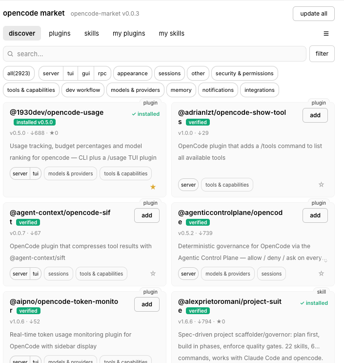

# OpenCode Market

English | [中文](README.zh.md)

[](https://www.npmjs.com/package/awesome-opencode-market)
[](https://github.com/awesome-market/awesome-opencode-market/blob/main/LICENSE)

Find plugins and skills for OpenCode, see what they do and whether they have
been tested, and install them without leaving the app.



## Why this exists

OpenCode has a large plugin ecosystem but no built-in marketplace. Community
lists help, but they are maintained by hand and mostly tell you a plugin exists
— not whether it installs or what it does to your setup.

Market's catalog is generated, not curated by hand: 5,000+ entries are
discovered, scanned, AI-reviewed and test-installed on an hourly pipeline, so a
listing carries actual check results instead of a copied description.

## Get started

```bash
opencode plugin add awesome-opencode-market
```

Then open the **Market** view in the TUI, or the **Market** panel in the GUI
(the GUI plugin is experimental).

Requires a recent OpenCode — the market builds on `@opencode/plugin` 2.x. If
the Market view never appears after installing, check your OpenCode version
first, then look at the plugin log in **Market → Advanced**.

## What you get

- **Browse and search** the catalog — filter by category and by which OpenCode
  features a plugin uses
- **Check labels** — `verified`, `failed`, `skipped`, `unverified`, each spelled
  out in plain words before you install. "Nothing found" is reported as
  "nothing found" — never as "safe"
- **One-click install and update** — including Update All for everything with
  a newer approved version; per-part status when a package ships both a
  plugin and a skill
- **Pinned installs** — the client installs exactly what review approved:
  `name@approved-version` for npm, `owner/repo#<commit-sha>` for GitHub —
  never a floating `latest` or `HEAD`
- **GitHub repos directly** — repo-only entries install from their reviewed
  commit snapshot, no npm package required
- **Skills** — discover and install skills alongside plugins, with per-skill
  permission prompts (allow / ask / deny)
- **Favorites** — bookmark what you want to come back to; export and restore
  them as JSON from settings
- **Your own catalog** — point the client at a mirror or a private index via
  the `indexUrl` option or `OPENCODE_MARKET_INDEX`
- **Bilingual** — English and 中文, remembered between sessions

## What stands behind a listing

Every entry goes through the same pipeline before you can install it:

1. **Discovery** — npm keywords, GitHub topics, submissions
2. **Static scan** — the package tarball (or the repo's commit snapshot) is
   checked against a published ruleset: credential access, network exfil,
   lifecycle scripts, obfuscation, prompt-injection markers
3. **AI review** — the scanned content plus package metadata goes to a review
   model; red-flagged entries get a draft for a human, not a verdict
4. **Test install** — entries with an installable part are actually installed
   and loaded in a sandbox (`verified` means it installed and loaded)
5. **Digest window** — a `pass` verdict does not release immediately: it is
   announced in the daily digest first, so objections can land before it ships
6. **Release** — only after the announcement window closes does the entry
   become installable through the catalog

The client re-checks the catalog right before spawning `plugin add`, so a
version concerned inside your cache window still cannot install. A check is
useful information, not a guarantee that software is safe — install sources
you trust.

## The catalog is also data

The same catalog feeds the Market panel, the TUI, and the website — one source
behind every surface:

- Machine-readable index:
  `https://awesome-market.github.io/awesome-opencode-market/index.json`
- Skill file catalog:
  `https://awesome-market.github.io/awesome-opencode-market/skills/`
- [Browse the catalog on the web](https://awesome-market.github.io/awesome-opencode-market/)
- [Trend boards](https://opencode-plugins.zhuikan.com) — star-growth and
  download rankings built on this catalog (new arrivals, daily/weekly/monthly
  movers, history)
- [Daily digest](https://github.com/awesome-market/awesome-opencode-market/tree/catalog/digest)
  — the announcement surface: every version about to be released is posted
  here first, so objections can land before it ships

The index URL is the only data-plane endpoint the client needs. Point it at a
mirror or a private catalog via the plugin's `indexUrl` option or the
`OPENCODE_MARKET_INDEX` env var; a "dev catalog source" toggle in settings
switches to the maintainer fork's catalog for development builds.

## Suggest a plugin or skill

[Send a suggestion](https://github.com/awesome-market/awesome-opencode-market/issues/new?template=submission.yml)
— submissions go through the same scan and test-install pipeline as everything
else before they appear in the catalog.

## Feedback

Bugs and feature requests go in
[issues](https://github.com/awesome-market/awesome-opencode-market/issues).
The review queue lives on the same tracker — `[review]` issues are the human
gate for entries the automated pipeline flagged.

[Source code and project details](https://github.com/awesome-market/awesome-opencode-market) ·
[MIT license](https://github.com/awesome-market/awesome-opencode-market/blob/main/LICENSE)
