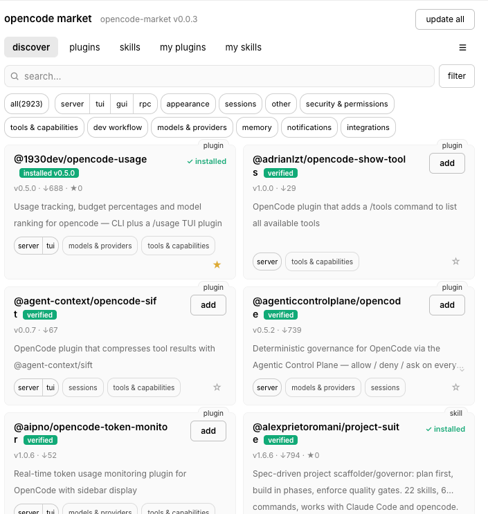

# OpenCode Market

[Read in English](https://github.com/awesome-market/awesome-opencode-market/blob/main/README.md)

在 OpenCode 里发现插件和技能，先了解它们的用途和测试情况，再直接安装。



## 开始使用

安装 Market 插件：

```bash
opencode plugin add awesome-opencode-market
```

随后打开 OpenCode 的 **Market** 面板，就可以浏览、搜索和筛选插件与技能，
查看介绍和已有的检查结果，并直接安装或更新。

## 安装前多了解一点

每个条目会展示用途、使用 OpenCode 的哪些功能，以及是否经过测试。尚未测试的
条目会明确标注。测试结果可以帮助了解情况，但不代表软件一定安全。

目录会定期更新，方便发现新扩展和已有扩展的更新。

## 浏览目录

也可以[在网页上浏览目录](https://awesome-market.github.io/awesome-opencode-market/)。

想推荐插件或技能？[提交推荐](https://github.com/awesome-market/awesome-opencode-market/issues/new?template=submission.yml)。

[项目源码与详情](https://github.com/awesome-market/awesome-opencode-market) ·
[MIT 许可证](https://github.com/awesome-market/awesome-opencode-market/blob/main/LICENSE)
