# 数据流全景（Data Flows）

> 本体 = `catalog` 分支上的数据文件；其它一切（站点、客户端、issue、workflow）都是它的投影或写入端。
> 核心不变量：**hold 是默认态**——任何版本必须先过机械红线、云验证、AI/人工裁决、日报公示，才会变成用户可见可装的版本。

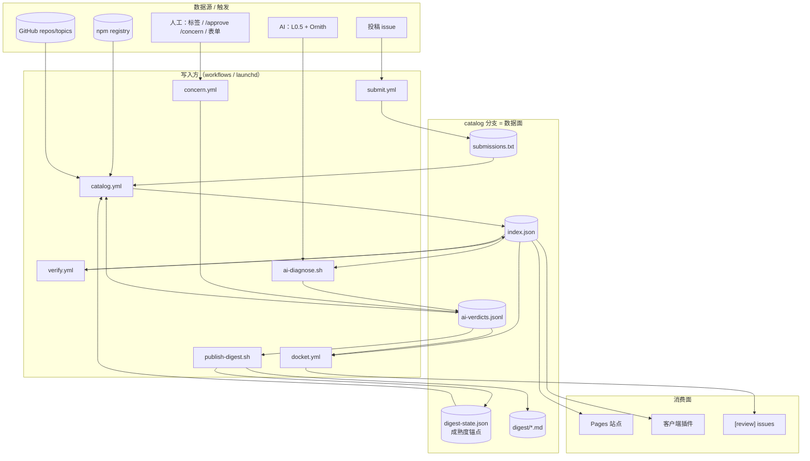

> 读法：`catalog.yml` 是心脏——每班先把 verdicts+digest-state 吃进旧 index（`applyMatureVerdicts` 放行），再发现/扫描/合并写回；`verify.yml` 只写 verification 槽；裁决全部 append-only 进 jsonl；站点和客户端只是 index 的投影。

---

## 0. 数据面：catalog 分支文件清单

`catalog` 是**纯数据分支**（无 pipeline 源码），所有 writer 通过 `git worktree` + fetch/reset/merge/commit/push 重试循环写入。

| 文件 | 写入方 | 消费方 | 语义 |
|---|---|---|---|
| `index.json` | catalog.yml publish / verify.yml merge | 站点构建、客户端、diagnose、docket、verify plan、applyMatureVerdicts | 完整目录（含 pending——数据面全量，展示面各自过滤） |
| `ai-verdicts.jsonl` | diagnose、submit.yml verdict、concern.yml | run.ts、diagnose（判重）、docket、digest | **append-only** 裁决流水；同 name@version 最新 `at` 胜出 |
| `submissions.txt` | submit.yml ingest、catalog.yml publish（notified 回写） | run.ts `--seed`、notify-published | JSONL：一行一个 `{name,repo,type,category,desc:{en,...},issue,notified}`；兼容旧格式：纯包名行、`github:owner/repo` 行 |
| `digest-state.json` | publish-digest.sh | run.ts | `{lastDigestAt}` — pass 成熟度锚点；缺失/损坏=-∞=全冻结 |
| `digest/YYYY-MM-DD.md` | publish-digest.sh | 人（手机/网页） | 日报：新放行表 + held 积压 + concerns + 审核单链接 |
| `blocklist.json` | 手工 | run.ts | `{names[],slugs[]}` 硬封禁 |
| `removed`（index 内字段） | run.ts tombstone / remerge 保留 | 站点/客户端（不渲染） | 消失条目墓碑，reason ∈ `npm-404|filtered|capped|manual|unknown`，180 天保留期 |

### AiVerdict 记录（每行一个）

```json
{"name":"pkg","version":"1.2.3"|null,"verdict":"pass"|"concern",
 "reason":"中文理由","reasonEn":"english reason","at":"ISO",
 "source":"ai"|"human","sha":"sha512-…（可选）"}
```

- `version: null` = github-kind 条目（无版本概念）。
- `source` 由写入方盖章，模型永远写不出 `human`。
- `sha` = npm `dist.integrity`——**只有人工通道（concern.yml/submit.yml）会带**，AI 诊断不写。同 hash 重打 tag 时可凭 sha 复用裁决。
- 键：`vkey(name,version)` = `name\0version`（NUL 分隔——`@` 会和 scoped 包名撞车）。
- `latestVerdicts` 逐行容错解析（坏行跳过）——diagnose/digest/docket 都走它。

### index.json 全字段（`src/schema.ts` PluginEntry）

```
CatalogIndex { version:'1', generatedAt, categories:{id→{en,zh?}}, plugins: PluginEntry[], removed: RemovedEntry[] }
```

| 字段 | 类型 | 语义 |
|---|---|---|
| `name` | string | npm 包名或 `owner/repo` |
| `slug` | string | 详情页 URL 键；repo 优先于包名（`slugOf`） |
| `aliases[]` | string[] | 同名不同源去重时挂的别名 |
| `type` | enum | `plugin|skill|agent|command|mcp|theme|bundle|rule`——分类器产出，默认 plugin |
| `contains[]` | enum? | `plugin|skill|mcp|command|agent|hook`——repo 内容探测（SKILL.md→'skill'） |
| `features[]` | enum? | `server|tui|gui|rpc`——镜像官方 Host.resolve：`./server`或根入口(`./`.`main`/`index.*`)→server；`./tui`→tui；`./rpc`+有 server→rpc；`./gui-experimental`（无 exports 时根下 `gui-experimental.cjs/.js`）且目标 `.cjs/.js`→gui。**无保底 server**——GUI/TUI-only 包合法为空 |
| `discoveredVia[]` | enum[] | `npm-keyword|github-topic|code-search|topic-list|submission` |
| `source` | obj | `{kind:npm|github, id, repo?, repoId?, version?}`；repoId=GitHub 数字 id，repojacking 检测 |
| `description` | obj | `{en, zh?}`——优先级：`.opencode-market.json` > 投稿声明 > 自动 |
| `category[]` | string[] | 分类 id 列表 |
| `license` / `deprecated` / `deprecatedMessage` / `replacement` | — | npm 元数据；replacement 从 deprecated 文案解析 |
| `createdAt` / `modifiedAt` | string? | packument `time.created/modified`——`createdAt > firstSeenAt` ⇒ 名字被重新注册（`sec:name-reused`） |
| `maintainers[]` | string[] | npm 维护者账号——变化 → `sec:maintainer-changed` |
| `distTags` | obj | npm dist-tag 表——回滚检测（`sec:version-rollback`） |
| `firstSeenAt` | string | 首次收录时间（merge 跨版本保留） |
| `latestVersion` | string? | **展示版**——held 语义下钉在批准版；null=github-kind |
| `publishedAt` | string? | 展示版的发布时间 |
| `metrics` | obj | `{stars, npmDownloads30d, checkedAt}` |
| `capabilities` | obj | `{scannedAt, rulesetVersion?, findings[], redFlags[]}`；`scannedAt:null`=没扫过（≠扫过没发现） |
| `verification` | obj | `{status, level?, opencodeVersion?, verifiedAt?, runUrl?, logExcerpt≤2048}`；status ∈ `verified|failed|unverified|skipped`，level ∈ `install|load|interactive|render|structure` |
| `compat` | obj | `{engines?, peer?}` |
| `approval` | enum | `pending`=hold 默认 / `approved`=放行 / `legacy`=门禁前老条目（schema 默认 legacy 兼容旧 index） |
| `approvalReason` | string? | pending 的理由；放行时清空 |
| `pendingUpdate` | obj? | **被扣住的新版** `{version, capabilities, verification, features?, publishedAt?, reason?, heldAt}` |

`RemovedEntry`（墓碑）：`{slug, name, lastSource?, disappearedAt, reason∈npm-404|filtered|capped|manual|unknown}`——180 天保留，URL 不 404 + 名字复用检测。

**判定语义速记**：
- `scannedAt:null` ≠ `findings:[]`——前者"没扫过"渲染 not scanned，后者"扫过无发现"渲染 scanned,no findings（都必须带"不等于安全"）
- `latestVersion:null`（github-kind）→ 不扫(scannedAt:null)、不验(skipped)、AI 不审（verdict 键都建不出来）
- `pendingUpdate` 存在 ⇒ `latestVersion` 是**旧版**，`plugin add` 拿到的永远是它

---

## 1. 收录发现流 — `catalog.yml`（每天 2 班 UTC 03:17/11:00 + 手动）

**实现**：`pipeline/run.ts::run`（主流程）· `discover/{npm,github,filter}.ts`（候选+入场过滤）· `fetch/{npm,github}.ts`（packument/tarball/repo 元数据）· `scan/{scan,rules}.ts`（tarball 静态扫描，`RULESET_VERSION='r2'`）· `publish/{merge,slug}.ts`（合并/去重/腐化门）· `remerge.ts`（重试合并）· `verdicts.ts::applyMatureVerdicts`（前置放行）· `notify-published.ts`（投稿通知）

`generate`（permissions:{} 零权限，跑不可信元数据；可选 `MARKET_PAT` 提额）→ `publish`（唯一 index writer：contents+issues 写权限）→ `site`（pages+id-token）→ `alert`（失败开 `pipeline-alert` issue）。整流 `concurrency: catalog-branch`——与 verify.yml、submit ingest 共享同一把分支写锁，写者串行。

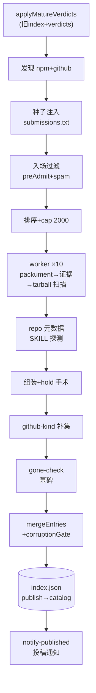

逐步细节：

```
discoverNpm + discoverGithub（并行）
  → + submissions.txt 种子注入（JSONL 声明式种子；纯名字；github:owner/repo）
      npm 种子注入 npmCands（discoveredVia=submission）
      repo-only 种子 → ghCands → 走 github-kind 路径
      seed 绕过 --max 字母序截断（排序在 cap 后回补）
  → 入场过滤：preAdmit(archived)——只作用 GitHub 侧（npm 候选无 archived/fork 信号）
      + looksLikeTemplateSpam（owner 级 ≥6 近同名）
  → 确定性排序 name-asc → cap（--max，默认 500；workflow 传 2000）
  → 逐候选 worker（10 并发）：
      更新检测三条路（本轮 vs 旧 index）：
        ① 版本变了（pk.version ≠ latestVersion）→ 走全流程，hold 进 pendingUpdate
        ② 版本同 + ruleset 同 → 增量短路整体复用（metrics.checkedAt >7d
           才 refreshMeta 重拉 packument/stars/downloads；否则零请求）
        ③ 旧有条目候选里没有 → gone-check 探活（见下）
      fetchPackument → hasPluginEvidence（via ≥2 或含 'entry'——仅 keyword 不算数）
      → fetchTarball+scanTarball → capabilities{findings,redFlags,rulesetVersion}
        redFlags>0 → verification={status:'skipped'}（高危信号没跑）
      fetchRepoMeta(repoId/stars) + fetchRepoTree(SKILL.md/.opencode/skills 探测→contains)
      + fetchMarketMeta（repo 根 .opencode-market.json 作者声明）
      repo package.json ≠ 包名 → finding 'sec:repo-mismatch:<actual>'
      字段优先级：marketMeta > 投稿声明 > 自动派生（description/category）
      detectFeatures({exports, main, files:tarball 路径})——镜像官方 Host.resolve
      （server=./server|根入口；gui=./gui-experimental 仅 .cjs/.js；rpc 需 server 同在）
      组装 entry：approval='pending', approvalReason='awaiting-review'
      hold 手术（见 §7）
  → github-kind 补集（无 npm 对应物的 repo 候选）：
      latestVersion:null、capabilities{scannedAt:null,空表}、
      verification:{status:'skipped'}——"无可装对象没跑"，不是"高危没跑"
      approval 继承 ghPrev（人工裁决过的状态跨轮保留）
  → gone-check：旧条目消失 → 探活：
      fetch 错误(429/5xx/网络) → 保留旧条目不打墓碑（瞬时失败≠消失）
      not-found → npm-404；cappedOut → capped；blocklist → manual；
      github-kind 或证据消失 → filtered；其它 → unknown
  → buildIndex = mergeEntries（双层缓存+trustFlags+skipped 不变量）
                + dedupeSlugs + corruptionGate（空/掉幅>20% 拒发）
  → index.json → publish job 写 catalog
     （worktree 上 fetch→reset→remerge(ours vs remote)→commit→push，4 次重试；
       remerge 保护 remote 侧 verify-merge 已写入的 verification/removed/identity）
  → notify-published：approval!=='pending' 的投稿 issue 评论+关闭，
     submissions.txt 回写 notified:true（二次提交）
```

**前置步骤（顺序负载）**：`generate` 开头先把 catalog 分支取下来，跑 `applyMatureVerdicts(old, verdicts, lastDigestAt)`——成熟裁决先作用于旧 index，再做发现比对（否则高频包的 pendingUpdate 会被下一班 npm bump 覆盖，永远饥饿）。旧 index 缺失/损坏 → 直接拒跑（WF-1，不盲跑）。

**mergeEntries 双层语义**：
- 身份层（name 匹配）：firstSeenAt/slug/aliases/discoveredVia 跨版本保留
- 版本层（name@version+host 匹配）：capabilities/verification 按版本槽恢复
- approval 层：`e.approval ?? prev?.approval ?? 'pending'`（worker 手术优先；github-kind/复用条目靠 prev）
- pendingUpdate 层：同版本→保留 remote 侧 verification 槽（verify-merge 可能刚写过）；remote 持有的我们没见过的版本→保留 hold（除非我们刚放行同版）
- trustFlags（sec:name-reused/repo-recreated/version-rollback/maintainer-changed/sec-delta:*）：身份级 flag→展示槽；`sec-delta:*`→候选槽（pendingUpdate.capabilities 或自身）。强规则（lifecycle-script/prepare-script）→redFlags，其余新规则→findings
- 不变量：`redFlags>0 且 verified|unverified → 'skipped'`；`failed` 保留真结果不被改写

---

## 2. 投稿流 — `submit.yml`

**实现**：`pipeline/submission.ts::parseSubmission/seedLine`（issue 解析+种子行）· `pipeline/review.ts::reviewPackage/verdict/renderReview`（机械审+报告）· workflow 内嵌 node 脚本（ingest 去重/verdict 写回/sweep）

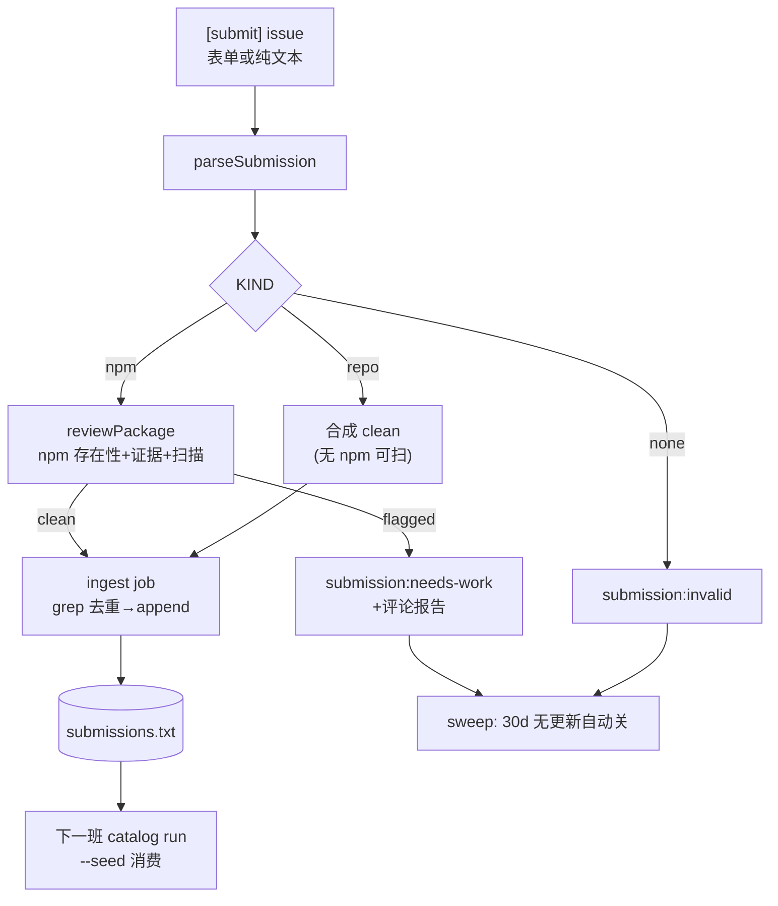

逐步细节：

```
issue(opened/edited/labeled) 且 (有 submission 标签 或 [submit] 标题)
  或 issue_comment(created) 且 issue 有 submission:{needs-work,invalid} 标签
  → review job（concurrency: sub-review-N，cancel-in-progress——重审幂等可丢弃）
      parseSubmission（issue-form ### 段 + freeform 兜底；repo 可无 name）
      KIND: npm→机械审 review.ts；repo→合成 clean（无 npm 可扫）；none→invalid
      机械审查：npm 存在性/插件证据/静态扫描 → verdict: clean|flagged|invalid
      守卫：非作者触发重审 → flagged；issue>24h 且包注册晚于 issue → flagged（防蹲名）
      verdict 取报告中 LAST 'verdict:' 注释标记（防包内文本注入伪造）
      评论报告 + 打 submission:{approved|needs-work|invalid} 标签
      ⚠️ 机械通过只是"入场"，不是上架
  → ingest job（clean 时，concurrency: catalog-branch）：
      "name":"KEY",/"repo":"KEY", grep 去重 → append submissions.txt（含 issue#,notified:false）
      → catalog run --seed 消费
  → verdict job（人工通道，见 §5）
  → sweep job（每日 UTC 05:23）：invalid/needs-work 30 天无更新自动关
```

---

## 3. 验证流 — `verify.yml`（每天 2 班 UTC 04:47/16:47 + `targets` 手动指定）

**实现**：`verify/plan.ts::verifyTargetOf/planTargets/shard`（目标+分片）· `verify/verify.ts::verifyPackage/xdgEnv/writeDummyProvider/loadedSignal`（L1/L1.5 沙箱验证）· `verify/tui.ts::checkTui/judgeTuiPane`（L2 tmux）· `verify/gui.ts::findGuiBundle/checkGuiBundle`（L3a jsdom 渲染）· `verify/merge.ts::mergeResults`（版本路由写槽）

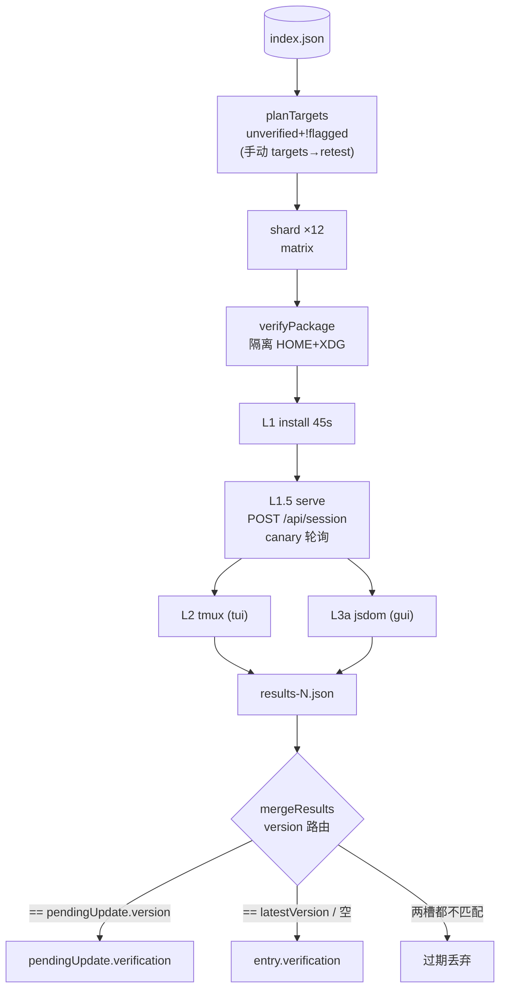

逐步细节：

```
plan job（contents:read）：
      catalog 分支取 index → targets 输入非空则按包名收窄 index
      → planTargets（retest 开关见下；cap=48/班）
        选序 = 两级：discoveredVia 含 'submission' 的先取（投稿优先），
        其余按 index.plugins 的 name-asc 顺取；cap 不变，积压跨班排空——
        一天取不完就取两三天；手动 targets= 仍可插队
        每个目标只消费一次：verified/failed 均永久离开 unverified 队列
        排队期间 npm 发新版 → pendingUpdate 换版，轮到验当前版；
        版本错配的结果 merge 时过期丢弃，不写错槽
        → shard 顺序切片 12/组（items.slice，非 hash）→ matrix 输出片索引
      手动 targets= 逗号包名 → 定向验证 + --retest（failed/verified 可重验；
        否则 failed 槽是终态，永远没机会重跑——修补前的死穴）
verify job（permissions:{} 零权限 + harden-runner egress 白名单
      registry/api.npmjs.org, api.github.com, github.com, *.githubusercontent.com；
      整 job if: shards != '[]'——空计划全跳）：
      npm i -g @opencode/cli@2.2.5（与 OPENCODE_VERSION 常量钉齐——缓存键含宿主版本）
      verifyPackage(name@version)：
        L1 install: 隔离 HOME+XDG_CONFIG/DATA/CACHE → `opencode plugin add name@ver`（45s）
        L1.5 load: writeDummyProvider（合并写！不抹 plugin add 的 plugins[]）
                   → `opencode serve` 后台 → 等 "server listening"+密码行
                   → GET /api/plugin + GET+POST /api/session
                     （2.2.5 懒加载：GET 不触发，POST session 才 load）
                   → 轮询日志 ≤12s 等 canary `loading plugin"?\s+id=<name>` → kill
        L2 interactive: features 含 tui → tmux 冒烟（checkTui）
        L3a render: features 含 gui → findGuiBundle + checkGuiBundle（jsdom+vm 真渲染）
        → VerifyResult{name,version,status,level,opencodeVersion,verifiedAt,logExcerpt≤2048}
        → results-<shard>.json artifact（7 天）
merge job（contents+pages+id-token 写）：
      mergeResults 按 version 路由写槽
      r.version == pendingUpdate.version → 写 pendingUpdate.verification
      r.version == latestVersion 或空 → 写 entry.verification
      两槽都不匹配 → 过期结果丢弃（npm 中途又发新版）
      RUN_URL env → verification.runUrl（失败详情页回链）
      写回 catalog（fetch→reset→merge→commit→push，4 次重试）
      重建站点 + deploy-pages（continue-on-error——部署失败不挡数据落盘）
alert job（failure()）：开 pipeline-alert issue
```

结果 → `verification.status ∈ {verified, failed, skipped, unverified}` + `level ∈ {install, load, interactive, render}`。

**verifyTargetOf**：`version = pendingUpdate?.version ?? latestVersion`；`unverified` 取**候选槽**自己的 verification；`flagged` 取候选槽 redFlags；features 同样候选槽优先。计划条件：`有版本 && unverified && !flagged`；retest 模式放宽到 failed/verified（flagged 永不执行——红旗代码不上 runner）。

---

## 4. AI 诊断流 — `bin/ai-diagnose.sh`（launchd 每小时；手动同命令）

**实现**：`pipeline/ai/diagnose.ts::unreviewedTargets/reviewMaterial/l05Score/ornithReview/verdictRecord` · `ai/l05_score.py`（L0.5 打分器，独立进程）· `verdicts.ts::loadVerdicts/latestVerdicts/vkey`

双通道合成——L0.5 机械打分压过 LLM 自判，任一通道挂都 fail-closed：

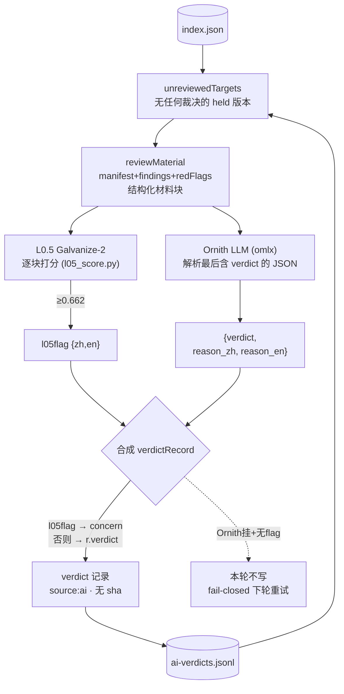

逐步细节：

```
catalog clone（~/.local/share/opencode-market-catalog）→ reset --hard
→ diagnose.ts（--limit DIAGNOSE_LIMIT=50；--name/DIAGNOSE_NAME 定向；--dry）
  候选 = unreviewedTargets：
      ver = pendingUpdate?.version ?? (approval==='pending' ? latestVersion : null)
      且 vkey(name,ver) 在 seen(latestVerdicts) 中**完全没有记录**
      ——任何 source 的 verdict 都排除：人工裁决就是终局，
        AI 复审会写一条 at 更新的记录静默翻盘（latest wins）
      ——AI 也绝不复审自己审过的（无 churn）
  每候选：
    reviewMaterial = manifest + findings + redFlags + pending 行
      （结构化材料块，不是整包源码——降 off-distribution 误报和注入面）
    L0.5（Galvanize-2, l05_score.py）逐块打分
      ≥0.662 → l05flag{zh,en}（红旗，压过 LLM 自判）
    Ornith（omlx, OpenAI 兼容）→ 解析最后一个含 "verdict" 的 JSON 块
      （reasoning 模型 think 文本里可能有花括号）
      {verdict, reason_zh, reason_en}（老单 reason 响应→双语复制；各截 500）
    合成：
      l05flag → concern（reason 双语：红旗优先 + LLM 上下文）
      否则    → r.verdict（reason=reason_zh, reasonEn=reason_en）
    fail-closed：Ornith 挂 + 无 flag → 该候选本次无 verdict（下轮重试，保持 held）
                Ornith 挂 + l05flag → 仍写 concern（L0.5 单独也能拦）
                L0.5 挂 → 仅记日志，LLM 照常
  verdict 记录：source:'ai'、version=候选版本、不带 sha（sha 只人工通道写）
  append ai-verdicts.jsonl → commit → pull --rebase → push（3 次重试）
```

Env：`AI_BASE_URL`（默认 `http://localhost:8001/v1`）、`AI_MODEL`、`AI_API_KEY`（`~/.config/opencode-market/ai.env`）、`HF_HOME`/`GALVANIZE_DIR`（L0.5）。

---

## 5. 人工裁决流 — `concern.yml`（maintainer 专属，手机可用）

**实现**：`.github/workflows/concern.yml`（事件解析+守卫+写盘全在 workflow node 脚本里）· `submit.yml` verdict job 同理 · 目标键 `verdicts.ts::vkey`

四条通道，全部写 `source:human` verdict：

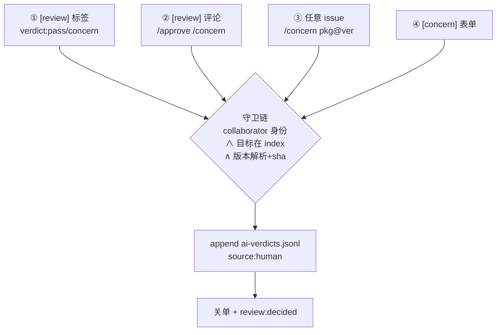

| 通道 | 触发 | 目标解析 |
|---|---|---|
| ① 标签点选 | `[review]` issue 打 `verdict:pass`/`verdict:concern` | 标题 `[review] name[@ver]` |
| ② 裸命令 | `[review]` issue 评论 `/approve`、`/concern [理由]` | 同上 |
| ③ 带参命令 | **任意** issue 评论 `/concern pkg[@ver] [理由]` | 参数（ver 空→npm 最新） |
| ④ 表单 | `[concern]` issue（模板，下拉选 pass/concern + 包名/版本/理由） | 表单字段 |

**守卫链**：
- `[concern]` 表单/评论命令：`author_association ∈ OWNER|MEMBER|COLLABORATOR`（job if 直接卡死）
- labeled 事件没有 labeler 身份 → `gh api collaborators/{actor}/permission` 要求 admin|maintain|write；不足→撤标签+评论
- `[submit]` issue 跳过（submit.yml 的地盘——裸 `/concern 中文理由` 不会被误当包名）
- 目标必须在 index 里（`p.name === NAME`；不在→评论提示不写盘）
- 版本解析：`owner/repo`（含 `/` 非 scoped）→ version:null；ver 空 → `npm view name version`（写回时刻的最新版+`dist.integrity` sha）
- 标签路径理由自动生成 `via label X by actor (issue #N)`；写盘后评论确认 + `review:pending`→`review:decided`
- **关单规则**：`[review]` issue（标签/评论都会关）+ `[concern]` 表单 issue（写完即关）；任意 issue 带参命令只写盘不关单

**并发模型**：`concurrency: verdict-${{issue.number}}`——每条裁决事件必须落盘，**不能共享 catalog-branch 锁**（GitHub 并发组只留 1 个 pending，burst 会静默丢裁决——实锤过）。跨 issue 写竞争由 append 步的 fetch→append→commit→push 3 次 rebase 重试吸收。

**submit.yml verdict job**（投稿通道，同语义，`concurrency: verdict-N`）：
- 非 bot 打 `submission:approved` 标签 或 collaborator 评论 `/approve`/`/concern [理由]`
- 目标=投稿包名（issue body 解析，不是评论参数），版本=npm 最新+`dist.integrity` sha
- bot 打的标签不算（机械审永不自行发布）

---

## 6. 日报流 — `bin/publish-digest.sh`（launchd 每日 21:00 本地）

**实现**：`pipeline/ai/digest.ts::renderDigest`（三板块渲染）· `verdicts.ts::loadVerdicts`（容错加载）· `bin/publish-digest.sh`（clone/commit/push 重试壳）

pass 从写入到放行的时序——digest 是公示环节，锚点推进才解锁成熟：

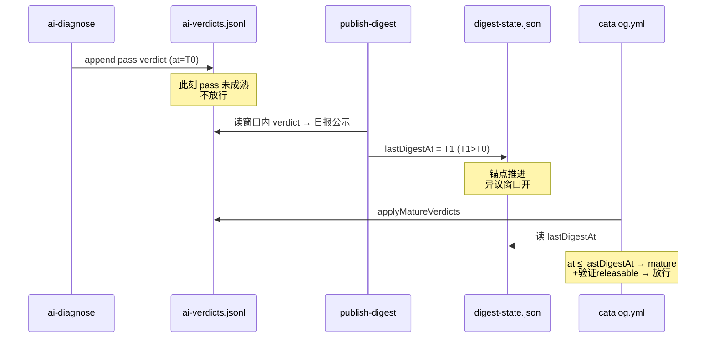

```
catalog clone → digest.ts --index --verdicts --state --out-dir [--date YYYY-MM-DD 回填]
  verdicts 走 loadVerdicts（坏行跳过——一行坏 JSON 不能崩掉整份日报：它是成熟度锚点）
  fresh = at ∈ (lastDigestAt, now] 的 verdict
  ① 新放行表：fresh pass（理由双语 reason/reasonEn + 审核单链接 MARKET_REPO_URL）
  ② held 积压清单（approval==='pending' || pendingUpdate——含"已上架但有滞留新版"）
  ③ concerns 表
  → digest/YYYY-MM-DD.md + digest-state.json {lastDigestAt: now}   ← 成熟度锚点推进
  → commit → pull --rebase → push（3 次重试）
```

**这是唯一完整的上架预告面**。没有它：pass 永不成熟（-∞ 冻结=总闸）。有了它：窗口内 pass 立刻成熟 → 下一班 catalog 放行。

---

## 7. 放行流 — catalog run 前置 `applyMatureVerdicts`

**实现**：`pipeline/verdicts.ts::applyMatureVerdicts`（放行判定+hold 手术在 `run.ts` worker 内联）

一个版本从出生到可装的完整旅程：

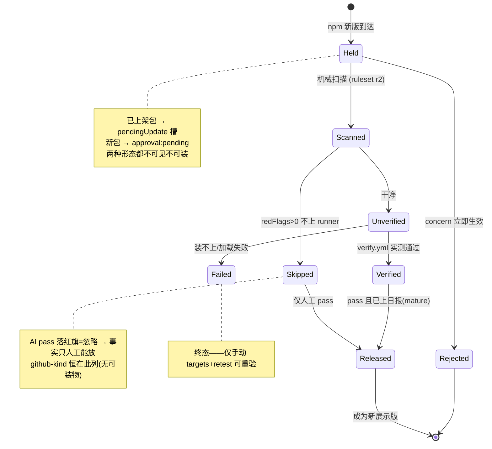

**hold 手术**（run.ts worker 内，新版本到达时）：
```
prev.approval≠pending 且 npm latest≠displayed
  → pendingUpdate={version,capabilities,verification,features,publishedAt,heldAt,reason:'awaiting-review'}
  → 展示字段钉在旧版（latestVersion/capabilities/verification/features/source.version 回写 prev）
pending 条目 bump → 就地换候选 + approvalReason 重置（旧理由说的是旧候选版）
已展示条目 npm latest 消失/回滚 → 携带全部展示态（pendingUpdate 也保留）
```

**放行判定**（两个版本槽各自查 `vkey(name, version)` 的最新 verdict）：

```
concern（任何 source）→ 立即生效不等成熟：
   pendingUpdate → pu.reason 标注（仍 held）
   展示槽 pending 条目 → approvalReason 标注（仍 pending）
   展示槽 approved/legacy → approval 拉回 pending + approvalReason（人工刹车）
pass → 需 mature（v.at ≤ lastDigestAt）
   && !(source=ai && 目标 capabilities.redFlags>0)   ← AI pass 落红旗条目=忽略（纵深防御）
   && verification.status ∈ {verified, skipped}      ← RELEASABLE
      verified=实测可装；skipped=没跑（高危信号 或 无可装对象）
      ——红旗 skipped 的 AI pass 已被上行忽略 → 事实只人工 pass 能放
      ——github-kind skipped 无版本无 AI 审 → 也只能人工 verdict(version:null) 放
      unverified/failed 永不放（fail-closed；verify 瘫痪=冻结发布而不是放行）
→ pendingUpdate 放行：latestVersion/publishedAt/capabilities/verification/features ← pu，
   source.version 同步，approvalReason 清空，pendingUpdate 删除
→ 展示槽 pending 放行：approval→approved，approvalReason 清空
标注幂等：reason 相同不重复写（held/releases 计数只记真变化）
```

**net 语义**：用户能装的版本 = 机械红线 + 验证 + 成熟 pass 全过的版本。concern 不需要公示期（保守方向），pass 必须过日报窗口（预告期）。

---

## 8. 审核单流 — `docket.yml`（hourly :40 + catalog/verify 成功完成后 + 手动）

**实现**：`pipeline/docket.ts::docketTargets/issueTitle`（目标+开单/关单，`gh` CLI 操作 issue）· `verdicts.ts::latestVerdicts`

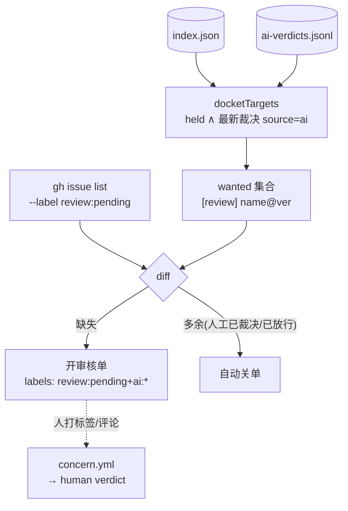

逐步细节：

```
docket.ts：index+verdicts → docketTargets
  = ver = pendingUpdate?.version ?? (approval==='pending' ? latestVersion : null)
    且 ver 非空（或条目本就无版本——github-kind 的 null 键查不到 AI 裁决，自然排除）
    且 最新 verdict.source='ai'
  （AI 已判、待人过目：pass 等放行窗口，concern 等人工翻案；
    人工裁决=终局 → 不进 wanted → 已开的单下轮自动关）
同步：
  缺失 → 开 [review] name@ver（labels: review:pending + ai:{verdict}，
        body：AI 判定+双语理由+验证状态+手机点选说明）
  多余 → 关单（已决议/已放行；gh issue list --label review:pending --limit 500）
  → bootstrap 标签（verdict:pass/concern, review:pending/decided, ai:pass/concern）
workflow_run 触发只认 conclusion==='success'；无并发组（操作 issue 不写数据分支，幂等）
```

人 → 标签 → concern.yml → verdict → 关单 → docket 下轮清理。闭环。

---

## 9. 站点发布流 — `pipeline/site/build.ts` → GitHub Pages

**实现**：`site/build.ts::isVisible/scanLabel/verifyLabel/approvalBadge/listPage/detailPage/buildSite/buildSkillCatalog`

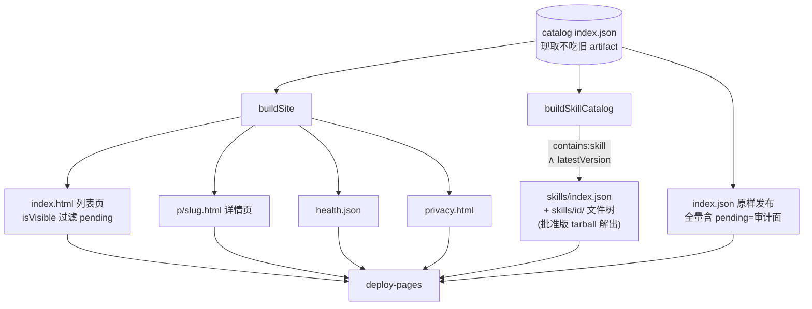

逐步细节：

```
index.json（catalog 分支现取，不吃旧 artifact——B-5）
  → /tmp/site:
      index.json      全量 catalog（含 pending——可审计数据面）
      index.html      列表页（filter isVisible：pending 不渲染；客户端搜索）
      p/<slug>.html   详情页（pendingUpdate 行"under review — not installable yet"；
                      findings 全列、logExcerpt、runUrl 回链、
                      install 行 opencode plugin add source.id@latestVersion）
      skills/index.json + skills/<id>/  HTTP skill catalog：
                      只处理 contains:['skill'] 且 latestVersion 非空的条目，
                      tarball = npm view "<name>@<latestVersion>" dist.tarball
                      ——钉到批准版；latestVersion:null → 跳过（绝不落 pendingUpdate 文件）
      health.json     {ok, entries(可见数), generatedAt}
      privacy.html
  → deploy-pages
```

诚实状态文案（AGENTS 规约）：verified=已实测可装可用 / failed=装不上或加载失败 / skipped=有高危信号没跑 / unverified=还没验。version-less（github-kind）条目渲染为 `nothing to install`（muted）——它的 skipped 是"没有可装的东西"不是"高危没跑"。legacy 徽标 = 门禁前老条目；"没扫到"必带"不等于安全"。

---

## 10. 客户端消费流 — `plugins/market`

**实现**：`src/catalog.ts`（fetch/sanitize/过滤/排序/搜索/pinSpec/approvedTarballUrl/i18n/localStorage 持久化）· `src/spec.ts`（cleanSpec/dedupeToSpec/removeSpec/buildExtras/featuresMap）· `src/skill-install.ts`（installSkillTar/uninstallSkillDir/globalSkillsRoot）· `src/gui.ts`（webview UI + host IPC api）· `src/tui.tsx`（终端 UI + 直接宿主调用）· `src/server.ts`（插件入口装配）

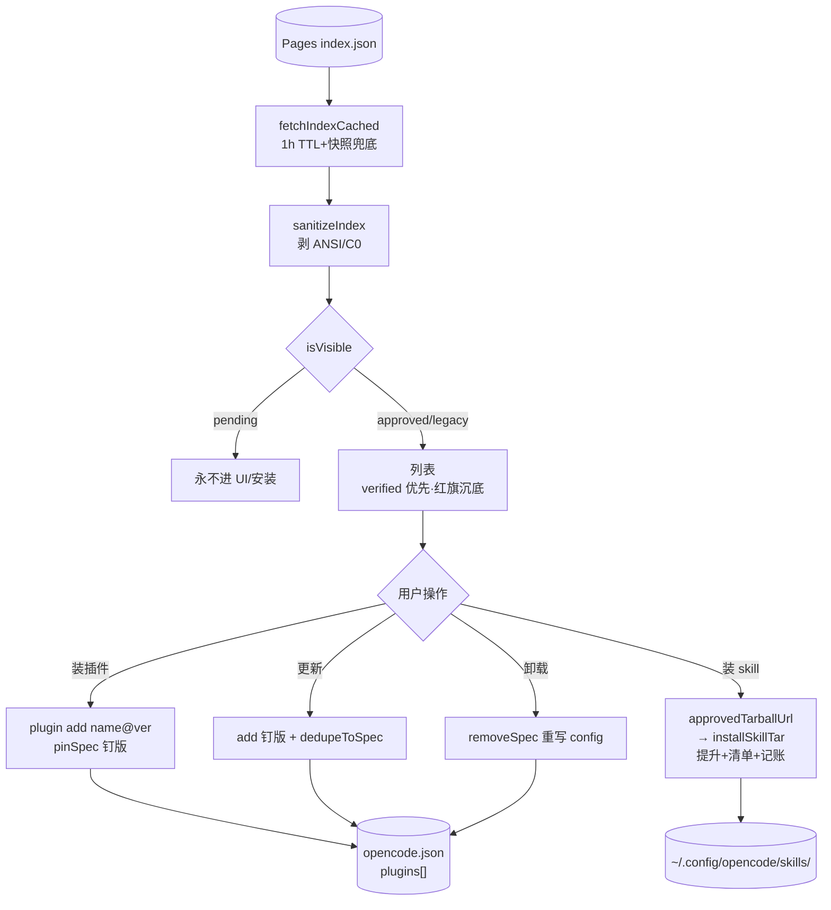

逐步细节：

```
fetchIndex(Pages index.json, 10s AbortController)
  → sanitizeIndex（剥 ANSI/C0 + name/slug/desc/category 逐字段——untrusted 输入）
  → filter isVisible（pending 永不进 UI/安装路径）
  → fetchIndexCached：localStorage 1h TTL + 失败快照兜底
UI（gui.ts webview / tui.tsx 终端）：
  列表 rows()（verified 优先，redFlag 沉底）/ search(name+description.en) / 分类
  状态标签：installed 优先；latestVersion==null → noInstallTarget
    （github-kind"无可安装对象"≠"有高危信号没跑"）；否则四态同站点
  安装：pinSpec(e) = name@latestVersion（钉到批准版，隐式 latest=绕过通道）
       gui: api.install({name,spec}) → host `plugin add <spec>`
       tui: 直接 spawn `plugin add <pin>`
  更新：add 钉版 spec → dedupeToSpec 重写 config plugins[]
       （plugin add 不去重会留双 spec——E2E 实锤；从不调 `plugin update`——它走 latest=旁路）
  卸载：removeSpec 重写 config plugins[]
       （CLI `plugin remove` 吃 spec 不吃目录名，钉版 spec 会静默 miss——gui/tui 都已改）
  skill 安装：approvedTarballUrl(pk,e) → 只取批准版 tarball
       （dist-tags.latest 就是 pendingUpdate——三处都钉：tui.installSkill、
        gui.installSkillNet、site buildSkillCatalog）
       → installSkillTar 解到 ~/.config/opencode/skills/<id>，
        提升 .opencode/skills|.claude/skills|.agents/skills 嵌套到根
        （包根有 SKILL.md 时连 `skills/` 目录一起提）、
        撞名加 <id>- 前缀、写 .market-skills.json 清单（供精确卸载）、
        skillVers 记账 + __skill_<base> 安装键 → 真 update 检测
  verifyActivation：隔离 HOME 起 serve → POST /api/session 触发懒加载
       → 轮询日志 canary → activated/not-loaded（GET-only 永远不触发——已修）
  skillSource：把 https://…/skills/ 加进 opencode.json skills[]（远程 catalog 源）
  skillPermission：写 permission 条目（action:skill, resource:id, effect:allow|deny|ask）
  extras：uncataloged 已装 spec → buildExtras 卡片（不在目录里的本机插件）
  devlog：宿主写 /tmp/opencode-market.log；渲染端 localStorage ring 300
```

---

## 11. 不变量与 fail-closed 速查

| 规则 | 机制 |
|---|---|
| 默认不可见 | `approval='pending'` 新生即持有；站点/客户端都过滤 |
| 机械审不发布 | submission:approved 只进 submissions.txt；bot 标签不写 verdict |
| AI 不越权 | `source` 由写入方盖章；AI pass 落 redFlags 条目被忽略 |
| AI 不复审 | unreviewedTargets 要求**无任何 verdict**——人工裁决是终局，AI 新 `at` 不能翻盘 |
| pass 要预告 | mature = at ≤ lastDigestAt；缺 digest-state = 全冻结 |
| concern 即时 | 不等窗口；打展示版本=撤回上架（人工刹车） |
| 验证是硬门 | unverified/failed 永不放；skipped 两类：红旗 skipped 事实只人工 pass 可放，github-kind skipped 只能人工 verdict(null) 放 |
| failed 终态可救 | 常规计划只跑 unverified；手动 `targets` 触发 --retest 可重验 failed/verified |
| 版本钉死 | 验证验候选版（pendingUpdate 优先）；客户端 pinSpec/approvedTarballUrl 钉批准版；`plugin add`/`npm view` 不隐式 latest |
| 审计可回放 | verdicts append-only，NUL 键最新 at 胜出，sha 溯源（人工通道） |
| 写冲突不丢数据 | 数据分支写入都走 fetch→改→commit→push 重试循环；并发组见 §12 |
| 裁决事件不丢 | verdict 类 job 用 per-issue 并发组（共享锁会丢 pending） |
| 发布不破目录 | corruptionGate：空 index/掉幅>20% 拒发 |
| 不可信代码零权限 | generate/verify jobs permissions:{} + egress 白名单 |
| github-kind 特殊 | 永不扫描(scannedAt:null)/永不验证(无版本)/永不 AI 审(无候选键)；只人工 verdict(version:null) 放行 |

---

## 12. 触发器与并发组总表

| 事件 | 工作流/脚本 | 并发组 | 写什么 |
|---|---|---|---|
| cron 03:17/11:00 UTC + dispatch | catalog.yml | catalog-branch（共享） | index.json、站点、tombstone、投稿通知 |
| cron 04:47/16:47 UTC + dispatch(targets) | verify.yml | catalog-branch（共享） | index.json（verification 槽）、站点 |
| issue [submit] opened/edited/labeled/comment | submit.yml review | sub-review-N（cancel 幂等） | 评论、submission 标签 |
| 同上 clean 后 | submit.yml ingest | catalog-branch（共享） | submissions.txt |
| submission:approved 标签 / 投稿 issue 命令 | submit.yml verdict | verdict-N（不 cancel） | ai-verdicts.jsonl |
| cron 05:23 UTC | submit.yml sweep | — | 关 30d 僵尸投稿 |
| issue [review]/[concern] opened/labeled + 评论 | concern.yml | verdict-N（不 cancel） | ai-verdicts.jsonl、review 标签、关单 |
| hourly :40 + catalog/verify success 完成 + dispatch | docket.yml | —（issue 操作幂等） | [review] issues、标签 |
| launchd 每小时 | bin/ai-diagnose.sh | — | ai-verdicts.jsonl |
| launchd 每日 21:00 本地 | bin/publish-digest.sh | — | digest/*.md、digest-state.json |
| push/PR | ci.yml | — | tsc + vitest ≥90%（合并门） |
| push | spike.yml | — | dev 演练（非数据面） |
| 用户 plugin add | 客户端 | — | 本机 opencode.json（不在本仓库数据面） |

**并发组语义**：`catalog-branch` 是分支写锁（catalog+verify+ingest 串行——数据完整性）；`verdict-N` 按 issue 分（事件必须全落盘）；`sub-review-N` cancel-in-progress（重审幂等，burst 只留最新合理）；`docket` 无锁（幂等 issue 同步）。

时序约定：digest(21:00 本地) → catalog(03:17/11:00 UTC) → verify(04:47/16:47 UTC) → docket(每小时 :40)。launchd 需系统盘路径或 TCC 授权（外置卷会 `Operation not permitted`）。

---

## 13. 实现地图（文件 → 导出 → 角色）

### pipeline/

| 文件 | 关键导出 | 角色 |
|---|---|---|
| `run.ts` | `run` `loadOldIndex` `replacementOf` | 收录主流水线：种子→过滤→cap→worker→merge→index（§1） |
| `discover/npm.ts` | `discoverNpm` `searchByKeyword` `KEYWORDS` | npm keyword 搜索候选 |
| `discover/github.ts` | `discoverGithub` `searchTopic` `normalizeRepoUrl` `TOPICS` | GitHub topic 搜索候选 |
| `discover/filter.ts` | `preAdmit` `looksLikeTemplateSpam` `hasPluginEvidence` | 入场过滤（archived/模板农场/插件证据） |
| `discover/seed.ts` | `buildSeedList` `extractRepos` `filterByStars` `repoToNpm` | awesome-list 冷启动种子（一次性工具） |
| `fetch/npm.ts` | `fetchPackument` `fetchTarball` `fetchDownloads30d` | npm 拉取（status: ok/not-found/error） |
| `fetch/github.ts` | `fetchRepoMeta` `fetchRepoTree` `fetchRepoPackageName` `repoFileExists` | repo 元数据/文件树探测（rate-limited 状态透传） |
| `scan/scan.ts` | `scanTarball` | tarball 解包+逐文件规则匹配 → findings/redFlags |
| `scan/rules.ts` | `RULES` `RULESET_VERSION='r2'` `isBinary` | 扫描规则表（high→redFlag，medium/low→finding） |
| `publish/merge.ts` | `mergeEntries` `buildIndex` `corruptionGate` `trustFlags` `dedupeSlugs` `cacheKey` `OPENCODE_VERSION='2.2.5'` | 双层合并+信任 flag+腐化门 |
| `publish/slug.ts` | `slugOf` | URL slug（repo 优先） |
| `remerge.ts` | `remerge` | publish 重试时 ours-vs-remote 再合并 |
| `verdicts.ts` | `loadVerdicts` `latestVerdicts` `vkey` `loadLastDigestAt` `applyMatureVerdicts` | 裁决读盘+NUL 键+放行判定 |
| `submission.ts` | `parseSubmission` `seedLine` | issue-form/freeform 解析+种子行 |
| `review.ts` | `reviewPackage` `verdict` `renderReview` | 投稿机械审（报告含 LAST verdict 标记） |
| `notify-published.ts` | `markNotified` | 投稿落地通知标记（approval≠pending 才算） |
| `docket.ts` | `docketTargets` `issueTitle` | [review] 审核单同步（gh CLI） |
| `backfill.ts` | `backfill` | 老条目身份字段一次性修补（createdAt/maintainers/repoId） |
| `verify/plan.ts` | `verifyTargetOf` `planTargets` `shard` | 验证目标（候选槽语义+retest）+12 片分片 |
| `verify/verify.ts` | `verifyPackage` `xdgEnv` `writeDummyProvider` `loadedSignal` `coerceTarget` | L1 install + L1.5 lazy-load canary 验证 |
| `verify/tui.ts` | `checkTui` `judgeTuiPane` | L2 tmux 冒烟 |
| `verify/gui.ts` | `checkGuiBundle` `findGuiBundle` | L3a jsdom+vm 真渲染 |
| `verify/merge.ts` | `mergeResults` | 结果按 version 路由写槽 |
| `site/build.ts` | `buildSite` `buildSkillCatalog` `listPage` `detailPage` `isVisible` `scanLabel` `verifyLabel` `approvalBadge` | Pages 站点+HTTP skill catalog |
| `ai/diagnose.ts` | `unreviewedTargets` `reviewMaterial` `l05Score` `ornithReview` `verdictRecord` | L0.5+Ornith 双通道 AI 审 |
| `ai/digest.ts` | `renderDigest` | 日报三板块渲染 |
| `ai/l05_score.py` | — | Galvanize-2 打分器（独立 python 进程） |

### plugins/market/src/

| 文件 | 关键导出 | 角色 |
|---|---|---|
| `catalog.ts` | `fetchIndex` `fetchIndexCached` `sanitizeIndex` `isVisible` `rows` `search` `pinSpec` `approvedTarballUrl` `hasUpdate` `scanSkillKeys` `skillInstalledVer` `t`/i18n `loadState`/`saveState` `appendLog`/`readLog`/`redactLog`/`keyLines` `EMPTY_STATE` | 数据面+纯函数层（webview/tui 共用） |
| `spec.ts` | `cleanSpec` `dedupeToSpec` `removeSpec` `featuresMap` `buildExtras` | opencode.json plugins[] spec 代数 |
| `skill-install.ts` | `installSkillTar` `uninstallSkillDir` `globalSkillsRoot` | tarball→skills 目录（提升/清单/撞名） |
| `gui.ts` | default `Plugin.define` | webview UI + 全部 host IPC api |
| `tui.tsx` | default `Plugin.define` | 终端 UI + 进程内宿主调用 |
| `server.ts` | — | 插件入口装配 |

### 辅助工具（不在主数据流周期里）

| 工具 | 用途 |
|---|---|
| `pipeline/discover/seed.ts` | awesome-list README → 高星 repo → npm 候选——一次性冷启动种子生成 |
| `pipeline/backfill.ts` | 给老条目补身份字段——一次性修补 |
| `pipeline/remerge.ts` | publish 重试时 ours vs remote 再合并——保护 remote 已写状态 |
| `pipeline/notify-published.ts` | 投稿落地标记 notified:true 并输出待通知 issue 号 |
| `pipeline/verify/{tui,gui}.ts` | L2 tmux / L3a jsdom 检查器（verifyPackage 按 features 调用） |

---

## 14. 交接物样例（真实形状）

### index.json 一条 entry（held 语义完整形态）

```json
{
 "name": "opencode-hush",
 "slug": "federicobordon09-dev/opencode-hush",
 "type": "plugin", "features": ["tui","server"],
 "discoveredVia": ["npm-keyword"],
 "source": {"kind":"npm","id":"opencode-hush","repo":"federicobordon09-dev/opencode-Hush","repoId":1426242744,"version":"0.3.0"},
 "latestVersion": "0.3.0",          ← 展示版：钉在批准版
 "distTags": {"latest":"0.4.1"},    ← npm 已到 0.4.1
 "capabilities": {"scannedAt":"2026-11-03T14:29:15Z","rulesetVersion":"r2","findings":[],"redFlags":[]},
 "verification": {"status":"verified","level":"load","opencodeVersion":"2.2.5","verifiedAt":"2026-11-02T00:02:51Z"},
 "approval": "legacy",
 "pendingUpdate": {                  ← 0.4.1 被 hold：已扫描未验证未裁决
   "version": "0.4.1",
   "capabilities": {"scannedAt":"2026-11-04T03:53:23Z","rulesetVersion":"r2","findings":[],"redFlags":[]},
   "verification": {"status":"unverified"},
   "features": ["tui","server"],
   "publishedAt": "2026-11-04T01:05:18Z",
   "reason": "awaiting-review",
   "heldAt": "2026-11-04T03:53:23Z" }
}
```

### ai-verdicts.jsonl（人工带 sha，AI 不带）

```jsonl
{"name":"opencode-keystone","version":"0.3.15","verdict":"concern","reason":"扫描发现可疑行为，拒绝","at":"2026-11-04T04:41:50Z","source":"human","sha":"sha512-6NRF…"}
{"name":"@fimars/mem9-oc2","version":"0.2.1","verdict":"concern","reason":"再想想还是不放行，外部服务调用不透明","at":"2026-11-04T04:42:10Z","source":"human","sha":"sha512-aam7…"}
{"name":"memory-monitor","version":"0.1.0","verdict":"pass","reason":"包只读系统指标","reasonEn":"read-only system metrics","at":"2026-11-04T04:00:00Z","source":"ai"}
```

### submissions.txt（每行一个种子）

```jsonl
{"name":"oc-market-quail-zephyr-72a0","repo":"terry2010/quail-zephyr","type":"plugin","category":["开发流程"],"desc":{"en":"…","zh":"…"},"issue":11,"notified":true}
{"name":"opencode-keystone","repo":"Adamkadaban/opencode-keystone","type":"plugin","category":null,"desc":{"en":"keystone plugin"},"issue":20,"notified":false}
```

### verify shard-N.json（plan 输出，每片 ≤12 个目标）

```json
[{"name":"opencode-poke","version":"0.1.5","features":["server","tui"]},
 {"name":"@fimars/mem9-oc2","version":"0.2.1","features":["server"]}]
```

### verify results-N.json（verify 输出 → mergeResults 消费）

```json
[{"name":"opencode-poke","version":"0.1.5","status":"verified","level":"load",
  "opencodeVersion":"2.2.5","verifiedAt":"2026-11-04T04:46:12Z",
  "logExcerpt":"…loading plugin id=opencode-poke…"}]
```

### [review] issue（docket 开出的审核单）

```
title: [review] opencode-poke@0.1.5
labels: review:pending, ai:pass

## 审核单 opencode-poke@0.1.5
- 当前 AI 判定：**pass** — <中文理由>
  - <english reason>
- 验证状态：unverified
- 数据：catalog 分支 `index.json` / `ai-verdicts.jsonl`

### 📱 手机裁决（点选，零打字）
本 issue → **Labels** → 勾选其一：
- `verdict:pass` — 人工放行（覆盖 AI concern）
- `verdict:concern` — 人工拦截
```

### digest/YYYY-MM-DD.md

```markdown
# marketplace digest 2026-11-04
## ① 今日新放行（pass verdicts — 5）
| 包 | 版本 | 来源 | 理由 | 审核 |
| opencode-poke | 0.1.5 | human | 人工复核通过（重发） | [审核单](issues?q=…) |
## ② 审核队列积压（held — 331）
- `@fimars/mem9-oc2` (未发布过) …
## ③ concerns
```

### 站点产物（/tmp/site → Pages）

```
index.json        全量 catalog（含 pending，审计面）
index.html        列表页（isVisible 过滤后）
p/<slug>.html     每条详情
skills/index.json + skills/<id>/   HTTP skill 源（latestVersion 钉版 tarball 解出）
health.json       {ok, entries, generatedAt}
privacy.html
```

---

## 15. 官方能力 vs 市场覆盖（缺口清单）

opencode 官方支持的加载方式 vs 市场当前提供的路径。**"官方支持" ≠ "市场有入口"**——底层手动都能用，缺的是目录侧的扫/验/装闭环。

| opencode 官方方式 | 市场支持 | 缺口 |
|---|---|---|
| npm `name@ver` | ✅ `pinSpec` 钉批准版装 | — |
| **git spec**：`owner/repo`、`github:`、`https://`、`git+`、`#ref` 钉 ref | ❌ github-kind 只展示 | **最大缺口**：实测 `opencode plugin add owner/repo` 真装上（写入 `plugins:["owner/repo"]`，git 缓存在 `~/.cache/opencode/npm/git-<pkg>-<commit>/`），但目录上 1399+ 条 github-kind 全部"无可装" |
| git `owner/repo#commit` 钉版 | ❌ | catalog `source.version` 对 github-kind 为 null——记上 head commit 即可达到与 npm `name@ver` 同级的钉版+审计 |
| github 条目静态扫描 | ❌ | `scanTarball` 只吃 npm tarball；GitHub 有免 npm 的 `codeload.github.com/<owner>/<repo>/tar.gz/refs/heads/<br>` |
| github 条目云验证 | ❌ | `planTargets` 要求 version；`opencode plugin add owner/repo` 可验但槽位模型（verification/pendingUpdate 按 version 索引）没留位置 |
| github repo 内容探测 | ❌ | `fetchRepoTree` 只跑 npm 候选；github-kind 条目的 `contains` 恒 null——repo 里有 SKILL.md 也看不到 |
| `~/.config/opencode/plugins/` 全局目录 | ❌ | 官方本地插件路径，方向不同（丢文件非装包），市场不覆盖 |
| `.opencode/plugins/` + 项目 `opencode.json` 项目级 | ❌ | 市场只写全局 `~/.config/opencode/opencode.json`；项目级完全不支持 |
| `file:`/本地路径 spec | ❌ | opencode CLI 同样拒绝（"must be npm registry package or Git package specifier"）——**一致，不算缺口** |
| skills 本地目录安装 | ✅ `installSkillTar` | — |
| skills 远程 HTTP catalog | ✅ `skillSource` 写 `skills[]` | — |
| 目录外已装（uncataloged） | ⚠️ extras 卡片可见 | 无更新检测 |

### skill 安装目录命名（已实现的条件规则）

`installSkillTar` 的落地目录 **默认用包 basename**，只有 basename 已被**另一个包**占用时双方才换全名编码 `scope--name`（`.market-skills.json` 记 `name` 判归属）：

| 场景 | `~/.config/opencode/skills/` 下 |
|---|---|
| 单装 `@a/test` | `test/` |
| 再装 `@b/test` | `a--test/` + `b--test/`（原 `test/` 改名） |
| 外来 `test/`（无 manifest） | 新包落 `b--test/`，外来目录不动 |
| `uninstall` | 先查 `a--test/`，回落 `test/` |

站点 `skills/<id>/` 同源：`buildSkillCatalog` 对目录内 skill 包做 basename 计数，>1 才上全名 id。`skillInstalledVer` 同时认 `__skill_<ns>`、`__skill_<base>` 及 `<id>-*` lifted 兄弟键。

### 补齐 github-kind 的最小路径（按工作量）

1. **客户端放开按钮**（最小）：github-kind 条目的 `pinSpec` 已返回 `owner/repo`——给个"安装(git)"动作即可，opencode 原生认
2. **catalog 记 commit sha**（小）：`source.version` 记 head commit → `owner/repo#sha` 钉版
3. **扫描/验证接 codeload**（中）：tar.gz → `scanTarball` 复用 + verify 槽位按 commit 索引
4. **fetchRepoTree 对 github-kind 补跑**（小）：让 `contains:[skill]` 不再恒 null
