# 数据流全景（Data Flows）

> 本体 = `catalog` 分支上的数据文件；其它一切（站点、客户端、issue、workflow）都是它的投影或写入端。
> 核心不变量：**hold 是默认态**——任何版本必须先过机械红线、云验证、AI/人工裁决、日报公示，才会变成用户可见可装的版本。

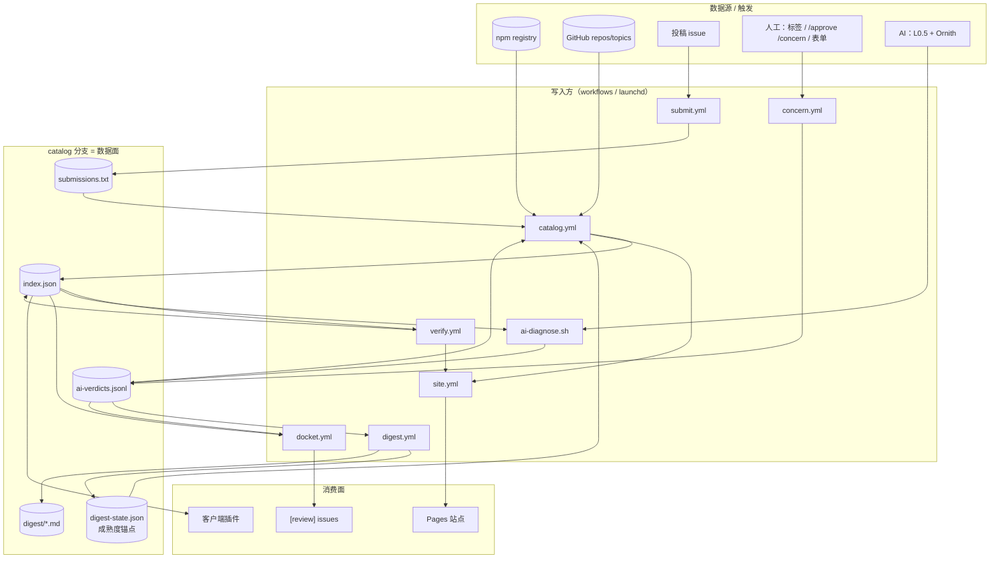

> 读法：`catalog.yml` 是心脏——每班先把 verdicts+digest-state 吃进旧 index（`applyMatureVerdicts` 放行），再发现/扫描/合并写回；`verify.yml` 只写 verification 槽；裁决全部 append-only 进 jsonl；站点和客户端只是 index 的投影。

---

## 0. 数据面：catalog 分支文件清单

`catalog` 是**纯数据分支**（无 pipeline 源码），所有 writer 通过 `git worktree` + fetch/reset/merge/commit/push 重试循环写入。

| 文件 | 写入方 | 消费方 | 语义 |
|---|---|---|---|
| `index.json` | catalog.yml publish / verify.yml merge | 站点构建、客户端、diagnose、docket、verify plan、applyMatureVerdicts | 完整目录（含 pending——数据面全量，展示面各自过滤） |
| `ai-verdicts.jsonl` | diagnose、submit.yml verdict、concern.yml | run.ts、diagnose（判重）、docket、digest | **append-only** 裁决流水；同 name@version 最新 `at` 胜出 |
| `submissions.txt` | submit.yml ingest、catalog.yml publish（notified 回写） | run.ts `--seed`、notify-published | JSONL：一行一个 `{name,repo,type,category,desc:{en,...},issue,notified}`；兼容旧格式：纯包名行、`github:owner/repo` 行 |
| `digest-state.json` | digest.yml / publish-digest.sh | run.ts | `{lastDigestAt, announced, day, dayAnnounced}` — pass 成熟看 `announced` 集合成员（上过日报的那行才算）；缺失/损坏=-∞=全冻结 |
| `digest/YYYY-MM-DD.md` | digest.yml（publish-digest.sh 兜底） | 人（手机/网页） | 日报：新放行表 + held 积压 + concerns + 审核单链接 |
| `blocklist.json` | 手工 | run.ts | `{names[],slugs[]}` 硬封禁 |
| `removed`（index 内字段） | run.ts tombstone / remerge 保留 | 站点/客户端（不渲染） | 消失条目墓碑，reason ∈ `npm-404|filtered|capped|manual|unknown`，180 天保留期 |

### AiVerdict 记录（每行一个）

```json
{"name":"pkg","version":"1.2.3"|null,"verdict":"pass"|"concern",
 "reason":"中文理由","reasonEn":"english reason","at":"ISO",
 "source":"ai"|"human","sha":"sha512-…（可选）",
 "by":"github.actor（可选）","issue":123（可选）,
 "model":"llm-id（可选）","l05":{"model":"galvanize-2","score":0.71}}
```

- `version: null` = github-kind 条目（无版本概念）。
- `source` 由写入方盖章，模型永远写不出 `human`。
- `sha` = npm `dist.integrity`——**两通道都盖**：人工通道写盘时取（npm view），AI 诊断经 `integrityOf` 盖。同 sha 跨版本复用判词；同版本 sha 漂移=re-tag→自动重审。
- `by`/`issue` = 人工裁决溯源（裁决人+单号）；`model`/`l05` = AI 审计元数据（模型 id + L0.5 实得分——阈值/模型变了老判词可回放）。
- 键：`vkey(name,version)` = `name\0version`（NUL 分隔——`@` 会和 scoped 包名撞车）。
- `latestVerdicts` 逐行容错解析（坏行跳过）——diagnose/digest/docket 都走它。

### index.json 全字段（`src/schema.ts` PluginEntry）

```
CatalogIndex { version:'1', generatedAt, categories:{id→{en,zh?}}, plugins: PluginEntry[], removed: RemovedEntry[] }
```

| 字段 | 类型 | 语义 |
|---|---|---|
| `name` | string | npm 包名或 `owner/repo` |
| `slug` | string | 详情页 URL 键；repo 优先于包名（`slugOf`） |
| `aliases[]` | string[] | 同名不同源去重时挂的别名 |
| `type` | enum | `plugin|skill|agent|command|mcp|theme|bundle|rule`——分类器产出，默认 plugin |
| `contains[]` | enum? | `plugin|skill|mcp|command|agent|hook`——部件清单显式记录（基线 `['plugin']`）；repo 探测 SKILL.md→'skill'（github-kind 也跑 hasSkillPath） |
| `features[]` | enum? | `server|tui|gui|rpc`——镜像官方 Host.resolve：`./server`或根入口(`./`.`main`/`index.*`)→server；`./tui`→tui；`./rpc`+有 server→rpc；`./gui-experimental`（无 exports 时根下 `gui-experimental.cjs/.js`）且目标 `.cjs/.js`→gui。**无保底 server**——GUI/TUI-only 包合法为空 |
| `discoveredVia[]` | enum[] | `npm-keyword|github-topic|code-search|topic-list|submission` |
| `source` | obj | `{kind:npm|github, id, repo?, repoId?, version?}`；repoId=GitHub 数字 id，repojacking 检测 |
| `description` | obj | `{en, zh?}`——优先级：`.opencode-market.json` > 投稿声明 > 自动 |
| `category[]` | string[] | 分类 id 列表 |
| `license` / `deprecated` / `deprecatedMessage` / `replacement` | — | npm 元数据；replacement 从 deprecated 文案解析 |
| `createdAt` / `modifiedAt` | string? | packument `time.created/modified`——`createdAt > firstSeenAt` ⇒ 名字被重新注册（`sec:name-reused`） |
| `maintainers[]` | string[] | npm 维护者账号——变化 → `sec:maintainer-changed` |
| `distTags` | obj | npm dist-tag 表——回滚检测（`sec:version-rollback`） |
| `firstSeenAt` | string | 首次收录时间（merge 跨版本保留） |
| `latestVersion` | string? | **展示版**——held 语义下钉在批准版；null=github-kind |
| `publishedAt` | string? | 展示版的发布时间 |
| `integrity` | string? | 展示版 `dist.integrity`（sha512-…）——装包逐字节校验公告值；github-kind 恒 null |
| `metrics` | obj | `{stars, npmDownloads30d, checkedAt}` |
| `capabilities` | obj | `{scannedAt, rulesetVersion?, findings[], redFlags[]}`；`scannedAt:null`=没扫过（≠扫过没发现） |
| `verification` | obj | `{status, level?, opencodeVersion?, verifiedAt?, runUrl?, logExcerpt≤2048, retries?}`；status ∈ `verified|failed|unverified|skipped`，level ∈ `install|load|interactive|render|structure`；`retries` 只在 failed 上计数（V-3 自动重试预算） |
| `compat` | obj | `{engines?, peer?}` |
| `approval` | enum | `pending`=hold 默认 / `approved`=放行 / `legacy`=门禁前老条目（schema 默认 legacy 兼容旧 index） |
| `approvalReason` | string? | pending 的理由；放行时清空 |
| `pendingUpdate` | obj? | **被扣住的新版** `{version, capabilities, verification, features?, publishedAt?, reason?, heldAt}` |

`RemovedEntry`（墓碑）：`{slug, name, lastSource?, disappearedAt, reason∈npm-404|filtered|capped|manual|unknown}`——180 天保留，URL 不 404 + 名字复用检测。

**判定语义速记**：
- `scannedAt:null` ≠ `findings:[]`——前者"没扫过"渲染 not scanned，后者"扫过无发现"渲染 scanned,no findings（都必须带"不等于安全"）
- `latestVersion:null`（github-kind）→ 无 npm 可装对象，但 tree 证据门+codeload tarball 静态扫描照常（扫描失败才 `scannedAt:null`）；不验(skipped)、AI 不审（verdict 键都建不出来）
- `pendingUpdate` 存在 ⇒ `latestVersion` 是**旧版**，`plugin add` 拿到的永远是它

---

## 1. 收录发现流 — `catalog.yml`（每天 2 班 UTC 03:17/11:00 + 手动）

**实现**：`pipeline/run.ts::run`（主流程）· `discover/{npm,github,filter}.ts`（候选+入场过滤）· `fetch/{npm,github}.ts`（packument/tarball/repo 元数据）· `scan/{scan,rules}.ts`（tarball 静态扫描，`RULESET_VERSION='r3'`）· `publish/{merge,slug}.ts`（合并/去重/腐化门）· `remerge.ts`（重试合并）· `verdicts.ts::applyMatureVerdicts`（前置放行）· `notify-published.ts`（投稿通知）

`generate`（permissions:{} 零权限，跑不可信元数据；可选 `MARKET_PAT` 提额）→ `publish`（唯一 index writer：contents+issues 写权限；末尾 dispatch site.yml——V-8 单 Pages 发布者，dispatch 失败只记日志）→ `alert`（失败开 `pipeline-alert` issue）。整流 `concurrency: catalog-branch`——与 verify.yml、submit ingest、digest.yml 共享同一把分支写锁，写者串行。

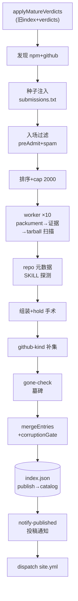

逐步细节：

```
discoverNpm + discoverGithub（并行）
  → + submissions.txt 种子注入（JSONL 声明式种子；纯名字；github:owner/repo）
      npm 种子注入 npmCands（discoveredVia=submission）
      repo-only 种子 → ghCands → 走 github-kind 路径
      seed 绕过 --max 字母序截断（排序在 cap 后回补）
  → 入场过滤：preAdmit(archived)——只作用 GitHub 侧（npm 候选无 archived/fork 信号）
      + looksLikeTemplateSpam（owner 级 ≥6 近同名）
  → 确定性排序 name-asc → cap（--max，默认 500；workflow 传 2000）
  → 逐候选 worker（10 并发）：
      更新检测三条路（本轮 vs 旧 index）：
        ① 版本变了（pk.version ≠ latestVersion）→ 走全流程，hold 进 pendingUpdate；
           R-1 pin-until-terminal：已有在押 hold → 整体带过 pendingUpdate
           （verification/heldAt/reason/capabilities 全保——旧行为是换版清零，
           verify 排队/AI 已判/人工在看的版本被悄悄替换→热点包永久饥饿；
           ruleset 升级也不再团灭在飞 hold），只刷 distTags/repoId/metrics。
           槽位释放（重定向到 pk.latest）仅当在押版达终态：最新裁决 concern，
           或 failed 且 retryable 耗尽；pk.latest 上有**人工**裁决时主动跳车
        ② 版本同 + ruleset 同 → 增量短路整体复用（metrics.checkedAt >7d
           才 refreshMeta 重拉 packument/stars/downloads；否则零请求）
        ③ 旧有条目候选里没有 → gone-check 探活（见下）
      fetchPackument → hasPluginEvidence（via ≥2 或含 'entry'——仅 keyword 不算数）
      → fetchTarball+scanTarball → capabilities{findings,redFlags,rulesetVersion}
        （解压累计 >512MB 即中止=防 zip bomb；findings>500 截断 + 'scan-capped'
        标记行——截断本身也是信号；rules 含 lifecycle-script 全生命周期
        prepublish/prepack/postpack 与 literal-ip 的 IPv6+私网段排除）
        redFlags>0 → verification={status:'skipped'}（高危信号没跑）
      fetchRepoMeta(repoId/stars) + fetchRepoTree(hasSkillPath：任意 SKILL.md/.opencode/skills→contains)
      + fetchMarketMeta（repo 根 .opencode-market.json 作者声明）
      repo package.json ≠ 包名 → finding 'sec:repo-mismatch:<actual>'
      字段优先级：marketMeta > 投稿声明 > 自动派生（description/category）
      detectFeatures({exports, main, files:tarball 路径})——镜像官方 Host.resolve
      （server=./server|根入口；gui=./gui-experimental 仅 .cjs/.js；rpc 需 server 同在）
      组装 entry：approval='pending', approvalReason='awaiting-review'
      hold 手术（见 §7）
  → github-kind 补集（无 npm 对应物的 repo 候选；coveredRepos 去重——
      npm 包已认领的 repo 不再重复收 github-kind）：
      证据门 hasRepoEvidence(tree 路径+topics)：OpenCode 专属信号
        （.opencode/、opencode.json[c]、SKILL.md、扩展类 topic）
        + 可装产物（.opencode plugin/skill 路径、SKILL.md、package.json）
        双缺即拒；通用 'opencode' topic 只是关联不是产物声明
      tree/tarball 固定走 HEAD ref——search 索引的 defaultBranch 可能过期
        （分支改名后具名 ref 404 会误杀）；codeload tarball 过同一套
        scanTarball，归档根前缀 strip
      暂态 tree error/rate-limited → 保留旧条目；not-found/空 → gone-check
      增量复用：pushedAt+ruleset 不变 → 整体沿用（modifiedAt 存 pushedAt）；
        扫描失败留 scannedAt:null，'too large' 盖 rulesetVersion 记忆化
        （pushedAt 变了才重试），timeout 每轮重试
      type：投稿声明优先；纯 skill 证据（有 SKILL.md、无根 package.json、
        无 .opencode plugin 路径）→ 'skill'，否则 'plugin'
      latestVersion:null、verification:{status:'skipped'}、
      approval 继承 ghPrev（人工裁决过的状态跨轮保留）
      ghStats 审计行：admitted/reused/npm-covered/evidence-rejected/
        transient-kept/empty/scan-failed(oversize)
  → gone-check：旧条目消失 → 探活：
      fetch 错误(429/5xx/网络) → 保留旧条目不打墓碑（瞬时失败≠消失）
      not-found → npm-404；cappedOut → capped；blocklist → manual；
      github-kind 或证据消失 → filtered；其它 → unknown
  → buildIndex = mergeEntries（双层缓存+trustFlags+skipped 不变量）
                + dedupeSlugs + corruptionGate（空/掉幅>20% 拒发）
  → index.json → publish job 写 catalog
     （worktree 上 fetch→reset→remerge(ours vs remote)→commit→push，4 次重试；
       remerge 保护 remote 侧 verify-merge 已写入的 verification/removed/identity，
       并对 categories 字典/条目 category 值做 catId 归一——
       remote 上的 legacy 中文键不会在重试路径原样回流）
  → notify-published：approval!=='pending' 的投稿 issue 评论+关闭，
     submissions.txt 回写 notified:true（二次提交）
```

**前置步骤（顺序负载）**：`generate` 开头先把 catalog 分支取下来，跑 `applyMatureVerdicts(old, verdicts, digestState)`——成熟裁决先作用于旧 index，再做发现比对（否则高频包的 pendingUpdate 会被下一班 npm bump 覆盖，永远饥饿）。旧 index 缺失/损坏 → 直接拒跑（WF-1，不盲跑）。

**mergeEntries 双层语义**：
- 身份层（name 匹配）：firstSeenAt/slug/aliases/discoveredVia 跨版本保留
- 版本层（name@version+host 匹配）：capabilities/verification 按版本槽恢复
- approval 层：`e.approval ?? prev?.approval ?? 'pending'`（worker 手术优先；github-kind/复用条目靠 prev）
- pendingUpdate 层：同版本→保留 remote 侧 verification 槽（verify-merge 可能刚写过）；remote 持有的我们没见过的版本→保留 hold（除非我们刚放行同版）
- trustFlags（sec:name-reused/repo-recreated/version-rollback/maintainer-changed/sec-delta:*）：身份级 flag→展示槽；`sec-delta:*`→候选槽（pendingUpdate.capabilities 或自身）。强规则（lifecycle-script/prepare-script）→redFlags，其余新规则→findings
- 不变量：`redFlags>0 且 verified|unverified → 'skipped'`；`failed` 保留真结果不被改写

---

## 2. 投稿流 — `submit.yml`

**实现**：`pipeline/submission.ts::parseSubmission/seedLine`（issue 解析+种子行）· `pipeline/review.ts::reviewPackage/verdict/renderReview`（机械审+报告）· workflow 内嵌 node 脚本（ingest 去重/verdict 写回/sweep）

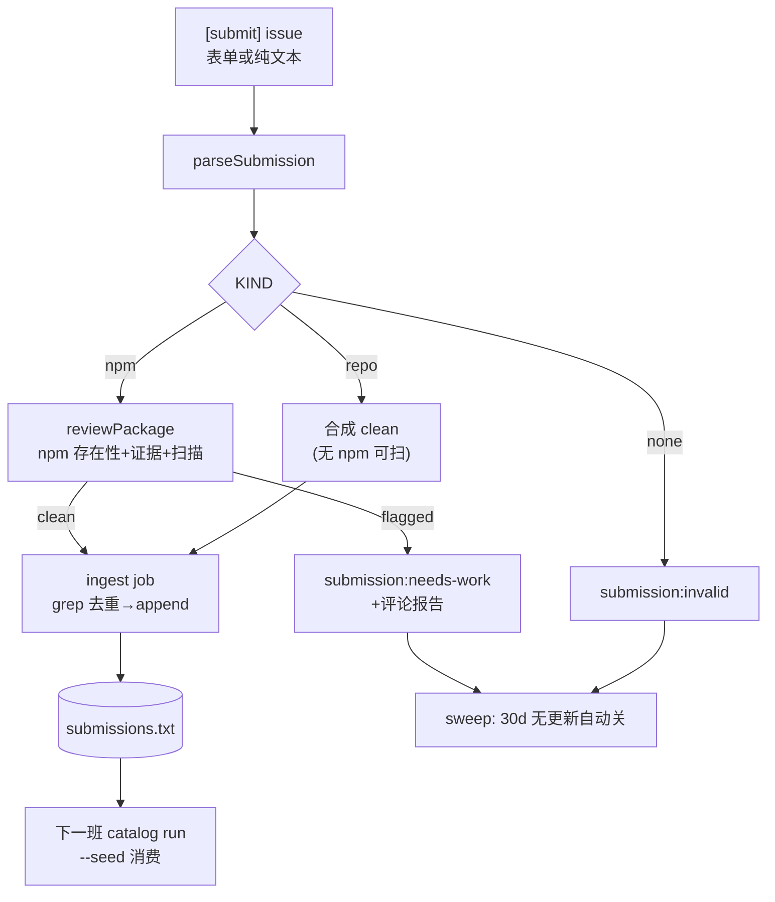

逐步细节：

```
issue(opened/edited/labeled) 且 (有 submission 标签 或 [submit] 标题)
  或 issue_comment(created) 且 issue 有 submission:{needs-work,invalid} 标签
  → review job（permissions:{} 零权限——跑攻击者可控的 tarball；
      concurrency: sub-review-N，cancel-in-progress——重审幂等可丢弃）
      parseSubmission（issue-form ### 段 + freeform 兜底；repo 可无 name）
      KIND: npm→机械审 review.ts；repo→合成 clean（无 npm 可扫）；none→invalid
      机械审查：npm 存在性/插件证据/静态扫描 → verdict: clean|flagged|invalid
      守卫：非作者触发重审 → flagged；issue>24h 且包注册晚于 issue → flagged（防蹲名）
      verdict 取报告中 LAST 'verdict:' 注释标记（防包内文本注入伪造）
      产出 review.md artifact + verdict output（不直接写 issue——N-6 拆权）
  → report job（permissions: issues:write，needs review）：
      评论报告（含 verdict 对应的下一步指引页脚）+
      打 submission:{approved|needs-work|invalid} 标签
      ⚠️ 机械通过只是"入场"，不是上架
  → ingest job（clean 时，concurrency: catalog-branch）：
      catalog-append.sh KEY 模式（name/repo 键去重）→ append submissions.txt
      （含 issue#,notified:false）→ catalog run --seed 消费
  → verdict job（人工通道，见 §5）
  → sweep job（每日 UTC 05:23）：invalid/needs-work 30 天无更新自动关
```

---

## 3. 验证流 — `verify.yml`（每天 2 班 UTC 04:47/16:47 + `targets` 手动指定）

**实现**：`verify/plan.ts::verifyTargetOf/planTargets/shard`（目标+分片）· `verify/verify.ts::verifyPackage/xdgEnv/writeDummyProvider/loadedSignal`（L1/L1.5 沙箱验证）· `verify/tui.ts::checkTui/judgeTuiPane`（L2 tmux）· `verify/gui.ts::findGuiBundle/checkGuiBundle`（L3a jsdom 渲染）· `verify/merge.ts::mergeResults`（版本路由写槽）

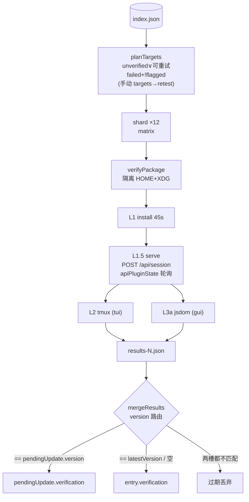

逐步细节：

```
plan job（contents:read）：
      catalog 分支取 index → targets 输入非空则按包名收窄 index
      → planTargets（retest 开关见下；cap 默认 48/班，dispatch 输入
        `cap` → VERIFY_CAP 可调）
        选序 = 两级：discoveredVia 含 'submission' 的先取（投稿优先），
        其余按 index.plugins 的 name-asc 顺取；cap 不变，积压跨班排空——
        一天取不完就取两三天；手动 targets= 仍可插队
        出队语义：verified 永久离开；failed 限界自动重试（V-3）——
        近 7 天失败且 retries<3 自动回队（merge 写槽时累加 retries），
        超限/超窗才成终态
        排队期间 npm 发新版 → pendingUpdate 换版，轮到验当前版；
        版本错配的结果 merge 时过期丢弃，不写错槽
        → shard 顺序切片 12/组（items.slice，非 hash）→ matrix 输出片索引
      手动 targets= 逗号包名 → 定向验证 + --retest（failed/verified 可重验，
        越过 retries 上限的手动补刀）
verify job（permissions:{} 零权限 + harden-runner egress 白名单
      registry/api.npmjs.org, api.github.com, github.com, *.githubusercontent.com；
      整 job if: shards != '[]'——空计划全跳；timeout-minutes 30——
      12 目标串行 ~18min 上限（V-4 把 load 窗口加宽后 20min 太薄，N-21））：
      npm i -g @opencode/cli@2.2.5（与 OPENCODE_VERSION 常量钉齐——缓存键含宿主版本）
      verifyPackage(name@version)：
        L1 install: 隔离 HOME+XDG_CONFIG/DATA/CACHE → `opencode plugin add name@ver`（45s）
        L1.5 load: writeDummyProvider（合并写！不抹 plugin add 的 plugins[]）
                   → `opencode serve` 后台 → 等 "server listening"+密码行
                   → GET /api/plugin + GET+POST /api/session
                     （2.2.5 懒加载：GET 不触发，POST session 才 load）
                   → 轮询 GET /api/plugin ≤20s 看 apiPluginState：
                     active→pass / failed→带 reason fail（apiLoaded/apiFailed）
                     ——canary 日志匹配降为诊断信息，不再当判定信号
        L2 interactive: features 含 tui → tmux 冒烟（checkTui）
        L3a render: features 含 gui → findGuiBundle + checkGuiBundle（jsdom+vm 真渲染）
        → VerifyResult{name,version,status,level,opencodeVersion,verifiedAt,logExcerpt≤2048}
        → results-<shard>.json artifact（7 天）
merge job（`if: always()`——分片挂了已落地的 results 照样合，不等整矩阵
      成功（N-10）；contents+actions 写；actions 只为 dispatch site.yml——V-8 单发布者）：
      mergeResults 按 version 路由写槽
      r.version == pendingUpdate.version → 写 pendingUpdate.verification
      r.version == latestVersion 或空 → 写 entry.verification
      两槽都不匹配 → 过期结果丢弃（npm 中途又发新版）
      RUN_URL env → verification.runUrl（失败详情页回链）
      写回 catalog（fetch→reset→merge→commit→push，4 次重试）
      → dispatch site.yml（gh workflow run；dispatch 失败只记日志——下一班
        catalog 会补发；不自建站点，V-8 单发布者原则）
alert job（failure()）：开 pipeline-alert issue
```

结果 → `verification.status ∈ {verified, failed, skipped, unverified}` + `level ∈ {install, load, interactive, render, structure}`；failed 槽经 mergeResults 累加 `retries`（非 failed 结果清零）。

**verifyTargetOf**：`version = pendingUpdate?.version ?? latestVersion`；`unverified` 取**候选槽**自己的 verification；`flagged` 取候选槽 redFlags；features 同样候选槽优先。计划条件（`verifyQueued`——planTargets 与 digest §④ 验证积压共享同一谓词）：`有版本 && !flagged && (unverified || retryable)`，`retryable`=failed 且 verifiedAt 在 7 天内且 retries<3；retest 模式放宽到任意 failed/verified（flagged 永不执行——红旗代码不上 runner）。

---

## 4. AI 诊断流 — `bin/ai-diagnose.sh`（launchd 每小时；手动同命令；**迁移期计划任务暂停**）

**实现**：`pipeline/ai/diagnose.ts::unreviewedTargets/reviewMaterial/l05Score/ornithReview/integrityOf/verdictRecord` · `ai/l05_score.py`（L0.5 打分器，独立进程）· `verdicts.ts::loadVerdicts/latestVerdicts/vkey`

双通道合成——L0.5 机械打分压过 LLM 自判，任一通道挂都 fail-closed：

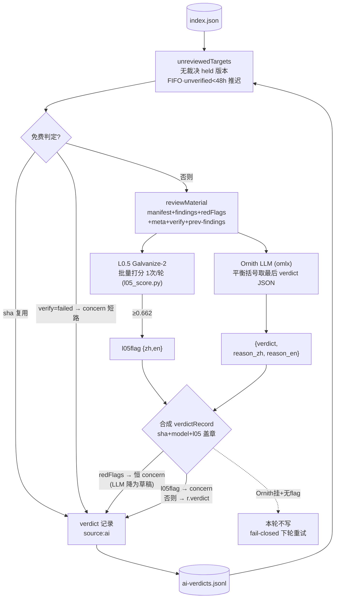

逐步细节：

```
ai-diagnose.sh 壳：env 检查 → mkdir 原子锁（防 launchd 叠实例双烧 LLM）
  → catalog clone（~/.local/share/opencode-market-catalog）→ fetch+reset --hard
  （失败即退，不拿陈旧数据跑）；本地日志 >5MB 自动截尾
→ diagnose.ts（--limit DIAGNOSE_LIMIT=50；--budget 45min；--name/DIAGNOSE_NAME 定向；
  --force 重审已裁决；--state 状态文件；--dry）
  有 LLM 候选时先 omlxAlive 探活（GET /models，任何响应即活）——
    死 omlx 秒退：免费 verdict（sha 复用/verify-failed）与 flagged/L0.5 兜底照写
  --state 文件按目标记连续 LLM 失败（探活跳过不算）：≥5 次（MAX_ATTEMPTS）
    写"工具故障非安全结论"concern——停止白烧 + 人类可见 + --force 可救；
    成功后清零
  候选 = unreviewedTargets（按 heldAt/firstSeenAt FIFO，不按字母序）：
      ver = pendingUpdate?.version ?? (approval==='pending' ? latestVersion : null)
      且 vkey(name,ver) 在 seen(latestVerdicts) 中**完全没有记录**
      ——任何 source 的 verdict 都排除：人工裁决就是终局，
        AI 复审会写一条 at 更新的记录静默翻盘（latest wins）
      ——AI 也绝不复审自己审过的（无 churn）；例外：sha 漂移（同版本
        re-tag）自动重审、--name --force 定向重审（模型/阈值升级通道）
      verification==='unverified' 且挂起 <48h → 推迟（等装测物料）；
        >48h 降级硬审（verify 瘫了不饿死在 unverified 上）
  每候选（先免费后付费）：
    integrityOf(name@ver) → npm dist.integrity（verdict 统一盖 sha）
      同 sha 已有裁决（跨版本同 tarball）→ 直接复用判词，零模型调用；
      shaFor 缓存让 drift 扫描与判词盖章共享单查（同轮不重复 npm view）
    目标槽 verification.status==='failed' → 直接写 concern
      （带 level+logExcerpt 摘要；spec §3/§11——模型看不到装测，不给它猜）
    reviewMaterial = manifest + findings + redFlags + pending 行
      + meta（type/source/created/firstSeen/published/maintainers/repoId/
        stars/下载量——休眠、维护者变更、repojack 信号）
      + verify（装测状态+日志摘录）+ prev-findings（展示版 delta 对照）
    L0.5（Galvanize-2）**每轮一次** python 调用批量打分
      （复合 id `name\0block` 拆回；meta/verify 纯机器串块不打分——
        off-distribution 路径串实测出 0.694 FP）
      ≥0.662 → l05flag{zh,en}（红旗，压过 LLM 自判）
    Ornith（omlx, OpenAI 兼容）→ 平衡括号扫描取最后含 "verdict" 的 JSON
      （嵌套 signals[]、code-fence、think 文本伪块都能取对）
      {verdict, reason_zh, reason_en}（老单 reason 响应→双语复制；各截 500）
    合成：
      目标 redFlags 非空 → verdict 恒 concern，LLM 输出降为草稿理由
        （spec §10 起草语义——不给审计流写永远无效的 pass）
      l05flag → concern（reason 双语：红旗优先 + LLM 上下文）
      否则    → r.verdict（reason=reason_zh, reasonEn=reason_en）
    fail-closed：Ornith 挂 + 无 flag → 该候选本次无 verdict（下轮重试，保持 held）
                Ornith 挂 + l05flag → 仍写 concern（L0.5 单独也能拦）
                L0.5 挂 → 仅记日志，LLM 照常
    --budget 分钟数到点 → 只跳 LLM 调用；sha 复用/verify-failed 免费 verdict 照写
  verdict 记录：source:'ai'、version=候选版本、sha=dist.integrity、
    model=LLM id、l05={model,score}（审计元数据——阈值/模型变了可回放）
  verdicts → mktemp 文件 → 推送循环 ×3：
    fetch → reset --hard → comm 去重 append → commit（staged-diff 判空）
    → push；远端并发写（catalog/verify/人工）不再撞 EOF 冲突，
    也不会丢本地裁决或推送假成功
```

Env：`AI_BASE_URL`（默认 `http://localhost:8001/v1`）、`AI_MODEL`、`AI_API_KEY`（`~/.config/opencode-market/ai.env`）、`HF_HOME`/`GALVANIZE_DIR`（L0.5）。

---

## 5. 人工裁决流 — `concern.yml`（maintainer 专属，手机可用）

**实现**：`pipeline/human-verdict.ts::resolveVerdictEvent`（三通道解析+歧义规则+mismatch 检测，纯函数可测）· `bin/catalog-append.sh`（共享写盘循环：worktree+整行去重+staged-diff 判空+`APPLY_INDEX=1` 经 `pipeline/release.ts` 即时生效）· 目标键 `verdicts.ts::vkey`

四条通道，全部写 `source:human` verdict（带 `by`=裁决人、`issue`=单号、sha=dist.integrity）：

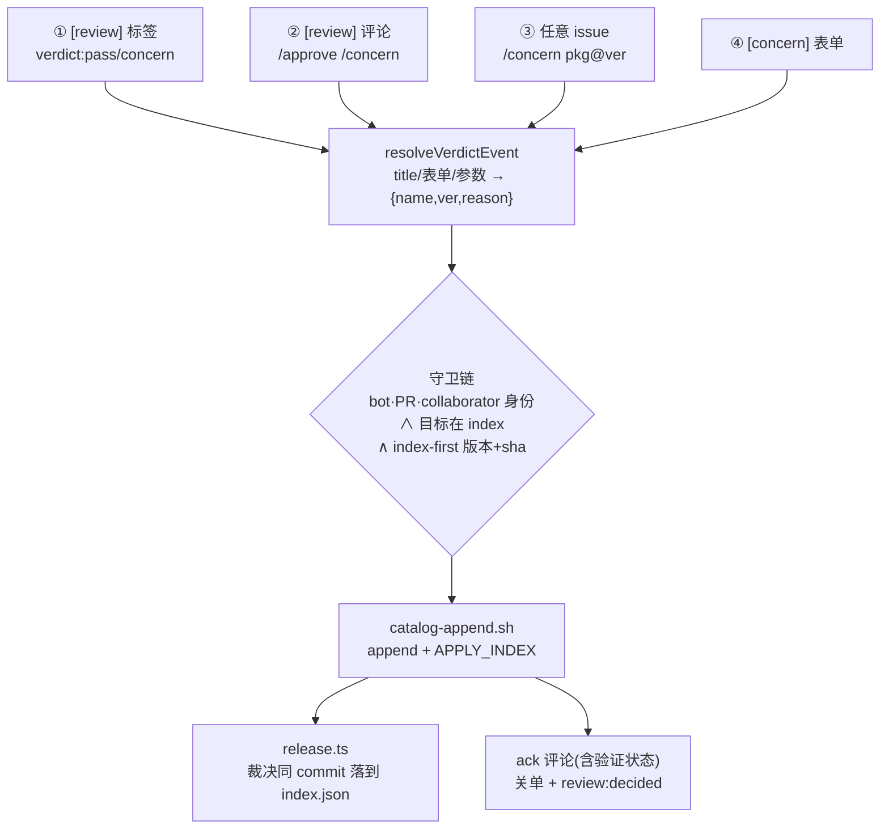

| 通道 | 触发 | 目标解析 |
|---|---|---|
| ① 标签点选 | `[review]` issue 打 `verdict:pass`/`verdict:concern` | 标题 `[review] name[@ver]` |
| ② 裸命令 | `[review]` issue 评论 `/approve`、`/concern [理由]` | 同上 |
| ③ 带参命令 | **任意** issue 评论 `/concern pkg[@ver] [理由]` | 参数 spec |
| ④ 表单 | `[concern]` issue opened/**edited**（模板，下拉选 pass/concern + 包名/版本/理由） | 表单字段（`###` 段解析，`#` 字符安全） |

**歧义规则（H 系列）**：有标题目标的 issue 上，**裸词一律当理由**（`/concern steals data` 是理由不是包名）；跨目标裁决必须写显式 spec（`name@ver`、`owner/repo`）；spec 与标题目标不一致 → `mismatch`：记录裁决但**不关错单**，评论说明。

**守卫链**：
- 顶层 `if`：`sender != 'github-actions[bot]'` + `!pull_request`（bot/PR 永不产 verdict）
- `[concern]` 表单/评论命令：`author_association ∈ OWNER|MEMBER|COLLABORATOR`（job if 直接卡死）
- labeled 事件没有 labeler 身份 → `gh api collaborators/{actor}/permission` 要求 admin|maintain|write；**瞬断重试一次**，仍失败保留标签提示重试（不把假拒绝当真）；权限不足→撤标签+评论
- `[submit]` issue 跳过（submit.yml 的地盘）
- 目标必须在 index 里；**版本解析 index-first**：`pendingUpdate.version ?? latestVersion`（裁决对象是在押版本，不是 registry 最新）→ 回落 `npm view`；npm 条目仍解析不出 → 评论说明**不写 verdict**（没有 `name\0` 死信）
- `owner/repo`（含 `/` 非 scoped）→ version:null + `dist.integrity` sha
- reason 折叠空白（防写坏 `$GITHUB_OUTPUT`）；标签路径理由自动生成 `via label X by actor (issue #N)`
- ack 评论带**当前验证状态**与在押版本提示；`deadslot`（裁决的版本既不在押也不展示）→ 明示"已存档但没有生效槽位"
- `noresolve`（裸命令落空）→ 用法提示评论，不静默
- **关单规则**：`[review]` issue（标签/评论都会关）+ `[concern]` 表单 issue（写完即关）；mismatch/任意 issue 带参命令只写盘不关单；非 maintainer 开 `[concern]` → triage job 解释+关闭

**并发模型**：`concurrency: verdict-${{issue.number}}`——每条裁决事件必须落盘，**不能共享 catalog-branch 锁**（GitHub 并发组只留 1 个 pending，burst 会静默丢裁决——实锤过）。跨 issue 写竞争由 `catalog-append.sh` 的 fetch→reset→dedupe→commit→push 重试吸收；`APPLY_INDEX=1` 让裁决经 `release.ts` 在同一 commit 落到 index.json（concern 即时刹车，不用等下一班 catalog）。

**submit.yml verdict job**（投稿通道，同语义，`concurrency: verdict-N`）：
- 非 bot 打 `submission:approved` 标签 或 collaborator 评论 `/approve`/`/concern [理由]`
- 目标=投稿包名（issue body 解析）；**评论带异目标 spec → argignored 告警**（不静默错目标）
- bot 打的标签不算（机械审永不自行发布）

---

## 6. 日报流 — `digest.yml`（CI cron 21:15 UTC + dispatch；`bin/publish-digest.sh` 为手动兜底）

**实现**：`pipeline/ai/digest.ts::renderDigest/nextDigestState`（五板块渲染+状态推进）· `verdicts.ts::loadVerdicts`（容错加载+坏行计数告警）· `digest.yml`（worktree fetch→reset→渲染→commit→push 重试壳，`concurrency: catalog-branch`）

pass 从写入到放行的时序——digest 是公示环节，**上过日报的那一行**才解锁成熟：

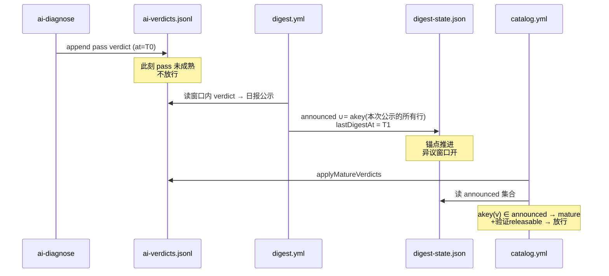

```
catalog worktree → fetch+reset → digest.ts --index --verdicts --state --out-dir [--date YYYY-MM-DD 回填]
  verdicts 走 loadVerdicts（坏行跳过+计数告警——一行坏 JSON 不能崩掉整份日报）
  fresh = at ∈ (lastDigestAt, now] 的 verdict
  ① 新放行表：fresh pass（理由双语 reason/reasonEn + 审核单链接 MARKET_REPO_URL）
  ② held 积压清单（approval==='pending' || pendingUpdate——含"已上架但有滞留新版"）
  ③ concerns 表
  ④ 验证积压（verifyQueued 共享谓词——planTargets 同口径的队列长度，
     96/天吞吐 vs 排队数一眼可见）
  ⑤ 评审积压（无裁决 held 版本——diagnose 的真实工作量水位）
  → digest/YYYY-MM-DD.md + digest-state.json
     {lastDigestAt:now, announced:∪akey(全部已公示行), day, dayAnnounced}
     ← 成熟锚点是**集合成员制**：晚推的 verdict 带旧 at 也偷渡不了——
       at≤锚点时间戳不够，必须真上过一份日报（akey=name\0version\0at）
  → 重试循环内每轮重新 fetch+reset+渲染（不是 push 失败后拿本地 commit 充数）
  → watchdog job：ai-verdicts >48h 未更新 + 队列非空 → pipeline-alert
    （本地 diagnose 死了有人知道）；index.json 陈旧也报——catalog.yml
    停摆时 digest 照样"成功"渲染在旧数据上，光盯 verdicts 会漏上游停摆
```

**这是唯一完整的上架预告面**。没有它：pass 永不成熟（-∞ 冻结=总闸）。搬 CI 的原因：日报是纯数据聚合（无 LLM），个人笔记本关机不该冻结整条放行链。`bin/publish-digest.sh` 保留为手动兜底（同款重试内重渲染修复）。

---

## 7. 放行流 — catalog run 前置 `applyMatureVerdicts`

**实现**：`pipeline/verdicts.ts::applyMatureVerdicts`（放行判定+hold 手术在 `run.ts` worker 内联）

一个版本从出生到可装的完整旅程：

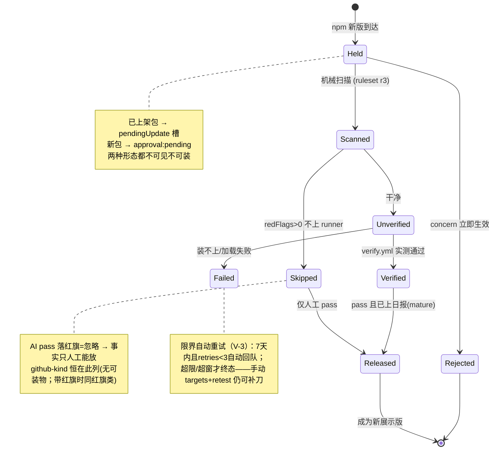

**hold 手术**（run.ts worker 内，新版本到达时）：
```
prev.approval≠pending 且 npm latest≠displayed
  → pendingUpdate={version,capabilities,verification,features,publishedAt,heldAt,reason:'awaiting-review'}
  → 展示字段钉在旧版（latestVersion/capabilities/verification/features/source.version 回写 prev）
pending 条目 bump → 就地换候选 + approvalReason 重置（旧理由说的是旧候选版）
已展示条目 npm latest 消失/回滚 → 携带全部展示态（pendingUpdate 也保留）
```

**放行判定**（两个版本槽各自查 `vkey(name, version)` 的最新 verdict）：

```
concern（任何 source）→ 立即生效不等成熟：
   pendingUpdate → pu.reason 标注（仍 held）
   展示槽 pending 条目 → approvalReason 标注（仍 pending）
   展示槽 approved/legacy → approval 拉回 pending + approvalReason（人工刹车）
human stickiness（R-4）：latest 按 at 决胜，但**只有更新的人工裁决能解除人工 concern**
   ——AI pass 写在人工 concern 之后不会翻盘（钟差/复审都不能越过刹车）；
   AI concern 仍可压过人工 pass（保守方向常开）
pass → 需 mature（akey(v)=name\0version\0at ∈ digest-state.announced——上过日报的
   那一行才算；晚推的 verdict 带旧 at 偷渡不了）
   && !(source=ai && 目标 capabilities.redFlags>0)   ← AI pass 落红旗条目=忽略（纵深防御）
   && verification.status ∈ {verified, skipped}      ← RELEASABLE
      verified=实测可装；skipped=没跑（高危信号 或 无可装对象）
      ——红旗 skipped 的 AI pass 已被上行忽略 → 事实只人工 pass 能放
      ——github-kind skipped 无版本无 AI 审 → 也只能人工 verdict(version:null) 放
      unverified/failed 永不放（fail-closed；verify 瘫痪=冻结发布而不是放行）
→ pendingUpdate 放行：latestVersion/publishedAt/capabilities/verification/features ← pu，
   source.version 同步，approvalReason 清空，pendingUpdate 删除
→ 展示槽 pending 放行：approval→approved，approvalReason 清空
标注幂等：reason 相同不重复写（held/releases 计数只记真变化）
```

**即时通道（R-2）**：`release.ts` 是 `applyMatureVerdicts` 的 CLI 壳——concern/submit 裁决写盘时 `catalog-append.sh APPLY_INDEX=1` 在同一 commit 把裁决应用到 index.json（人工 concern 立刻刹车、人工 pass 即时生效受同一套成熟+验证闸约束），不必等下一班 catalog。

**net 语义**：用户能装的版本 = 机械红线 + 验证 + 成熟 pass 全过的版本。concern 不需要公示期（保守方向），pass 必须过日报窗口（预告期）。

---

## 8. 审核单流 — `docket.yml`（hourly :40 + catalog/verify 成功完成后 + 手动）

**实现**：`pipeline/docket.ts::docketTargets/issueTitle/issueBody`（目标+开单/关单/漂移同步，`gh` CLI 操作 issue）· `verdicts.ts::latestVerdicts/latestHumanVerdicts` · job 级 `concurrency: review-docket`（K-1，触发源可重叠）

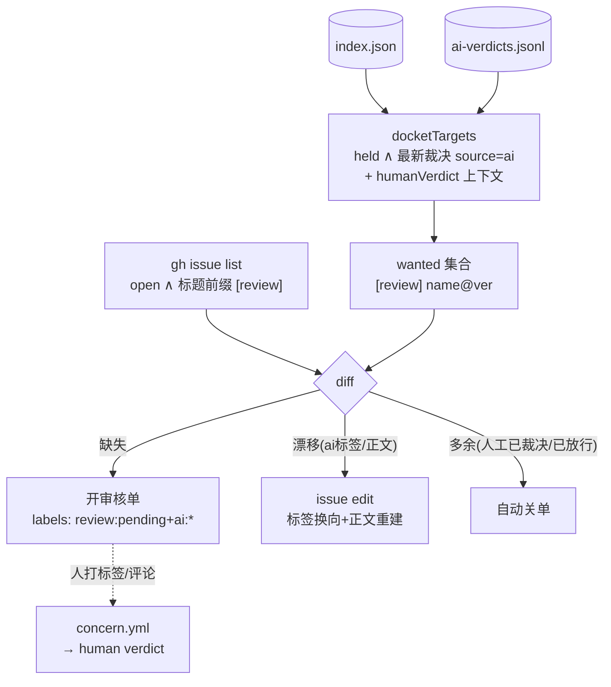

逐步细节：

```
docket.ts：index+verdicts → docketTargets
  = ver = pendingUpdate?.version ?? (approval==='pending' ? latestVersion : null)
    且 ver 非空（或条目本就无版本——github-kind 的 null 键查不到 AI 裁决，自然排除）
    且 最新 verdict.source='ai'
  （AI 已判、待人过目：pass 等放行窗口，concern 等人工翻案；
    人工裁决=终局 → 不进 wanted → 已开的单下轮自动关）
同步：
  缺失 → 开 [review] name@ver（labels: review:pending + ai:{verdict}，
        body：AI 判定+双语理由+验证状态+手机点选说明）
  已存在但漂移 → issue edit：ai:* 标签换向、review:pending 补回、
        正文按 issueBody(t) 确定性重建（判词翻转/验证落地/人工刹车上下文
        都传播——创建时刻的冻结文案不再误导，K-2/K-3/K-5）
  多余 → 关单（已决议/已放行；列全部 open 单后按 [review] 前缀过滤，--limit 500）
  → bootstrap 标签（verdict:pass/concern, review:pending/decided, ai:pass/concern）
workflow_run 触发只认 conclusion==='success'；concurrency: review-docket 串行化
（三触发源可重叠——并发双跑曾会双建单，K-1）
```

人 → 标签 → concern.yml → verdict → 关单 → docket 下轮清理。闭环。

---

## 9. 站点发布流 — `pipeline/site/build.ts` → GitHub Pages

**实现**：`site/build.ts::isVisible/scanLabel/verifyLabel/approvalBadge/installHint/listPage/detailPage/buildSite/buildSkillCatalog/healthGate/skillsPage/removedPage`（页脚 repo 链接 `siteRepoUrl`：`MARKET_REPO_URL` env > `git remote get-url origin` > 内置默认——仓库改名/转移不 404）

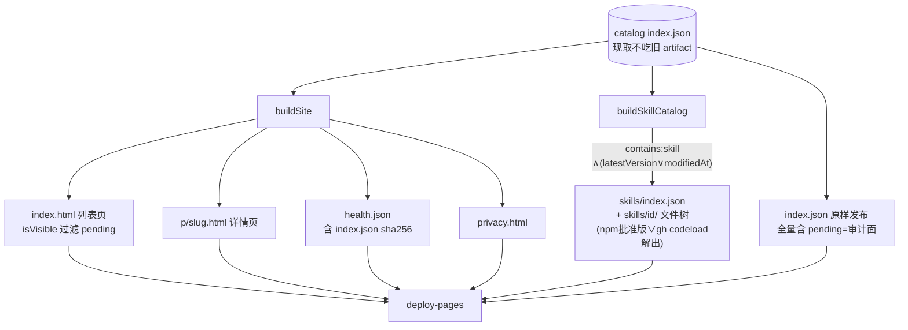

逐步细节：

```
index.json（catalog 分支现取，不吃旧 artifact——B-5；CLI 前置 zod 校验）
  → rm -rf /tmp/site 重建（不留陈旧文件）
  → /tmp/site:
      index.json      全量 catalog（含 pending——可审计数据面；唯一索引面，
                      lite 已砍——无消费者，死工件会腐化）
      index.html      列表页（filter isVisible：pending 不渲染；
                      搜索框 + category 下拉组合过滤，data-cats 精确匹配）
      p/<slug>.html   详情页（pendingUpdate 行"under review — not installable yet"
                      +held reason；findings 全列、integrity/verifiedAt/logExcerpt/
                      runUrl 回链；installHint 按 installPlan 同规则出：
                      npm 插件 pin 批准版 / skill 指 skills catalog /
                      github 插件 "no client install path"——不印装不上的命令）
      skills/index.json + skills/<id>/  HTTP skill catalog：
                      npm 条目 = npm view "<name>@<latestVersion>" dist.tarball
                      ——钉到批准版（绝不落 pendingUpdate 文件）；
                      github 条目 = codeload <repo>/tar.gz/<tree sha>——钉到
                      扫描过的 source.version（版本标记=字节标记；
                      无 sha 的遗产条目退回 HEAD+modifiedAt）；
                      两者都 latestVersion/modifiedAt/sha 为空 → 跳过；
                      <id>@<ver> 缓存（actions/cache 滚动键）——未变技能零网络，
                      失效键自动 prune；id 碰撞 → -x 确定性后缀；
                      拉取走 SKILL_POOL 限界 worker 池（S-14——冷缓存下
                      串行 npm view+curl 会超时，pool 化才跑得完）
                      解包走两段式：tzf 列表 → 仅按名提取 .md 成员
                      （symlink 成员不创建=无穿越原语；node_modules 段滤除）
      skills.html     技能浏览页（id+版本+文件链接）
      removed.html    墓碑页（disappearedAt 倒序最新 300——消失的插件不是裸 404）
      404.html        自定义 404——解释"可能已下架"，回链 removed/主目录
      health.json     {ok, entries(可见数), skills:{candidates,landed,degraded},
                      generatedAt, sha256, bytes}
                      ——sha256 覆盖 index.json 序列化字节，客户端先拉它再决定
                      要不要下全量 index（moved hash → 下载+逐字节验证）；
                      degraded=有候选但落地不足一半（registry 抖动≠真空目录）
      privacy.html
  → deploy gate：healthGate(live prev, cur)——entries<200 绝对地板
     或 <上次发布 50% → 失败不部署（拉不到 live health 只退绝对地板，
     网络抖动不拦发布）；
     skills degraded 且 candidates≥10 → 拦（抓取故障不该发半空目录）
  → deploy-pages → github.io
alert job：失败查重——已有 pipeline-alert open issue 则评论追加，不轰炸
```

诚实状态文案（AGENTS 规约）：verified=已实测可装可用 / failed=装不上或加载失败 / skipped=有高危信号没跑 / unverified=还没验。version-less（github-kind）条目渲染为 `nothing to install`（muted）——skipped 主要是"没有可装的东西"；经 codeload 静态扫描后带 redFlags 时兼有"高危没跑"含义。legacy 徽标 = 门禁前老条目；"没扫到"必带"不等于安全"。

---

## 10. 客户端消费流 — `plugins/market`

**实现**：`src/catalog.ts`（fetch/sanitize/过滤/排序/搜索/pinSpec/approvedTarballUrl/i18n/localStorage 持久化）· `src/spec.ts`（cleanSpec/dedupeToSpec/removeSpec/buildExtras/featuresMap）· `src/skill-install.ts`（installSkillTar/uninstallSkillDir/globalSkillsRoot）· `src/gui.ts`（webview UI + host IPC api）· `src/tui.tsx`（终端 UI + 直接宿主调用）· `src/server.ts`（插件入口装配）

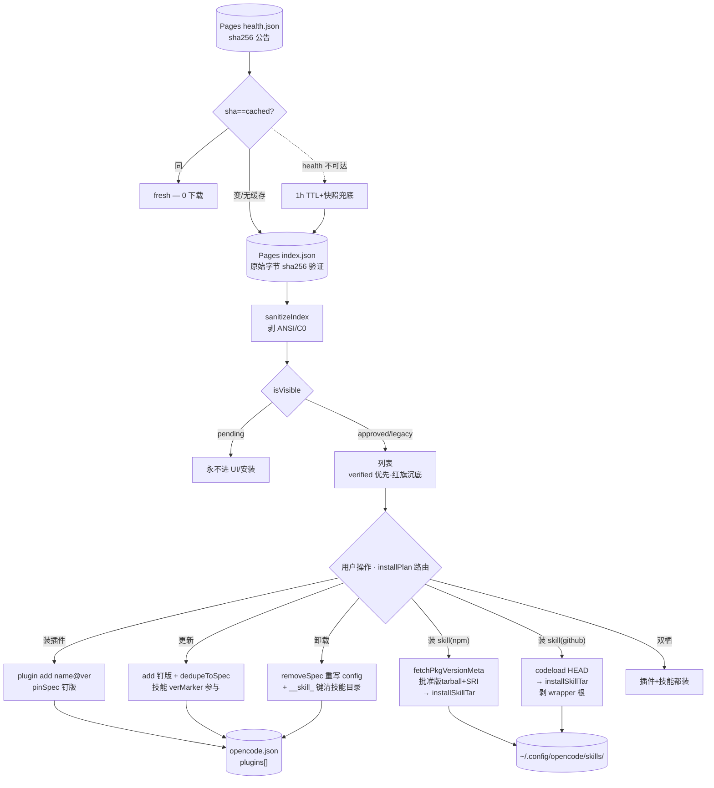

逐步细节：

```
index URL 解析：ctx.options.indexUrl > OPENCODE_MARKET_INDEX > Pages 默认
       （https-only；healthUrl/skillsUrl 同目录推导——换源一处生效）
fetchIndexCached（manifest-first 两段式）：
  ① health.json {sha256} — ~100B；命中缓存 sha → fresh，0 下载
  ② sha 变了（moved）或 force → 拉 index.json **原始 text** 先算 sha256，
     与公告比对——不匹配=mismatch，保留旧缓存绝不钉存错对；
     匹配才 JSON.parse → sanitizeIndex → isVisible 过滤 → 写缓存
  health 不可达 → 退回 1h TTL + 失败快照兜底；crypto 不可用 → 不 pin 不谎称验证
  缓存后端 storage()：webview=localStorage；Node 侧（TUI/main）无
  localStorage → 模块级槽位兜底——否则每次开 dialog 都整拉 index（N-9）
  fetchOutcome()：first|updated|fresh|stale|mismatch —— 刷新按钮如实区分
  "已是最新"/"已刷新 N 条"/"校验未通过"
UI（gui.ts webview / tui.tsx 终端）：
  列表 sortEntries（verified 优先）/ search(name>aliases>desc 加权) / 分类
  TUI 渲染 cap 120 起步按选中位增长；uncataloged 已装 spec 进合成卡片
  状态标签：installed 优先；!canInstall(e) → noInstallTarget 惰性徽标
    （github 插件仓无 npm 产物时）；否则四态同站点
  安装路由 installPlan(e)：{plugin:有npm版∧contains:plugin, skill:npm|github|null}
    双栖（contains 含 plugin+skill）→ 插件 pinSpec 装 + 技能装，一次点完
  插件安装：pinSpec(e) = name@latestVersion（钉到批准版；VER_SAFE 字符
       校验——crafted version 直接拒装，不让怪串进 spec）（N-8）
       gui: api.install → host `plugin add <spec>`（restrictedEnv，90s kill）
       tui: 同 spawn + 90s 超时
  技能安装（npm）：fetchPkgVersionMeta(name,latestVersion) 取批准版
       tarball+integrity → fetch(15-30s timeout；content-length+字节双闸
       过 MAX_SKILL_TGZ) → integrityMatches SRI
       sha512 校验（公告值不匹配=拒装 fail-closed）→ installSkillTar
  技能安装（github）：codeload <repo>/tar.gz/HEAD → installSkillTar
       两段式解包剥 `<repo>-<ref>/` wrapper 根；version 记账=modifiedAt
  installSkillTar：assertEntryId(npm名∨owner/repo) → 路径逃逸双闸 →
       48/256MB 双顶 → 提升 .opencode|.claude|.agents skills 嵌套到根
       （包根有 SKILL.md 时连 `skills/` 目录一起提）、撞名 <id>- 前缀、
       .market-skills.json 清单（卸载按清单精确删）、__skill_<base> 安装键
  更新：add 钉版 spec → dedupeToSpec 重写 config plugins[]
       （plugin add 不去重会留双 spec——E2E 实锤；从不调 `plugin update`——它走 latest=旁路）
       技能更新走 verMarker（npm=latestVersion,github=modifiedAt）比较，
       updateAll 双端都含技能
  卸载：removeSpec 重写 config plugins[]；装了技能的面才清技能目录
       （__skill_ 键探测——纯插件条目绝不扫技能根）
  verifyActivation：隔离 HOME 起 serve → POST /api/session 触发懒加载
       → 轮询日志 canary → activated/not-loaded（GET-only 永远不触发——已修）
  skillSource：把 skillsUrl(indexUrl) 加进 opencode.json skills[]（远程 catalog 源）
  skillPermission：写 permission 条目（action:skill, resource:id, effect:allow|deny|ask）
  pendingUpdate 透出：详情页"有 vX 在审"；github 条目显示 tree sha
  版本号：__PKG_VERSION__ 由 build.ts 从 package.json 注入（gui/tui 头部）
  extras：uncataloged 已装 spec → buildExtras 卡片（不在目录里的本机插件）
  TUI 本地状态：ctx.storage.store（favorites/lang/skillVers/devlog/界面态）；
       mySkills 标签页=contains:skill ∧ 本机已装；settings 页有
       备份/恢复 ~/opencode-market-backup.json（恢复走字段形状校验——
       构造的备份文件不能毁掉 state）
  devlog：宿主写 market.log（clearDevlog 清它）；渲染端 localStorage ring 300
```

---

## 11. 不变量与 fail-closed 速查

| 规则 | 机制 |
|---|---|
| 默认不可见 | `approval='pending'` 新生即持有；站点/客户端都过滤 |
| 机械审不发布 | submission:approved 只进 submissions.txt；bot 标签不写 verdict |
| AI 不越权 | `source` 由写入方盖章；AI pass 落 redFlags 条目被忽略 |
| AI 不复审 | unreviewedTargets 要求**无任何 verdict**——人工裁决是终局，AI 新 `at` 不能翻盘；例外：sha 漂移（re-tag）自动重审、`--name --force` 定向重审 |
| pass 要预告 | mature = akey(name\0ver\0at) ∈ digest-state.announced（上过日报的那行才算）；缺 digest-state = 全冻结 |
| 人工刹车黏住 | human stickiness：只新人工裁决能解除人工 concern；AI 后写的 pass 翻不了盘（AI concern 仍可压人工 pass） |
| concern 即时 | 不等窗口；打展示版本=撤回上架（人工刹车） |
| 验证是硬门 | unverified/failed 永不放；skipped 两类：红旗 skipped 事实只人工 pass 可放，github-kind skipped 只能人工 verdict(null) 放（其红旗扫描结果同样约束人工判断） |
| failed 限界重试 | failed 槽 7 天内且 retries<3 自动回队（merge 计数）；超限/超窗才终态；手动 `targets`+--retest 手动补刀 |
| 版本钉死 | 验证验候选版（pendingUpdate 优先）；客户端 pinSpec/approvedTarballUrl 钉批准版；`plugin add`/`npm view` 不隐式 latest |
| 审计可回放 | verdicts append-only，NUL 键最新 at 胜出；sha 双通道溯源（AI 经 integrityOf、人工写盘时取）+ by/issue 人工溯源 + model/l05 AI 元数据 |
| 写冲突不丢数据 | 数据分支写入都走 fetch→改→commit→push 重试循环；并发组见 §12 |
| 裁决事件不丢 | verdict 类 job 用 per-issue 并发组（共享锁会丢 pending） |
| 发布不破目录 | corruptionGate：空 index/掉幅>20% 拒发 |
| 不可信代码零权限 | generate/verify jobs permissions:{} + egress 白名单 |
| github-kind 特殊 | tree 证据门准入 + codeload 静态扫描（失败才 scannedAt:null）；不验证（无版本）/不 AI 审（无候选键）；只人工 verdict(version:null) 放行 |

---

## 12. 触发器与并发组总表

| 事件 | 工作流/脚本 | 并发组 | 写什么 |
|---|---|---|---|
| cron 03:17/11:00 UTC + dispatch | catalog.yml | catalog-branch（共享） | index.json、站点、tombstone、投稿通知 |
| cron 04:47/16:47 UTC + dispatch(targets, cap) | verify.yml | catalog-branch（共享） | index.json（verification 槽）、站点 |
| issue [submit] opened/edited/labeled/comment | submit.yml review | sub-review-N（cancel 幂等） | 评论、submission 标签 |
| 同上 clean 后 | submit.yml ingest | catalog-branch（共享） | submissions.txt |
| submission:approved 标签 / 投稿 issue 命令 | submit.yml verdict | verdict-N（不 cancel） | ai-verdicts.jsonl + index.json（APPLY_INDEX 即时） |
| cron 05:23 UTC | submit.yml sweep | — | 关 30d 僵尸投稿 |
| issue [review]/[concern] opened/**edited**/labeled + 评论 | concern.yml | verdict-N（不 cancel） | ai-verdicts.jsonl + index.json（APPLY_INDEX 即时）、review 标签、关单 |
| hourly :40 + catalog/verify success 完成 + dispatch | docket.yml | review-docket（K-1 防双建） | [review] issues、标签 |
| catalog/verify push 后 dispatch | site.yml | site-deploy | Pages 站点（单发布者） |
| cron 21:15 UTC + dispatch | digest.yml | catalog-branch（共享） | digest/*.md、digest-state.json |
| launchd 每小时（**迁移期暂停**） | bin/ai-diagnose.sh | mkdir 原子锁（防叠实例） | ai-verdicts.jsonl |
| 手动兜底 | bin/publish-digest.sh | — | digest/*.md、digest-state.json |
| push/PR | ci.yml | — | tsc + vitest ≥90%（合并门） |
| workflow_dispatch（手动） | spike.yml | — | dev 演练（非数据面；曾 on:push 白烧 runner+模型，N-17） |
| 用户 plugin add | 客户端 | — | 本机 opencode.json（不在本仓库数据面） |

**并发组语义**：`catalog-branch` 是分支写锁（catalog+verify+ingest+digest 串行——数据完整性）；`verdict-N` 按 issue 分（事件必须全落盘）；`sub-review-N` cancel-in-progress（重审幂等，burst 只留最新合理）；`review-docket` 串行化三触发源（cron/workflow_run/dispatch 可重叠，K-1）；`site-deploy` 串行化 Pages 发布（最后一个赢且拿最新数据）。

时序约定：digest(21:15 UTC CI) → catalog(03:17/11:00 UTC) → verify(04:47/16:47 UTC) → docket(每小时 :40)。launchd 迁移期暂停；恢复时需系统盘路径或 TCC 授权（外置卷会 `Operation not permitted`）。

---

## 13. 实现地图（文件 → 导出 → 角色）

### pipeline/

| 文件 | 关键导出 | 角色 |
|---|---|---|
| `run.ts` | `run` `loadOldIndex` `replacementOf` | 收录主流水线：种子→过滤→cap→worker→merge→index（§1） |
| `discover/npm.ts` | `discoverNpm` `searchByKeyword` `KEYWORDS` | npm keyword 搜索候选 |
| `discover/github.ts` | `discoverGithub` `searchTopic` `normalizeRepoUrl` `TOPICS` | GitHub topic 搜索候选 |
| `discover/filter.ts` | `preAdmit` `looksLikeTemplateSpam` `hasPluginEvidence` `hasRepoEvidence` `hasSkillPath` | 入场过滤（archived/模板农场/插件证据/repo 证据门/skill 路径） |
| `discover/seed.ts` | `buildSeedList` `extractRepos` `filterByStars` `repoToNpm` | awesome-list 冷启动种子（一次性工具） |
| `fetch/npm.ts` | `fetchPackument` `fetchTarball` `fetchDownloads30d` | npm 拉取（status: ok/not-found/error） |
| `fetch/github.ts` | `fetchRepoMeta` `fetchRepoTree` `fetchRepoPackageName` `fetchRepoPackage` `repoFileExists` | repo 元数据/文件树探测（rate-limited 状态透传） |
| `scan/scan.ts` | `scanTarball` | tarball 解包+逐文件规则匹配 → findings/redFlags（MAX_UNPACKED=512MB 解压上限防 zip bomb；MAX_FINDINGS=500 截断+scan-capped 标记） |
| `scan/rules.ts` | `RULES` `RULESET_VERSION='r3'` `isBinary` | 扫描规则表（high→redFlag，medium/low→finding） |
| `publish/merge.ts` | `mergeEntries` `buildIndex` `corruptionGate` `trustFlags` `dedupeSlugs` `cacheKey` `OPENCODE_VERSION='2.2.5'` | 双层合并+信任 flag+腐化门 |
| `publish/slug.ts` | `slugOf` | URL slug（repo 优先） |
| `remerge.ts` | `remerge` | publish 重试时 ours-vs-remote 再合并 |
| `verdicts.ts` | `loadVerdicts` `latestVerdicts` `latestHumanVerdicts` `effectiveVerdict` `vkey` `akey` `loadDigestState` `digestStateOf` `applyMatureVerdicts` | 裁决读盘+NUL 键+放行判定（announced 成熟+human stickiness） |
| `human-verdict.ts` | `resolveVerdictEvent` `titleTarget` `splitSpec` | 人工裁决三通道解析+歧义规则+mismatch（§5） |
| `release.ts` | — | applyMatureVerdicts CLI 壳——裁决写盘同 commit 落 index（R-2 即时通道） |
| `re-features.ts` | — | features 字段重算修补 |
| `submission.ts` | `parseSubmission` `seedLine` | issue-form/freeform 解析+种子行 |
| `review.ts` | `reviewPackage` `verdict` `renderReview` | 投稿机械审（报告含 LAST verdict 标记） |
| `notify-published.ts` | `markNotified` | 投稿落地通知标记（approval≠pending 才算） |
| `docket.ts` | `docketTargets` `issueTitle` `issueBody` | [review] 审核单同步+漂移收敛（gh CLI） |
| `backfill.ts` | `backfill` | 老条目身份字段一次性修补（createdAt/maintainers/repoId） |
| `verify/plan.ts` | `verifyTargetOf` `planTargets` `shard` | 验证目标（候选槽语义+retest）+12 片分片 |
| `verify/verify.ts` | `verifyPackage` `xdgEnv` `writeDummyProvider` `loadedSignal` `apiPluginState` `apiLoaded` `apiFailed` `coerceTarget` | L1 install + L1.5 lazy-load 验证（API 状态判定+canary 诊断） |
| `verify/tui.ts` | `checkTui` `judgeTuiPane` | L2 tmux 冒烟 |
| `verify/gui.ts` | `checkGuiBundle` `findGuiBundle` | L3a jsdom+vm 真渲染 |
| `verify/merge.ts` | `mergeResults` | 结果按 version 路由写槽 |
| `site/build.ts` | `buildSite` `buildSkillCatalog` `listPage` `detailPage` `skillsPage` `removedPage` `healthGate` `installHint` `isVisible` `scanLabel` `verifyLabel` `approvalBadge` | Pages 站点+HTTP skill catalog（缓存+两段式提取+发布闸门） |
| `ai/diagnose.ts` | `unreviewedTargets` `reviewMaterial` `l05Score` `ornithReview` `omlxAlive` `integrityOf` `verdictRecord` | L0.5+Ornith 双通道 AI 审（sha/48h/红旗草稿/budget/force/state 尝试计数） |
| `ai/digest.ts` | `renderDigest` `nextDigestState` | 日报五板块渲染（放行/held/concerns/验证积压/评审积压）+announced 锚点推进 |
| `ai/l05_score.py` | — | Galvanize-2 打分器（独立 python 进程） |

### plugins/market/src/

| 文件 | 关键导出 | 角色 |
|---|---|---|
| `catalog.ts` | `fetchIndex` `fetchIndexCached`/`fetchOutcome` `resolveIndexUrl`/`healthUrl`/`skillsUrl` `sha256Hex` `sanitizeIndex` `isVisible` `sortEntries` `search` `pinSpec` `approvedTarballUrl` `fetchPkgVersionMeta` `integrityMatches` `installPlan`/`canInstall` `verMarker`/`hasUpdate` `fmtN` `inDays` `scanSkillKeys` `skillInstalledVer` `t`/`tf`/i18n `loadState`/`saveState` `appendLog`/`readLog`/`redactLog`/`keyLines` `EMPTY_STATE` | 数据面+纯函数层（webview/tui 共用） |
| `spec.ts` | `cleanSpec` `dedupeToSpec` `removeSpec` `featuresMap` `buildExtras` | opencode.json plugins[] spec 代数 |
| `skill-install.ts` | `installSkillTar` `uninstallSkillDir` `globalSkillsRoot` `safeTarRel` `MAX_SKILL_TGZ`/`MAX_SKILL_TAR` | tarball→skills 目录（两段式剥 wrapper/提升/清单/撞名） |
| `hostx.ts` | `assertPkgName` `assertEntryId` `assertSpecForName` `skillId`/`assertSkillId` `readJson`/`strArrayField`/`writeJsonAtomic` `marketLogPath`/`appendBounded` `restrictedEnv` | 宿主侧校验+安全原语（npm 名∨owner/repo；原子写+限界日志） |
| `gui.ts` | default `Plugin.define` | webview UI + 全部 host IPC api |
| `tui.tsx` | default `Plugin.define` | 终端 UI + 进程内宿主调用 |
| `server.ts` | — | 插件入口装配（ctx.options.indexUrl 通道） |
| `version.ts` | `PKG_VERSION` | `__PKG_VERSION__` build 注入版本号 |

### 辅助工具（不在主数据流周期里）

| 工具 | 用途 |
|---|---|
| `pipeline/discover/seed.ts` | awesome-list README → 高星 repo → npm 候选——一次性冷启动种子生成 |
| `pipeline/backfill.ts` | 给老条目补身份字段——一次性修补 |
| `pipeline/remerge.ts` | publish 重试时 ours vs remote 再合并——保护 remote 已写状态+categories 归一 |
| `pipeline/notify-published.ts` | 投稿落地标记 notified:true 并输出待通知 issue 号 |
| `pipeline/verify/{tui,gui}.ts` | L2 tmux / L3a jsdom 检查器（verifyPackage 按 features 调用） |
| `bin/catalog-append.sh` | 共享 catalog 写盘循环（worktree+整行去重+staged-diff+APPLY_INDEX）——concern/submit 裁决与 ingest 三处复用 |
| `bin/ai-diagnose.sh` | launchd 诊断壳（env 检查→fetch/reset→diagnose→mktemp 重放推送） |
| `bin/publish-digest.sh` | 日报手动兜底壳（重试循环内重渲染） |

---

## 14. 交接物样例（真实形状）

### index.json 一条 entry（held 语义完整形态）

```json
{
 "name": "opencode-hush",
 "slug": "federicobordon09-dev/opencode-hush",
 "type": "plugin", "features": ["tui","server"],
 "discoveredVia": ["npm-keyword"],
 "source": {"kind":"npm","id":"opencode-hush","repo":"federicobordon09-dev/opencode-Hush","repoId":1426242744,"version":"0.3.0"},
 "latestVersion": "0.3.0",          ← 展示版：钉在批准版
 "integrity": "sha512-AAA…",        ← latestVersion 对应 dist.integrity（装包逐字节校验）
 "contains": ["plugin"],            ← 部件清单（双栖包=plugin+skill）
 "distTags": {"latest":"0.4.1"},    ← npm 已到 0.4.1
 "capabilities": {"scannedAt":"2026-11-03T14:29:15Z","rulesetVersion":"r3","findings":[],"redFlags":[]},
 "verification": {"status":"verified","level":"load","opencodeVersion":"2.2.5","verifiedAt":"2026-11-02T00:02:51Z"},
 "approval": "legacy",
 "pendingUpdate": {                  ← 0.4.1 被 hold：已扫描未验证未裁决
   "version": "0.4.1",
   "capabilities": {"scannedAt":"2026-11-04T03:53:23Z","rulesetVersion":"r3","findings":[],"redFlags":[]},
   "verification": {"status":"unverified"},
   "features": ["tui","server"],
   "publishedAt": "2026-11-04T01:05:18Z",
   "reason": "awaiting-review",
   "heldAt": "2026-11-04T03:53:23Z" }
}
```

### ai-verdicts.jsonl（双通道盖 sha；人工带 by/issue，AI 带 model/l05）

```jsonl
{"name":"opencode-keystone","version":"0.3.15","verdict":"concern","reason":"扫描发现可疑行为，拒绝","at":"2026-11-04T04:41:50Z","source":"human","sha":"sha512-6NRF…","by":"terry2010","issue":87}
{"name":"@fimars/mem9-oc2","version":"0.2.1","verdict":"concern","reason":"再想想还是不放行，外部服务调用不透明","at":"2026-11-04T04:42:10Z","source":"human","sha":"sha512-aam7…","by":"terry2010","issue":88}
{"name":"memory-monitor","version":"0.1.0","verdict":"pass","reason":"包只读系统指标","reasonEn":"read-only system metrics","at":"2026-11-04T04:00:00Z","source":"ai","sha":"sha512-x9k…","model":"ornith","l05":{"model":"galvanize-2","score":0.12}}
```

### submissions.txt（每行一个种子）

```jsonl
{"name":"oc-market-quail-zephyr-72a0","repo":"terry2010/quail-zephyr","type":"plugin","category":["开发流程"],"desc":{"en":"…","zh":"…"},"issue":11,"notified":true}
{"name":"opencode-keystone","repo":"Adamkadaban/opencode-keystone","type":"plugin","category":null,"desc":{"en":"keystone plugin"},"issue":20,"notified":false}
```

### verify shard-N.json（plan 输出，每片 ≤12 个目标）

```json
[{"name":"opencode-poke","version":"0.1.5","features":["server","tui"]},
 {"name":"@fimars/mem9-oc2","version":"0.2.1","features":["server"]}]
```

### verify results-N.json（verify 输出 → mergeResults 消费）

```json
[{"name":"opencode-poke","version":"0.1.5","status":"verified","level":"load",
  "opencodeVersion":"2.2.5","verifiedAt":"2026-11-04T04:46:12Z",
  "logExcerpt":"…loading plugin id=opencode-poke…"}]
```

### [review] issue（docket 开出的审核单）

```
title: [review] opencode-poke@0.1.5
labels: review:pending, ai:pass

## 审核单 opencode-poke@0.1.5
- 当前 AI 判定：**pass** — <中文理由>
  - <english reason>
- 验证状态：unverified
- 数据：catalog 分支 `index.json` / `ai-verdicts.jsonl`

### 📱 手机裁决（点选，零打字）
本 issue → **Labels** → 勾选其一：
- `verdict:pass` — 人工放行（覆盖 AI concern）
- `verdict:concern` — 人工拦截
```

### digest/YYYY-MM-DD.md

```markdown
# marketplace digest 2026-11-04
## ① 今日新放行（pass verdicts — 5）
| 包 | 版本 | 来源 | 理由 | 审核 |
| opencode-poke | 0.1.5 | human | 人工复核通过（重发） | [审核单](issues?q=…) |
## ② 审核队列积压（held — 331）
- `@fimars/mem9-oc2` (未发布过) …
## ③ concerns
```

### 站点产物（/tmp/site → Pages）

```
index.json        全量 catalog（含 pending，审计面）
index.html        列表页（isVisible 过滤 + 搜索 + category 下拉）
p/<slug>.html     每条详情
skills/index.json + skills/<id>/   HTTP skill 源（npm 钉版 tarball ∨
                                    gh codeload 钉 tree sha；<id>@<ver> 缓存复用）
skills.html       技能浏览页
removed.html      墓碑页（最新 300）
404.html          下架解释页（回链 removed/主目录）
health.json       {ok, entries, skills:{candidates,landed,degraded}, generatedAt, sha256, bytes}
privacy.html
```

---

## 15. 官方能力 vs 市场覆盖（缺口清单）

opencode 官方支持的加载方式 vs 市场当前提供的路径。**"官方支持" ≠ "市场有入口"**——底层手动都能用，缺的是目录侧的扫/验/装闭环。

| opencode 官方方式 | 市场支持 | 缺口 |
|---|---|---|
| npm `name@ver` | ✅ `pinSpec` 钉批准版装 | — |
| **git spec**：`owner/repo`、`github:`、`https://`、`git+`、`#ref` 钉 ref | ⚠️ 部分 | github **skill** 已可装（客户端 installPlan → codeload `tar.gz/HEAD` → `installSkillTar`）；github **plugin** 仍只展示（`installPlan` 明确拒绝，`installHint` 不印装不上的命令）——`opencode plugin add owner/repo` 本身可用但目录不提供该路径 |
| git `owner/repo#commit` 钉版 | ⚠️ | `modifiedAt` 记 pushedAt（站点技能目录拿它当版本/缓存键）；github-kind 的 `source.version` 现在记 **tree sha**（fetchRepoTree 返回——内容身份审计用，但不是 git ref，`repo#sha` 钉版仍需 head commit sha） |
| github 条目静态扫描 | ✅ | **已实现**：codeload `tar.gz/HEAD` 过同一套 `scanTarball`（§1 github-kind 补集），扫描失败才 `scannedAt:null` |
| github 条目云验证 | ❌ | `planTargets` 要求 version；`opencode plugin add owner/repo` 可验但槽位模型（verification/pendingUpdate 按 version 索引）没留位置 |
| github repo 内容探测 | ✅ | **已实现**：github-kind 走 `fetchRepoTree` 证据门 + `hasSkillPath` → `contains` 检测（§1）；站点技能目录已按此对 github-kind 出 `codeload` 文件 |
| `~/.config/opencode/plugins/` 全局目录 | ❌ | 官方本地插件路径，方向不同（丢文件非装包），市场不覆盖 |
| `.opencode/plugins/` + 项目 `opencode.json` 项目级 | ❌ | 市场只写全局 `~/.config/opencode/opencode.json`；项目级完全不支持 |
| `file:`/本地路径 spec | ❌ | opencode CLI 同样拒绝（"must be npm registry package or Git package specifier"）——**一致，不算缺口** |
| skills 本地目录安装 | ✅ `installSkillTar` | — |
| skills 远程 HTTP catalog | ✅ `skillSource` 写 `skills[]` | — |
| 目录外已装（uncataloged） | ⚠️ extras 卡片可见 | 无更新检测 |

### skill 安装目录命名（已实现的条件规则）

`installSkillTar` 的落地目录 **默认用包 basename**，只有 basename 已被**另一个包**占用时双方才换全名编码 `scope--name`（`.market-skills.json` 记 `name` 判归属）：

| 场景 | `~/.config/opencode/skills/` 下 |
|---|---|
| 单装 `@a/test` | `test/` |
| 再装 `@b/test` | `a--test/` + `b--test/`（原 `test/` 改名） |
| 外来 `test/`（无 manifest） | 新包落 `b--test/`，外来目录不动 |
| `uninstall` | 先查 `a--test/`，回落 `test/` |

站点 `skills/<id>/` 同源：`buildSkillCatalog` 对目录内 skill 包做 basename 计数，>1 才上全名 id。`skillInstalledVer` 同时认 `__skill_<ns>`、`__skill_<base>` 及 `<id>-*` lifted 兄弟键。

### 补齐 github-kind 的最小路径（按工作量）

1. ~~**客户端放开按钮**~~ **skill 侧已实现**（installPlan → codeload → installSkillTar）；plugin 侧刻意不开——`plugin add owner/repo` 无版本锚点可钉，装上什么无法审计
2. **catalog 记 commit sha**（小）：`source.version` 已记 tree sha（内容身份）；钉版仍需 head **commit** sha → `owner/repo#sha`
3. ~~**扫描接 codeload**~~ **已实现**（tar.gz → `scanTarball` 复用）；验证槽位仍按 version 索引，github-kind 无位
4. ~~**fetchRepoTree 对 github-kind 补跑**~~ **已实现**（`contains` 由 tree 证据填充）
