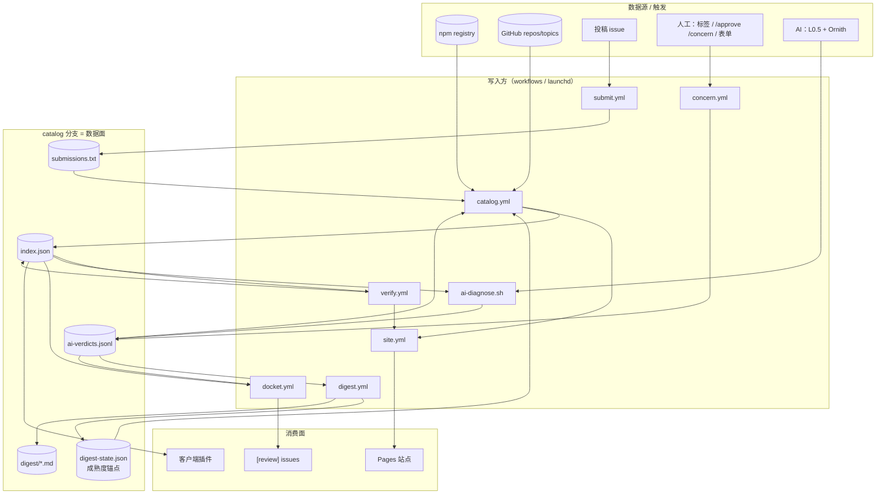
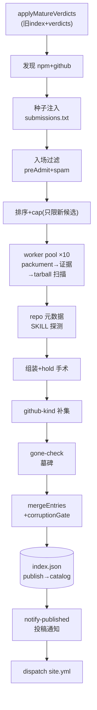
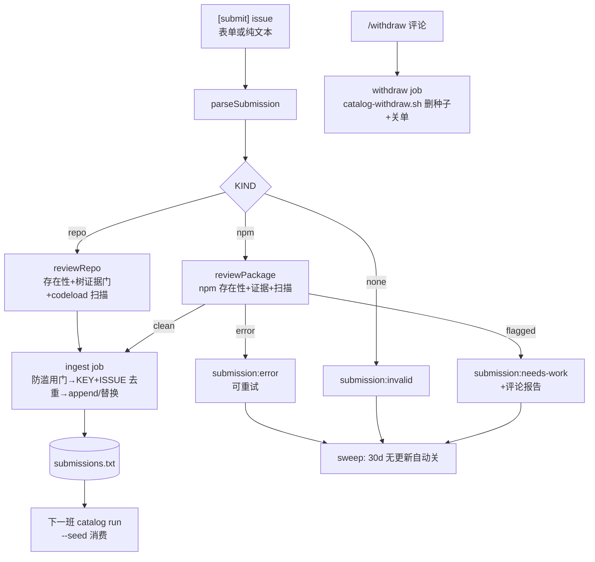
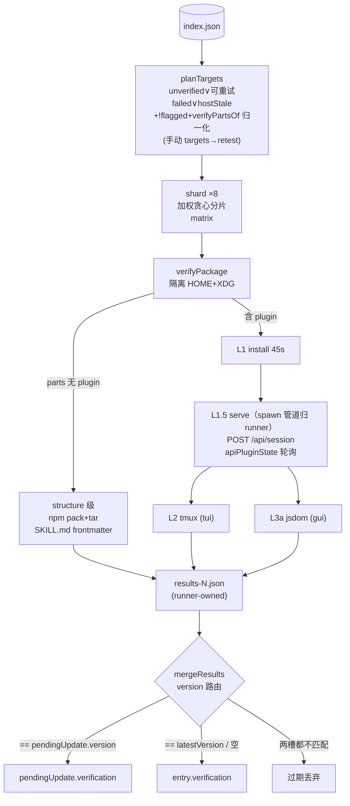
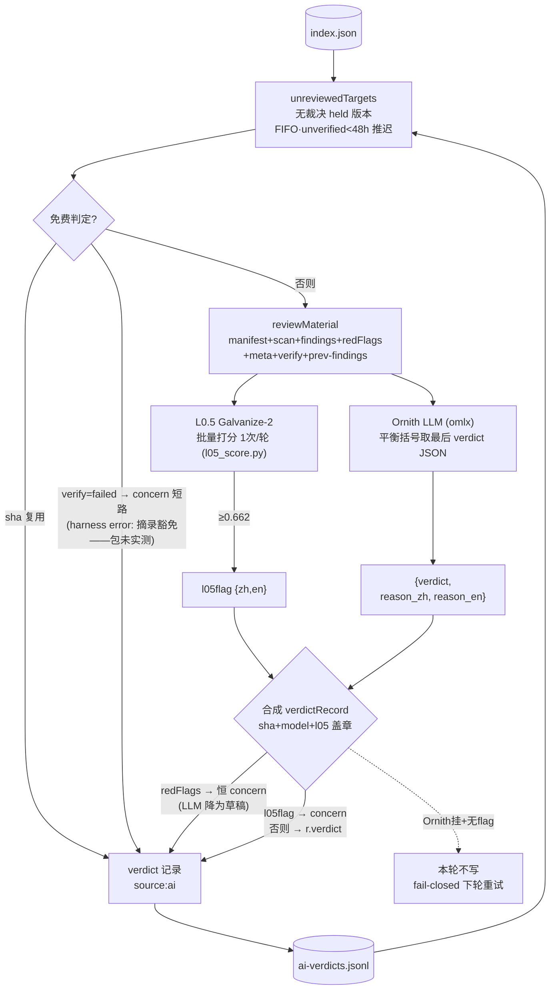
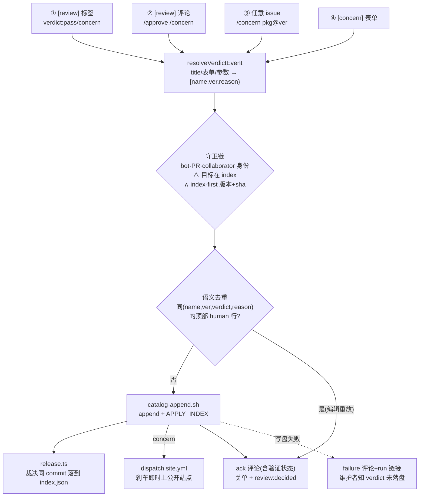
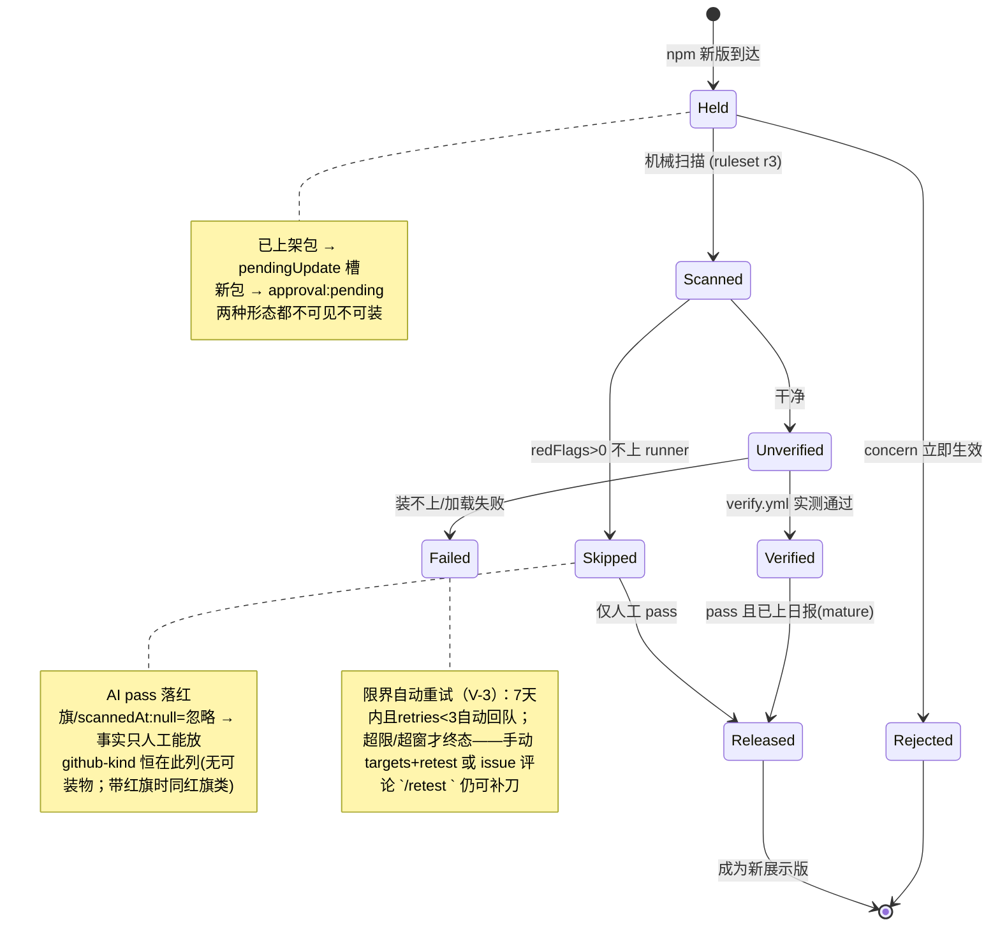
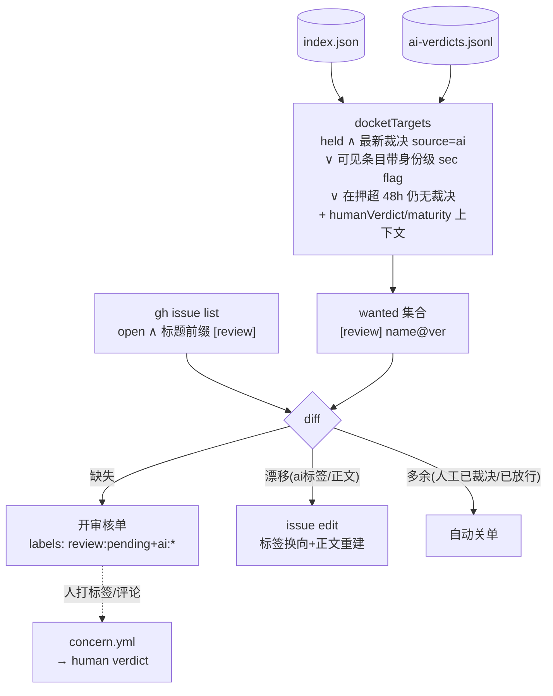
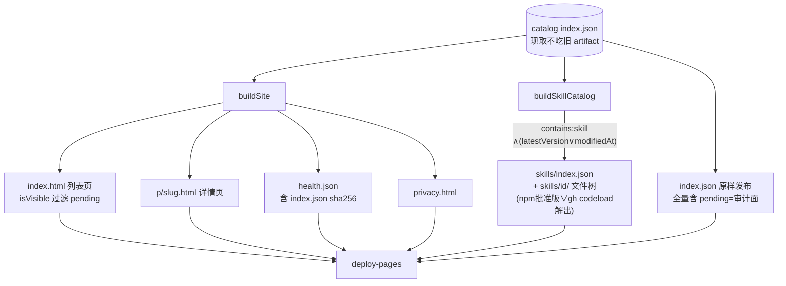
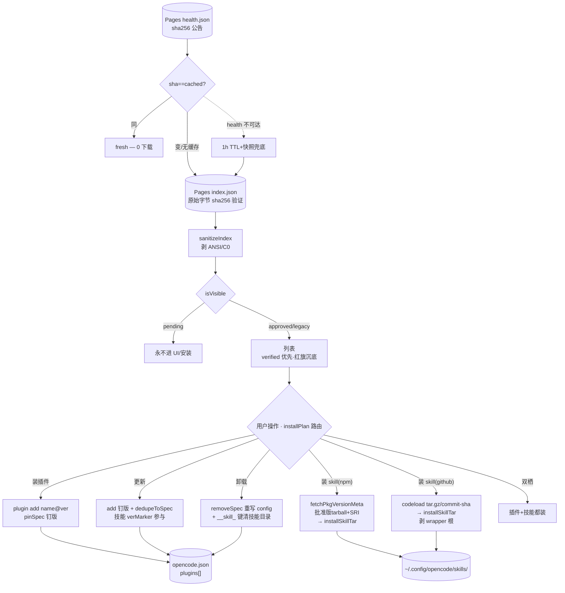

# 数据流全景（Data Flows）

> 本体 = `catalog` 分支上的数据文件；其它一切（站点、客户端、issue、workflow）都是它的投影或写入端。
> 核心不变量：**hold 是默认态**——任何版本必须先过机械红线、云验证、AI/人工裁决、日报公示，才会变成用户可见可装的版本。



> 读法：`catalog.yml` 是心脏——每班先把 verdicts+digest-state 吃进旧 index（`applyMatureVerdicts` 放行），再发现/扫描/合并写回；`verify.yml` 只写 verification 槽；裁决全部 append-only 进 jsonl；站点和客户端只是 index 的投影。

---

## 0. 数据面：catalog 分支文件清单

`catalog` 是**纯数据分支**（无 pipeline 源码），所有 writer 通过 `git worktree` + fetch/reset/merge/commit/push 重试循环写入。

| 文件 | 写入方 | 消费方 | 语义 |
|---|---|---|---|
| `index.json` | catalog.yml publish / verify.yml merge | 站点构建、客户端、diagnose、docket、verify plan、applyMatureVerdicts | 完整目录（含 pending——数据面全量，展示面各自过滤） |
| `ai-verdicts.jsonl` | diagnose、submit.yml verdict、concern.yml；digest.yml 班内 `verdicts-compact.ts` 压实 | run.ts、diagnose（判重）、docket、digest、site 详情页（裁决记录区块） | **append-only** 裁决流水；同 name@version 最新 `at` 胜出；详情页折叠透出最近 10 条 + 全量链接。压实只丢「被同键更新行取代且超保留窗（默认 180d）的 AI 行」——畸形行、human 行、每键最新行、窗口内行全保留，最新行集合不变 → 全消费端语义不变 |
| `submissions.txt` | submit.yml ingest、catalog.yml publish（notified/dead 回写+终态剪枝）、catalog-withdraw.sh | run.ts `--seed`、notify-published、submission-status | JSONL：一行一个 `{name,repo,type,category,desc:{en,...},version?,pkg?,issue,author?,at,notified,staleWarned?,dead?}`；`version`=被审版本（npm ver/repo resolvedSha（commit sha）），`at`=投稿时刻，`author`=issue 作者；`dead:true`=终态（30 天未落地），run.ts 跳过不再注入但**仍可在迟到上架时补发落地通知**（关单≠聋）；终态行（notified/dead）超 90 天宽限期被 publish 剪除；兼容旧格式：纯包名行、`github:owner/repo` 行 |
| `digest-state.json` | digest.yml / publish-digest.sh | run.ts | `{lastDigestAt, announced, day, dayAnnounced}` — pass 成熟看 `announced` 集合成员（上过日报的那行才算）；`announced` 按「每键最新裁决行 ∩ 公告候选（held 槽位/不在 index 的幽灵键/concern）」截断——已放行/永不需成熟的 pass 键也裁掉，不无限膨胀；**缺失/损坏**：消费端 announced=∅ 全冻结，生产端若已有日报历史则拒绝重渲（fail-closed，不全量公告） |
| `digest/YYYY-MM-DD.md` | digest.yml（publish-digest.sh 兜底） | 人（手机/网页） | 日报：新放行表 + held 积压 + concerns + 审核单链接。入口：[review] 审核单正文"预告面"链接、站点列表页 `digest` 链接、README——异议窗口必须找得到日报才有意义 |
| `blocklist.json` | 手工 | run.ts | `{names[],slugs[]}` 硬封禁 |
| `removed`（index 内字段） | run.ts tombstone / remerge 保留 | 站点/客户端（不渲染）、run.ts 重进对照 | 消失条目墓碑 `{slug,name,lastSource,createdAt?,disappearedAt,reason}`——`lastSource.repoId`/`createdAt` 存旧对象身份，同名再进时对照检出 repo 重建/名字复用；reason ∈ `npm-404|repo-404|filtered|capped|manual|unknown`，180 天保留期 |

### AiVerdict 记录（每行一个）

```json
{"name":"pkg","version":"1.2.3"|null,"verdict":"pass"|"concern",
 "reason":"中文理由","reasonEn":"english reason","at":"ISO",
 "source":"ai"|"human","sha":"sha512-…（可选）",
 "by":"github.actor（可选）","issue":123（可选）,
 "model":"llm-id（可选）","l05":{"model":"galvanize-2","score":0.71}}
```

- `version: null` = 两种键位：github-kind 条目（无版本概念，`name\0` 就是其槽位键），以及 npm 包的**包级裁决**（写方 `pkg@*` 解析而来——human concern 刹车全包各槽，更新的 human pass 解套）。
- `source` 由写入方盖章，模型永远写不出 `human`（包级 `@*` 同理只走人工通道）。
- `sha` = npm `dist.integrity`——**两通道都盖**：人工通道写盘时取（npm view），AI 诊断经 `makeIntegrityOf`（packument 每 name 一次取全版本）盖。同 sha 跨版本复用判词；同版本 sha 漂移=re-tag→自动重审（drifted 插队队首）。
- `by`/`issue` = 人工裁决溯源（裁决人+单号）；`model`/`l05` = AI 审计元数据（模型 id + L0.5 实得分——阈值/模型变了老判词可回放）。
- 键：`vkey(name,version)` = `name\0version`（NUL 分隔——`@` 会和 scoped 包名撞车）。
- `latestVerdicts` 逐行容错解析（坏行跳过）——diagnose/digest/docket 都走它。

### index.json 全字段（`src/schema.ts` PluginEntry）

```
CatalogIndex { version:'1', generatedAt, categories:{id→{en,zh?}}, plugins: PluginEntry[], removed: RemovedEntry[] }
```

| 字段 | 类型 | 语义 |
|---|---|---|
| `name` | string | npm 包名或 `owner/repo` |
| `slug` | string | 详情页 URL 键；repo 优先于包名（`slugOf`） |
| `aliases[]` | string[] | 同名不同源去重时挂的别名 |
| `type` | enum | `plugin|skill|agent|command|mcp|theme|bundle|rule`——schema 预留八值，但当前管线只产出 `plugin`/`skill` 两种（其余为死 schema 面）；分类器产出，默认 plugin |
| `contains[]` | enum? | `plugin|skill|mcp|command|agent|hook`——部件清单**显式且权威**（含 `[]`=无可装载荷；仅字段缺失才按 type 回落推导——三处消费方 verifyPartsOf/installPlan/entryParts 同规则）；npm 'plugin' 需 main/exports 入口，SKILL.md-only 包只领 'skill'；repo 探测 SKILL.md→'skill'（github-kind 也跑 hasSkillPath）。**随版本分槽**：hold 存在时钉在展示版，候选版的 parts 存 `pendingUpdate.contains`（含显式 []） |
| `features[]` | enum? | `server|tui|gui|rpc`——镜像官方 Host.resolve：`./server`或根入口(`./`.`main`/`index.*`)→server；`./tui`→tui；`./rpc`+有 server→rpc；`./gui-experimental`（无 exports 时根下 `gui-experimental.cjs/.js`）且目标 `.cjs/.js`→gui。**无保底 server**——GUI/TUI-only 包合法为空 |
| `discoveredVia[]` | enum[] | `npm-keyword|github-topic|code-search|topic-list|submission` |
| `source` | obj | `{kind:npm|github, id, repo?, repoId?, version?}`；repoId=GitHub 数字 id，repojacking 检测 |
| `description` | obj | `{en, zh?}`——优先级：`.opencode-market.json` > 投稿声明 > 自动 |
| `category[]` | string[] | 分类 id 列表 |
| `license` / `deprecated` / `deprecatedMessage` / `replacement` | — | npm 元数据；replacement 从 deprecated 文案解析 |
| `createdAt` / `modifiedAt` | string? | packument `time.created/modified`——`createdAt > firstSeenAt` ⇒ 名字被重新注册（`sec:name-reused`） |
| `maintainers[]` | string[] | npm 维护者账号——变化 → `sec:maintainer-changed` |
| `distTags` | obj | npm dist-tag 表——回滚检测（`sec:version-rollback`；versionCmp 含 prerelease 语义：release>自身预发布、数字标识<字母、等长前缀短者小，不可比→0=不算回退） |
| `firstSeenAt` | string | 首次收录时间（merge 跨版本保留） |
| `latestVersion` | string? | **展示版**——held 语义下钉在批准版；null=github-kind |
| `publishedAt` | string? | 展示版的发布时间 |
| `integrity` | string? | 展示版 `dist.integrity`（sha512-…）——装包逐字节校验公告值；github-kind 恒 null |
| `metrics` | obj | `{stars, npmDownloads30d, checkedAt}` |
| `capabilities` | obj | `{scannedAt, rulesetVersion?, findings[], redFlags[]}`；`scannedAt:null`=没扫过（≠扫过没发现） |
| `verification` | obj | `{status, level?, opencodeVersion?, verifiedAt?, runUrl?, logExcerpt≤2048, retries?}`；status ∈ `verified|failed|unverified|skipped`，level ∈ `install|load|interactive|render|structure`；`retries` 只在 failed 上计数（V-3 自动重试预算） |
| `compat` | obj | `{engines?, peer?}`——npm 侧取 packument 展示版的 `engines`/`peerDependencies`，github-kind 取 repo 根 package.json；**序列化为两条展示字符串**（engines `k v; …` ≤300 字符，peer `k@v, …` ≤500 字符）——packument 字段是攻击者可控文本，绝不原样入库 |
| `approval` | enum | `pending`=hold 默认 / `approved`=放行 / `legacy`=门禁前老条目（schema 默认 legacy 兼容旧 index） |
| `approvalReason` | string? | pending 的理由；放行时清空 |
| `pendingUpdate` | obj? | **被扣住的新版** `{version, capabilities, verification, features?, contains?, integrity?, publishedAt?, reason?, heldAt}` ——只存在于**非 pending** 条目（pending 条目的候选就是 `latestVersion` 本身）；`contains`=候选版的 parts、`integrity`=候选版的 tarball SRI（两者展示槽都钉在展示版，放行时随 pendingUpdate 提升） |

`RemovedEntry`（墓碑）：`{slug, name, lastSource?, disappearedAt, reason∈npm-404|filtered|capped|manual|unknown}`——180 天保留，URL 不 404 + 名字复用检测。

**判定语义速记**：
- `scannedAt:null` ≠ `findings:[]`——前者"没扫过"渲染 not scanned，后者"扫过无发现"渲染 scanned,no findings（都必须带"不等于安全"）
- `latestVersion:null`（github-kind）→ 无 npm 可装对象，但 tree 证据门+codeload tarball 静态扫描照常（扫描失败才 `scannedAt:null`）；不验(skipped)、AI 不审（verdict 键都建不出来）
- `pendingUpdate` 存在 ⇒ `latestVersion` 是**旧版**，`plugin add` 拿到的永远是它
- `approval==='pending'` 的条目**不应携带** `pendingUpdate`——刹车留下的残存 hold 在上游继续 bump 后是比候选更旧的版本，会遮蔽真实候选（mergeEntries 在合并边界丢弃，R-9）

---

## 1. 收录发现流 — `catalog.yml`（每天 2 班 UTC 03:17/11:00 + 手动 `force_publish`）

**实现**：`pipeline/run.ts::run`（主流程）· `discover/{npm,github,filter}.ts`（候选+入场过滤）· `fetch/{npm,github}.ts`（packument/tarball/repo 元数据）· `scan/{scan,rules}.ts`（tarball 静态扫描，`RULESET_VERSION='r4'`）· `publish/{merge,slug}.ts`（合并/去重/腐化门）· `remerge.ts`（重试合并）· `verdicts.ts::applyMatureVerdicts`（前置放行）· `notify-published.ts`（投稿通知）

`generate`（permissions:{} 零权限 + harden-runner egress 白名单（npm registry/api + github api/raw/codeload/objects/release-assets——它解析不可信 tarball 字节，出站只给必需域），跑不可信元数据；可选 `MARKET_PAT` 提额；**无并发锁**——只读 catalog 分支，不占写锁）→ `publish`（唯一 index writer：contents+issues+actions 写权限；`concurrency: catalog-branch` 只挂在写阶段——与 verify.yml、submit ingest、digest.yml 共享分支写锁，写者串行；末尾 dispatch site.yml，失败 10s 后重试一次——V-8 单 Pages 发布者）→ `alert`（失败查 `pipeline-alert` 既有 open issue，有则评论追加、无则新建——连败不轰炸）。blocklist.json 存在但损坏 → `generate` 拒跑（fail-closed：坏黑名单不等于没黑名单）；文件缺失才视为"未配置"；**名单条目加载即小写归一**——书写者用显示大小写也拦得住（查询侧 isBlockedAnyCase 同样小写化）。



逐步细节：

```
discoverNpm + discoverGithub（并行；npm keyword ×6（opencode-plugin/opencode/
  opencode-ai/opencode-skill/opencode-mcp/opencode-config）× ≤10 页 250/页，
  github topic ×7（前述 + opencode-theme/agent-skill）× ≤10 页 100/页、
  query 带 fork:false 服务端过滤；**关键词/主题循环有界并发**
  （npm ×3、gh ×2，mapPool——页级 15s 超时的长尾不再跨循环叠加，对
  registry/API 仍温和）；分页中途非 ok 或吃满页 → console.warn
  截断遥测——静默截断会被误读成"没有更多候选"）
  → + submissions.txt 种子注入（JSONL 声明式种子；纯名字；github:owner/repo；
      dead:true 行直接跳过——撤回/超期终态不再消耗扫描预算；
      **种子名字/repo 一律小写归一**——repo 身份键全链小写，投稿大小写
      漂移不再产生双条目；`--seed` 文件不存在 → warn 继续（与其他可选
      输入一致，本地误配不炸 run））
      npm 种子注入 npmCands（discoveredVia=submission）
      repo-only 种子 → ghCands → 走 github-kind 路径——注入的候选元数据是
        伪造的（id:null、stars:0、archived:false），**ghWorker 在证据门前
        先 fetchRepoMeta 回填**：repoId（repojack 对照）、createdAt（墓碑
        对照）、pushedAt（增量复用）、canonical fullName（显示大小写锚定）、
        真 archived（伪造的 false 曾让已归档投稿绕过 preAdmit）；
        meta 返回 archived → 直接拒收
      seed 元数据先消毒：desc 每语种 ≤4000 字符、category ≤8 项 ×80 字符、
        version/pkg/issue/author 限长、非字符串值剔除（表单可改 → 按
        marketMeta 同款上限处理）；version=被审版本（npm ver / repo resolvedSha（commit sha））
      repo 种子漂移检测：treeRes.sha ≠ seed.version →
        finding `sec:repo-moved-since-review`（审查后仓库已变——github-kind
        无版本槽，裁决无法钉此，finding 是持久信号）
  → 入场过滤：preAdmit(archived)——只作用 GitHub 侧（npm 候选无 archived/fork 信号）
      + looksLikeTemplateSpam（owner 级 ≥6 近同名；**npm/gh 两侧同跑**——
        gh 侧 owner 下连发近同名 repo 是同一指纹的另一面；名单上日志可审计）
  → 确定性排序 name-asc → cap（--max，默认 500；workflow 传 2000）：
      **只限"新候选"数量**——已在 index 里的条目 + 投稿 seed 全部豁免
      （旧语义把 cap 当目录总量：活跃条目逼近上限时字母序靠后的老条目
      会被系统性逐出并批量立 'capped' 墓碑；现在超限的新候选只是本轮
      不索引，不产生墓碑、下轮仍有机会进）
      seed 再前排：投稿 seed 在队列内被稳定地提到最前——人工点名的包
      不该在 worker 时间预算下饿死队尾（与 verify 侧投稿优先同策略）
  → 逐候选 worker（池化 10 并发——先到先得不再按批设障，
      慢候选不再拖垮整个批次屏障；entries 追加即发布点）:
      更新检测三条路（本轮 vs 旧 index）：
        ① 版本变了（pk.version ≠ latestVersion）→ 走全流程，hold 进 pendingUpdate；
           R-1 pin-until-terminal：已有在押 hold → 整体带过 pendingUpdate
           （verification/heldAt/reason/capabilities 全保——旧行为是换版清零，
           verify 排队/AI 已判/人工在看的版本被悄悄替换→热点包永久饥饿；
           ruleset 升级也不再团灭在飞 hold——但会**就地重扫在押 tarball**
           （packument.tarballOf 取 held 版 URL，capabilities 换新，
           verification/heldAt 不动；新红旗经 merge 的 skipped 不变量降级），
           pin 路径同时**全量刷 marketMeta/desc/category/license/downloads**
           （hold 期间作者改 .opencode-market.json 不再冻结到放行）并对
           展示槽跑 repo-dir-traversal/repo-mismatch/declared-mismatch
           身份级检查——与新条目同口径。
           槽位释放（重定向到 pk.latest）仅当在押版达终态：最新裁决 concern，
           或 failed 且 retryable 耗尽；pk.latest 上有**人工**裁决时主动跳车
        ② 版本同 + ruleset 同 → 增量短路整体复用；**seed 候选先补版本**——
           投稿行不带 version，先拉一份 abbreviated packument（install-v1）
           拿 dist-tags.latest 再进同版比较（否则种子存活 ~90d 内每班都全量
           重扫）；ruleset 比较读
           **cand.version 实际占据的槽位**（PU 版→PU caps，展示版→展示 caps，
           都不匹配→null 不短路——旧实现的 `PU ?? 展示` 跨槽回退把
           "PU 扫描失败无 rulesetVersion"误判成同规则，失败扫描永久冻结）。
           短路前仍过 isBlocked(name,slug) 双键检查。metrics.checkedAt >7d 或
           **缺 integrity** → refreshMeta 重拉 packument/stars/downloads 并回填
           SRI（三探针并行）；否则零请求
        ③ 旧有条目候选里没有 → gone-check 探活（见下）
      fetchPackument → hasPluginEvidence：specific（opencode keyword /
        readme-install 句）∧ artifact（main/exports 入口 / readme-install）——
        仅 keyword 不算数，仅入口也不算数（任意 npm 包都有入口）。
        **已批准条目证据回退**（latest 版作者删 keyword/改 main）→ 不连坐
        展示版：保留 + `sec:evidence-regressed@<latest>` finding；若在押
        hold 钉在该版则解绑交回 merge 重估；pending 条目照常 'filtered' 立碑
      → fetchTarball+scanTarball → capabilities{findings,redFlags,rulesetVersion}
        （压缩报文按字节流上限 64MB——content-length 可缺可谎，流式计数
        超限即断；解压累计 >512MB 即中止=防 zip bomb；**成员数 >200k 即中止**；
        **fetch 手动跟随重定向**——入口 https 校验对 redirect 无效，每一跳
        重新 parse+校验 https、无 Location/超 5 跳即拒（防 registry/mirror
        降级 http 或指内网）；媒体文件不缓冲（二进制豁免规则不需要字节体），
        非文本只留 8KB isBinary 窗口；findings>500 截断 + 'scan-capped' 标记行；
        rules 含 lifecycle-script 全生命周期与 literal-ip 私网段排除；
        **obfuscation（eval/new Function/长 hex）限定代码扩展名** `.js/.ts/.sh`
        等——README/AGENTS.md 里的 eval 示例不再误升高危（credential-read
        同口径）；**已知良性二进制载荷降级 medium**（.wasm/.node/.dll/.so/
        .dylib/.exe/.bin/.dat——tree-sitter/sqlite-wasm/esbuild 插件常态携带，
        high→verification skipped→每版都要人工 pass 的 FP 摊薄红旗信号；
        仍是 finding，未豁免成无记录））
        redFlags>0 → verification={status:'skipped'}（高危信号没跑）；
        npm 侧 'too large' 同样盖 rulesetVersion 记忆化（确定性失败不重取，
        版本 bump 自带新槽自然重试）；其余扫描失败留 scannedAt:null 每轮重试
      fetchRepoMeta(repoId/stars)+fetchDownloads30d+fetchMarketMeta **并行**
      （repo 关联来自 `normalizeRepoUrl`——git+/git@/ssh/monorepo directory
        + npm `github:owner/repo` 缩写都解析为同一 owner/repo 身份；
        repo 根 .opencode-market.json 作者声明；死代码 fetchRepoTree 已删——
        skill 检测用 tarball scanFiles，树调用曾只为一条截断告警烧 API 配额）
      repo package.json ≠ 包名 → finding 'sec:repo-mismatch:<actual>'；
      `repository.directory` 含 `..`/`.` → `sec:repo-dir-traversal`（目录
      字段攻击者可控，穿越路径不取内容只记 finding）；投稿声明 repo ≠
      packument repo → `sec:repo-declared-mismatch:<declared>`（比对全小写）
      墓碑对照（P1-5）：同名条目曾立碑 → 比 lastSource.repoId/createdAt——
        repoId 不同 → `sec:repo-recreated`；pkg createdAt 更新 → `sec:name-reused`
        （墓碑存 createdAt 就是为这一刻：名字复用 ≠ 对象复活）
      字段优先级：marketMeta > 投稿声明 > 自动派生（description/category）；
      **category 白名单**：声明值过 catId 归一并限 CAT_NAMES 税目内——
        任意字符串不进条目、不铸全局字典；识别不出退回 classify 分类器
      contains=按产物发牌：npm 'plugin' 需 main/exports 入口（opencode 实际
        加载的东西）；SKILL.md-only 包只领 'skill'（走 skill 验证链，不再
        替不存在的 plugin 失败安装）；空数组=无可装载荷，显式记录而非省略；
        **投稿声明 type='skill' 不再剥离真实入口的 plugin 部件**——声明设
        徽章不设验证级别，带 main/exports 的 "skill 包" 仍走 install+load 链
      detectFeatures({exports, main, files:tarball 路径})——镜像官方 Host.resolve
      （server=./server|根入口；gui=./gui-experimental 仅 .cjs/.js；rpc 需 server 同在）
      组装 entry：approval='pending', approvalReason='awaiting-review'；
      compat 填展示版 engines/peerDependencies 序列化值（见 §表 compat 行）
      hold 手术（见 §7）
  → github-kind 补集（coveredRepos 去重，**全小写比较**——GitHub
      fullName 带显示大小写，小写变体不得穿透去重；**既有 gh 条目豁免
      覆盖过滤**：它是该 repo 的正规记录，照常处理保持 metrics/scan 新鲜
      ——slug 去重在发布层把 npm/gh 两视图并成一条；blocklist 同走小写
      比较 isBlockedAnyCase——名单里的小写 owner/repo 拦得住显示大小写）：
      证据门 hasRepoEvidence(tree 路径+topics)：OpenCode 专属信号
        （.opencode/、opencode.json[c]、opencode-plugin/opencode-skill topic）
        + 可装产物（.opencode plugin/skill 路径、SKILL.md、package.json）
        双缺即拒。**裸 SKILL.md 只算产物、不算归属**（纯 Claude 技能仓库
        不该混进 OpenCode 目录）；通用 'opencode'/'agent-skill' topic 只是
        关联不是产物声明
      tree/tarball 固定走 HEAD ref——search 索引的 defaultBranch 可能过期
        （分支改名后具名 ref 404 会误杀）；codeload tarball 过同一套
        scanTarball，归档根前缀 strip
      暂态 tree error/rate-limited → 保留旧条目（ghStats.treeTransient）；
        tree not-found（404/409）→ rejectedGh 记录正向拒绝 → gone-check 定碑；
        **tree truncated → ghStats.truncated 单列计数**（API 截了深层路径，
        数据不全 ≠ 拒绝依据）；准入条目在残缺树上建成 → `sec:tree-truncated`
        finding 入槽（深层 .opencode/ 可能没被看到）
      repo 根 package.json 探测**先看 tree 再取**——tree 已告知存在性，
        `fetchRepoPackage`/`fetchRepoPackageName` 只对存在路径发请求
        （省一次注定 404 的 raw.githubusercontent 往返）；取回的
        engines/peerDependencies 填 compat（npm 侧同口径序列化）
      增量复用：pushedAt+ruleset 不变 → 沿用 scan 但**刷新 metrics**
        （stars 随搜索结果候选更新——字节没变不代表热度没变，此前 stars
        永久冻结）；复用同样过 isBlockedAnyCase 双键；gh 复用计入 reusedNames
        扫描失败留 scannedAt:null，'too large' 盖 rulesetVersion 记忆化
        （pushedAt 变了才重试），timeout 每轮重试
      type：投稿声明优先；纯 skill 证据（有 SKILL.md、无根 package.json、
        无 .opencode plugin 路径——**任意深度**，monorepo 子目录同样算数）
        → 'skill'，否则 'plugin'
      条目命名：既有条目保持已存 name（显示大小写改名不分叉身份）；新条目
        用 fetchRepoMeta 的 canonical fullName；slug 恒小写
      latestVersion:null、verification:{status:'skipped'}、
      approval 继承 ghPrev（人工裁决过的状态跨轮保留）
      ghStats 审计行：admitted/reused/npm-covered/**blocked**/seed-archived/
        evidence-rejected/transient-kept/empty/truncated-tree/
        scan-failed(oversize)
        ——covered 只算 npm 认领，blocklist 拦截单列不再混入
  → gone-check：旧条目消失 → 先分"缺席类型"再探活：
      fetch 错误(429/5xx/网络) → 保留旧条目不打墓碑（瞬时失败≠消失）
      **探活 ok 且本轮无正向拒绝记录 → 保留**（rejectedNpm/rejectedGh 集合：
      被证据门拒才算 'filtered'——分页/排序窗口/搜索瞬断导致的"没搜到"
      不构成拒绝证据，活着的条目不再被立错碑）
      npm 探活用**缩写 packument**（install-v1——只要存在性+dist.tarball，
      不拉全文档）
      **ruleset 周期重扫**（保留路径顺带）：槽位 rulesetVersion ≠ 当前 →
      有界补扫（每轮 ≤20 个条目，npm 走 tarballOf、gh 走 HEAD tree+
      codeload）——掉出发现窗口的老条目不会永远被退役规则审判；
      失败保持可重试（undefined ruleset 恒旧），oversize 印记豁免
      **integrity 漂移顺带检查**（缩写 packument 已带 integrityOf，零成本）：
      展示版锚点 ≠ registry 当前 sha → 冻结旧锚 + `sec:integrity-drift`
      redFlag；在押槽同规则但重锚到当次扫描实际覆盖的字节。掉出发现面的
      条目永远到不了 refreshMeta/pin 路径——本 sweep 是其 re-tag 唯一检出点
      not-found → npm-404/repo-404；cappedOut → capped（防御性残留分支——
      新 cap 语义下老条目不会再被截断）；blocklist → manual（isBlockedAnyCase
      小写双键）；正向拒绝 → filtered；其它 → unknown
      墓碑记录加 createdAt（包/repo 生辰）——供 P1-5 同名再进对照
  → buildIndex = mergeEntries（双层缓存+trustFlags+skipped 不变量）
                + dedupeSlugs + corruptionGate（空/掉幅>20% 拒发；
                人工逃生门：workflow_dispatch `force_publish` → `--force-gate`
                绕过拒发——大规模合理下架/上游改名潮时不再只能靠改代码解锁，
                stderr 记录 override）
  → index.json → publish job 写 catalog
     （worktree 上 fetch→reset→remerge(ours vs remote)→release.ts 追赶应用
       →commit→push，4 次重试；
       commit 前先 `git diff --cached --quiet` 预判——区分"真无变更"和
       commit 失败，杜绝 `commit || echo no-changes` 式假成功；
       remerge 保护 remote 侧 verify-merge 已写入的 verification/removed/identity，
       对 categories 字典/条目 category 值做 catId 归一，且 remote 已放行的
       在押版本不会复活 hold（R-8：采纳 remote 展示态）；
       remerge 后跑 `release.ts`（applyMatureVerdicts 幂等）——generate→publish
       窗口内落地的人工刹车/新裁决/digest 公示按**最新 verdicts+digest-state**
       重新推导，不被本班 stale 快照覆盖（R-10 窗口闭合））
  → notify-published：approval!=='pending' 的投稿 issue 评论+关闭（issues 按
     issue 号去重——一单一评），submissions.txt 回写 notified:true——
     **先重试推送标记（3 次）再发评论**；workflow 侧以 flagPushed 门控
     整个通知块——推送失败即跳过评论/关闭（宁可下轮重发，不丢
     "已通知"事实，也不留"标了没评论"的僵尸）；终态行（dead/notified）
     超 90 天宽限期从文件中剪除（git 历史是审计，文件不无限增长）；
     `at` 超 14 天仍未落地（缺席或 pending）→ 一次性 staleWarned 评论
     （不关单——管线侧延迟不等于作者放弃）；
     `at` 超 30 天仍未落地 → dead:true 终态 + 关单（与 submit sweep 同视界，
     run.ts 跳过 dead 种子不再消耗扫描预算）；**dead 行不豁免落地通知**——
     关单≠聋：条目之后经别条路放行上架时仍补发一次落地评论并标
     notified（投稿人不再被告知"失败了"实则已上架）
  → submission-status：为每个仍有活种子的投稿 issue 维护一条
     edit-in-place 状态评论（排队中/评审中/已上架）——进度可见
```

**前置步骤（顺序负载）**：`generate` 开头先把 catalog 分支取下来，跑 `applyMatureVerdicts(old, verdicts, digestState)`——成熟裁决先作用于旧 index，再做发现比对（否则高频包的 pendingUpdate 会被下一班 npm bump 覆盖，永远饥饿）。旧 index 缺失/损坏 → 直接拒跑（WF-1，不盲跑）。

**mergeEntries 双层语义**：
- 身份层（name 匹配）：firstSeenAt/slug/aliases/discoveredVia 跨版本保留
- 版本层（name@version+host 匹配）：capabilities/verification 按版本槽恢复；
  ruleset 相同恢复 remote caps 时 findings/redFlags **取并集**——本轮
  worker 新计算的信号（证据回退标记者）不能被 remote 槽整体覆盖；
- approval 层：`e.approval ?? prev?.approval ?? 'pending'`（worker 手术优先；github-kind/复用条目靠 prev）
- pendingUpdate 层：同版本→保留 remote 侧 verification 槽（verify-merge 可能刚写过）；remote 持有的我们没见过的版本→保留 hold（除非我们刚放行同版）；**合并结果为 pending → pu 一律丢弃**（pending 条目的候选就是 latestVersion，残存 hold 只会是更旧版本——刹车遗留的 pending+pu 曾把真实候选永久遮蔽，R-9）
- trustFlags（sec:name-reused/repo-recreated/version-rollback/maintainer-changed/sec-delta:*）：身份级 flag→展示槽；`sec-delta:*`→候选槽（pendingUpdate.capabilities 或自身）。强规则（lifecycle-script/prepare-script）→redFlags，其余新规则→findings
- category 白名单：buildIndex/remerge 双边过 `catId→CAT_NAMES` 过滤——
  非税目 id 同时从条目 category 和 categories 字典剔除（防注入面收口）
- 不变量：`redFlags>0 且 verified|unverified → 'skipped'`；`failed` 保留真结果不被改写

---

## 2. 投稿流 — `submit.yml`

**实现**：`pipeline/submission.ts::parseSubmission/seedLine`（issue 解析+种子行）· `pipeline/review.ts::reviewPackage/reviewRepo/verdict/repoVerdict/renderReview/renderRepoReview`（机械审+报告）· workflow 内嵌 node 脚本（ingest 去重/verdict 写回/sweep）



逐步细节：

```
issue(opened/edited/labeled) 且 (有 submission 标签 或 [submit] 标题)
  或 issue_comment(created) 且 issue 有 submission:{needs-work,invalid,error} 标签
  或 issue_comment(created) /withdraw（作者或 collaborator）→ withdraw job
  → review job（permissions:{} 零权限——跑攻击者可控的 tarball；
      concurrency: sub-review-N，cancel-in-progress——重审幂等可丢弃）
      parseSubmission（issue-form ### 段 + freeform 兜底；repo 可无 name；
        descEn 取整段折叠空白不截断；descOther 的 en: 行不覆盖专用字段；
        种子行带 author=issue 作者）
      KIND: npm→reviewPackage；repo→reviewRepo；none→invalid
      机械审查：npm=存在性/插件证据/静态扫描；repo=仓库存在性+树证据门
        （与目录收录同一 hasRepoEvidence）+codeload tarball 扫描
        → verdict 四态：clean|flagged|invalid|**error**
        （registry/API 瞬断 → error 可重试，绝不误报"不存在"；
        扫描失败 scanned:false → flagged——"没扫到"≠安全；
        证据门与目录同函数 ev.ok——keyword 无产物不再 clean）
        报告记录被审版本（npm reviewedVersion/repo resolvedSha（commit sha））+findings 折叠进 <details>；
        repo 报告证据不通过时给独立的「⚠️ 证据不足」段（与 npm 侧同构——
        缺的专属信号 .opencode/ opencode.json opencode-* topic 直说，
        并声明目录端同样拒收）
      守卫：非作者触发重审 → flagged（collaborator 催审豁免——他们本身就是人工复核）；
        issue>24h 且包/仓在 issue 后 **24h 窗口内**注册 → flagged（防蹲名；
        间隔更长的慢速作者发布不再永久误伤）
      verdict 取报告中 LAST 'verdict:' 注释标记（防包内文本注入伪造）
      产出 review.md artifact + verdict output（不直接写 issue——N-6 拆权）
  → report job（permissions: issues:write，needs review）：
      评论报告（含 verdict 对应的下一步指引页脚）+
      打 submission:{approved|needs-work|invalid|error} 标签
      ⚠️ 机械通过只是"入场"，不是上架
  → ingest job（clean 时，concurrency: catalog-branch）：
      防滥用门：作者 open 投稿数 ≥5 → 撤 approved 标签改 needs-work + 说明评论，不入队
      catalog-append.sh KEY+ISSUE 模式→ 同 issue 重审**替换**旧种子行
      （一单一行，新 reviewedVersion 生效；不同 issue 同包装仍走 KEY+LIVE 去重——
      **KEY 比较大小写不敏感**（`Owner/Repo` 投稿与 `owner/repo` 候选是同一
      身份）；墓碑/未落地条目可重新投稿，removed[] 不算 in-flight）
  → verdict job（人工通道，见 §5）
  → review-alert job（needs review/report/ingest，failure()）：
      审查/入库基础设施失败时在 issue 留"可能未完成"评论+run 链接——
      失败不再静默挂起（sweep 只管裁决标签单）
  → sweep job（每日 UTC 05:23）：invalid/needs-work/error 30 天无更新自动关
      （--limit 1000，队列再大最老单也扫得到）
```

---

## 3. 验证流 — `verify.yml`（每天 2 班 UTC 04:47/16:47 + `targets` 手动指定）

**实现**：`verify/plan.ts::verifyTargetOf/verifyPartsOf/planTargets/shard`（目标+parts 归一化+加权分片）· `verify/verify.ts::verifyPackage/checkSkillStructure/xdgEnv/writeDummyProvider/loadedSignal`（L1/L1.5 沙箱验证 + 技能载荷结构检查）· `verify/tui.ts::checkTui/judgeTuiPane`（L2 tmux）· `verify/gui.ts::findGuiBundle/checkGuiBundle`（L3a jsdom 渲染）· `verify/merge.ts::mergeResults`（版本路由写槽）



逐步细节：

```
plan job（contents:read + harden-runner egress 白名单——不跑不可信代码但
      拉 catalog 数据，同 verify 分片的出站姿态堵住这个静默缺口）：
      if 闸：schedule 只在已知数据面仓跑（白名单：awesome-market org
        规划 prod + terry2010 fork 现 prod）——其他 fork 的 cron 会白烧
        2×N×35min 分片机时并写 dev catalog；手动 dispatch 处处可跑
      catalog 分支取 index——分支存在但 index 读不出 → exit 1 硬失败
        （fetch 故障不等于"无可验目标"，绿过空跑会静默饿一天验证）；
        分支真不存在（首跑）才是合法空计划
      → targets 输入非空则按包名收窄 index
      → planTargets（retest 开关见下；cap 默认 48/班，dispatch 输入
        `cap` → VERIFY_CAP 可调）
        选序 = 三级 + FIFO：submission 层（discoveredVia 含 'submission'）→
        **staleHost 层**（verified 但 opencodeVersion ≠ 当前 runner 版本——
        宿主升级后旧结论不等价，按陈旧窗口重验而非永久有效）→ 常规层；
        层内按 candidateHeldAt（在押版本 heldAt→capabilities.scannedAt→
        firstSeenAt，与 diagnose 消费同一时钟）最老优先——index 序是
        name-asc，不加这个排序深积压会把字母序靠后的包永久饿死；
        cap 不变，积压跨班排空——一天取不完就取两三天；手动 targets= 仍可插队
        出队语义：verified 永久离开；failed 限界自动重试（V-3）——
        近 7 天失败且 retries<3 自动回队（merge 写槽时累加 retries），
        超限/超窗才成终态
        排队期间 npm 发新版 → pendingUpdate 换版，轮到验当前版；
        版本错配的结果 merge 时过期丢弃，不写错槽
        parts 归一化（verifyPartsOf）：hold 在押时取 pendingUpdate.contains
        （候选版 parts——entry.contains 已钉展示版）；无 holds 字段的旧
        pendingUpdate 回落 entry.contains（旧语义下它仍是候选版的）；
        都没有的 legacy 条目按 type 补形——type=skill → ['skill']
        （声明技能、载荷是 SKILL.md 而非可加载插件），其余 → ['plugin']。
        既无 plugin 也无 skill 的条目（mcp/command/agent 尚无结构检查）
        不排队——没有可诚实验证的载荷
        → shard 加权贪心 8/组——顺序切片会把 submission 优先层和
          feature 重的目标全挤进头部片；现按 1+features 数+双栖
          plugin∧skill 附加 1（结构检查是第二趟 npm pack+tar）估分钟数
          贪心摊到最轻的片（等权时退化为轮转，给定输入确定性）
        → matrix 片索引写 /tmp/plan-matrix.json（文件输出，不再 tail -1
          刮 stdout 末行——将来加日志行不会悄悄毁掉片表）
      手动 targets= 逗号包名 → 定向验证 + --retest（failed/verified 可重验，
        越过 retries 上限的手动补刀）；收窄后零命中 → plan 步 exit 1
        红失败（打错名不能绿过空跑，让操作者以为验过了）；
        retest 独立 boolean input 同效但不收窄集合——注意 cap 仍生效
        （默认 48，全量重验要 retest+调大 cap 一起）；
        维护者侧 `/retest <pkg>[@ver]` issue 评论（concern.yml retest job）
        是面向 failed 终态的同一通道——自动重试预算（3 次/7 天）耗尽后
        唯一能再实测的入口
verify job（permissions:{} 零权限 + harden-runner egress 白名单
      registry/api.npmjs.org, api.github.com, github.com, *.githubusercontent.com；
      整 job if: shards != '[]'——空计划全跳；timeout-minutes 35——
      8 目标串行 ≈30min 上限（V-4 加宽 load 窗口后旧的 18min/12 目标
      账已过期，片宽 12→8 + 超时 30→35 留余量））：
      npm i -g @opencode/cli@2.2.5（与 OPENCODE_VERSION 常量钉齐——缓存键含宿主版本；
        测试断言 workflow 字面量与常量同步，钉漂移当场红）
      ocVersion 每片探测一次（verifyShard 入口，runner 侧——--version
        不执行插件代码；探到版本随 opts 分发给全部目标，不再每包一次）
      verifyPackage(name@version)：
        parts 路由：无 'plugin' 部件 → checkSkillStructure（npm pack 钉版
          包——pacote 顺带校 dist.integrity——+ tar 列表找 SKILL.md +
          提取验证 frontmatter 含 name:；与收录门 hasSkillPath 同一"技能
          文件"口径，tarball 多一层 package/ 前缀）。结果 level='structure'
          ——诚实语义"字节可装、清单可解析，但没有代码跑过"；
          plugin add/serve 整条链根本不跑——否则正当的技能包会被
          apiPluginState 误判 failed
        L1 install: 隔离 HOME+XDG_CONFIG/DATA/CACHE → `opencode plugin add name@ver`（45s；
          失败摘录带一句"沙箱出站是白名单——拉取失败可能是网络策略而非包坏"）
          沙箱 home 两级权属：父目录 runner-owned 0711（nobody 可穿越不可写，
            护住 runner-owned 证据区），<home>/u 由 runner mkdir 后
            `sudo -n chown` 移交 nobody——曾按 nobody mkdir 实现，真 runner
            上 EACCES（0711 不可写正是设计），e2e 抓到；
            verifyShard 入口先跑**深度沙箱探针**：sudo -n -u nobody true
            之外再真演一遍 setupSandbox+`sudo -u nobody touch` 写测试——
            探针挂=基础设施坏，整片硬失败（绝不降级为同 uid 跑不可信代码）；
            此前 sudo 通但 chown/mkdir 链断的盲区正是 2025-11-04 批量假
            failed 的成因
        L1.5 load: writeDummyProvider（合并写！不抹 plugin add 的 plugins[]）
                   → `opencode serve` 经 spawn 起后台（沙箱模式下唯一过
                     nobody wrapper 的部分）——stdout/stderr 管道直接回
                     runner 进程，等 "server listening"+密码行
                   → GET /api/plugin + GET+POST /api/session（curl 全部
                     runner 侧跑；2.2.5 懒加载：GET 不触发，POST session 才 load）
                   → 轮询 GET /api/plugin ≤20s 看 apiPluginState：
                     active→pass / failed→带 reason fail（apiLoaded/apiFailed）
                     ——canary 日志匹配降为诊断信息，不再当判定信号
                   证据面边界：serve.out/plugins.json 全部落在 runner-owned
                     home——曾存在的伪造洞（nobody 可写 serve.out 预种
                     listening 行、间隔重写 plugins.json）已封：PORT/PW 从
                     runner 持有的管道字节提取，apiPluginState 解析的文件
                     nobody 物理够不着；判定路径无插件可写环节
                   清理：finally SIGTERM + 沙箱下 sudo -u nobody pkill -f
                     'opencode serve'（sudo 链会留 nobody 孤儿，同 uid 清扫）
        L2 interactive: features 含 tui → tmux 冒烟（checkTui）
        L3a render: features 含 gui → findGuiBundle + checkGuiBundle（jsdom+vm 真渲染；
          沙箱模式下移到 `npx tsx gui.ts` nobody 子进程——vm 逃逸只拿 nobody）
        双栖补验：parts 同时含 plugin+skill → 插件链过后再跑一遍
          checkSkillStructure——技能半边载荷坏（SKILL.md 缺/frontmatter 残）
          → failed，level 记插件链最深通过级，excerpt 注明"plugin half passed"
        → VerifyResult{name,version,status,level,opencodeVersion,verifiedAt,logExcerpt≤2048,harness?}
          （logExcerpt 来源 readLog 改尾部 256KB 读——插件可控的日志文件
          写多大都不能把 runner 顶 OOM；harness=true=分片在包检查外围抛错
          ——基础设施信号不是判词，merge 整条丢弃）
          基础设施熔断：verifyPackage 对包问题一律 RETURN failed——throw
          意味着 harness 自身坏了（fs/sudo/spawn）；连续 3 个 throw 即中止
          本片剩余目标（留 unverified 下轮再验），不再把整片基础设施故障
          写成 N 条包级 failed
          level 双关语义：failed=失败的阶段；verified=最深通过的阶段
          （带 feature 的目标会过 'load' 进 interactive/render）
        → results-<shard>.json artifact（7 天；逐目标增量 flush——片崩只丢
          在验目标，N-10）
merge job（`if: always()`——分片挂了已落地的 results 照样合，不等整矩阵
      成功（N-10）；`concurrency: catalog-branch` 只挂本 job——分片 ~30min
      相位零写入，工作流级锁会白饿 catalog/digest/submit 半个钟；
      contents+actions 写；actions 只为 dispatch site.yml——V-8 单发布者）：
      artifact 边界校验：results-*.json 逐条过 VerifyResultFile zod
        （status/level 枚举 + 必填元数据），畸形行 warn+丢弃——坏 artifact
        不能裸进 index 把下游所有 CatalogIndex.parse 打成硬抛；
        合并输出再 CatalogIndex.parse 一次才落盘（坏结果产不出非法 index）
      skipIfFlagged 归一（与 mergeEntries 同规则）：plan→merge 窗口内槽位
        新长红旗时 verified 结果改写 skipped——不能展示"实测通过"给
        没真测过的字节；failed 保留真结果（它本来就是实测结论）
      mergeResults 按 version 路由写槽
      r.version == pendingUpdate.version → 写 pendingUpdate.verification
      r.version == latestVersion → 写 entry.verification；
        版本-less 旧结果仅在**无 pendingUpdate** 时落展示槽——有在押时
        它说不清测的是哪一版，宁可丢也不写错槽
      两槽都不匹配 → 过期结果丢弃（npm 中途又发新版）
      harness:true 行（分片抛错标记）整条丢弃不写槽——基础设施故障
        不是包判词：不烧 retries、不进 diagnose 的 verify-failed concern
        短路（isHarnessFailure 另对存量 'harness error:' 摘录同样豁免）
      RUN_URL env → verification.runUrl（失败详情页回链）
      写回 catalog（worktree 先 remove --force 清残留再加——上次 run 崩溃
        留下的 /tmp/cat 会让裸 add 连 fallback 一起挂；
        fetch→reset→merge→add→commit→push，4 次重试——
        每轮对新鲜远端头重新 merge，不推陈旧产物；
        staged-diff 预检区分"无事可提→ok 跳出"与"commit 真失败→重试"，
        `commit || echo` 那类遮羞布会让提交失败被空 push 成功掩盖、
        结果静默丢失——同 C-2 修法）
      每轮重试 merge 后跑 `release.ts`（G1）——已成熟 pass 的验证槽一落地
        即时放行、中途到达的人工刹车即时生效，不必等下一班 catalog（~12h）；
        失败非致命（verify 结果照样落盘，下轮 catalog 重推同态），
        但末轮仍败 → deduped pipeline-alert issue（G10：工作流整体绿、
        alert job 不触发，此路单独报）
      → dispatch site.yml（gh workflow run；dispatch 失败只记日志——下一班
        catalog 会补发；不自建站点，V-8 单发布者原则；
        仅当 merge 真推了 commit 才派发——全 harness 丢弃/零变化的合并
        不白烧一次站点重建）
alert job（failure()）：pipeline-alert issue 去重——查 open 单有则评论
      追加、无则新建（npm 故障/钉包坏掉的连败不再 12h 一单轰炸）
```

结果 → `verification.status ∈ {verified, failed, skipped, unverified}` + `level ∈ {install, load, interactive, render, structure}`；failed 槽经 mergeResults 累加 `retries`（非 failed 结果清零；legacy 无 retries 字段按 0 起算——首记失败=1 次）。`structure` 级语义：载荷字节可装、SKILL.md 清单可解析——但没有执行过任何代码（纯技能/无插件部件的条目只走这一路）。

**verifyTargetOf**：`version = pendingUpdate?.version ?? latestVersion`；`unverified` 取**候选槽**自己的 verification；`flagged` 取候选槽 redFlags；features 同样候选槽优先；`hostStale`=候选槽 verified 但 `opencodeVersion ≠ OPENCODE_VERSION`（宿主版本常量，编译进 pipeline——verified 结论绑定验它的宿主，宿主漂移的旧结论回队重验，缺字段的 legacy 槽同样计 stale）。计划条件（`verifyQueued`——planTargets 与 digest §④ 验证积压共享同一谓词）：`有版本 && !flagged && (unverified || retryable)`，`retryable`=failed 且 verifiedAt 在 7 天内且 retries<3；**hostStale 是 planTargets 的额外准入+优先层**（不入共享谓词——digest §④ 报的是"待验"积压，宿主重验是后台刷新不算欠账）；retest 模式放宽到任意 failed/verified（flagged 永不执行——红旗代码不上 runner）。`verifyPartsOf` 归一化 `contains→parts`：hold 在押取 `pendingUpdate.contains`（候选版，**含显式 []**），否则 entry.contains（`[]` 显式=权威，不补形），字段缺失才按 type 补形；parts 无 plugin 无 skill 的条目不排队（无可验载荷）。

---

## 4. AI 诊断流 — `bin/ai-diagnose.sh`（launchd 每小时；手动同命令；**迁移期计划任务暂停**）

**实现**：`pipeline/ai/diagnose.ts::unreviewedTargets/reviewMaterial/contentMaterial/materialPrompt/l05Score/ornithReview/makePackumentOf/makeIntegrityOf/verdictRecord` · `ai/l05_score.py`（L0.5 打分器，独立进程）· `verdicts.ts::loadVerdicts/latestVerdicts/vkey`

双通道合成——L0.5 机械打分压过 LLM 自判，任一通道挂都 fail-closed：



逐步细节：

```
ai-diagnose.sh 壳：env 检查 → mkdir 原子锁（防 launchd 叠实例双烧 LLM；
  锁龄>2h 视为僵死回收——SIGKILL/断电不会把评审永久停摆，D-11）
  → catalog clone（~/.local/share/opencode-market-catalog）→ fetch+reset --hard
  （失败即退，不拿陈旧数据跑）；本地日志 >5MB 自动截尾
→ diagnose.ts（--limit DIAGNOSE_LIMIT=50；--budget 45min；--name/DIAGNOSE_NAME 定向；
  --force 重审已裁决；--state 状态文件；--dry——探查性 dry 不记 attempts，D-14）
  有 LLM 候选时先 omlxAlive 探活（GET /models，任何响应即活）——
    死 omlx 秒退：免费 verdict（sha 复用/verify-failed——但
    logExcerpt 以 'harness error:' 开头的 failed 是基础设施故障不是
    包判词，isHarnessFailure 豁免短路、走正常 LLM 评审）与
    flagged/L0.5 兜底照写
  探活后中途死掉 → CIRCUIT_MAX=3 连续真实失败即开熔断：
    剩余 LLM 候选留 held，不再每个烧 5min 超时到预算耗尽（D-12）；
    flagged/L0.5 兜底 verdict 照写；间歇失败（成功即清零）不误触
  --state 文件按目标记连续 LLM 失败（探活跳过/熔断跳过都不算）：≥5 次
    （MAX_ATTEMPTS）写"工具故障非安全结论"concern——停止白烧 + 人类可见
    + --force 可救；成功后清零
  候选 = **drifted 插队 + unreviewedTargets FIFO**（D-9：re-tag=同版本
      换字节，是最可疑信号，不许在 >limit 积压里饿死在队尾）：
      ver = pendingUpdate?.version ?? (approval==='pending' ? latestVersion : null)
      且 vkey(name,ver) 在 seen(latestVerdicts) 中**完全没有记录**
      ——任何 source 的 verdict 都排除：人工裁决就是终局，
        AI 复审会写一条 at 更新的记录静默翻盘（latest wins）
      ——AI 也绝不复审自己审过的（无 churn）；例外：sha 漂移（同版本
        re-tag）自动重审、--name --force 定向重审（模型/阈值升级通道；
        注意 --name 不带 --force 仍受 48h 推迟——插队要 --force，D-17）
      verification==='unverified' 且挂起 <48h → 推迟（等装测物料）；
        >48h 降级硬审（verify 瘫了不饿死在 unverified 上）
  drift 扫描：全体「在押+已判+带 sha」条目 → shaFor 查 registry
    （mapPool 并发 8 限流，D-10——不再 Promise.all 假并发串行阻塞）；
    **--sweep-state 节流 6h**——AI 判词铺开后每小时全量 packument 拉取
    是纯等 npm，re-tag 几小时内发现足够；--name/--force 定向跑永远扫
  每候选（先免费后付费）：
    shaFor(name@ver) → npm dist.integrity（verdict 统一盖 sha）
      ——makeIntegrityOf：每 name 一次 packument 覆盖全版本 integrity
        （D-10：老的逐版本 `npm view` 是 execFileSync 伪并行，
          几百条在押判词就是数分钟纯等 npm）
      同 sha 已有裁决（跨版本同 tarball）→ 直接复用判词，零模型调用；
      shaFor 缓存让 drift 扫描与判词盖章共享单查
    目标槽 verification.status==='failed' → 直接写 concern
      （带 level+logExcerpt 摘要；spec §3/§11——模型看不到装测，不给它猜）
    reviewMaterial = manifest + findings + redFlags + pending 行
      + **scan**（scannedAt/ruleset/findings/redFlags 计数；`scannedAt:null`
        → 明示 "never-ran——findings/redFlags 下方为空是缺席而非检净"，
        AI 看得到"没扫过"与"扫过没发现"的区别）
      + meta（type/source/created/firstSeen/published/maintainers/repoId/
        stars/下载量——休眠、维护者变更、repojack 信号）
      + verify（装测状态+日志摘录）+ prev-findings（展示版 delta 对照）
      + **content:\***（§5/§6 真包内容——contentMaterial 拉该版本 tarball，
        取 package.json + 全部 .md/.txt（SKILL.md/AGENTS.md/指令文档正是
        prompt-injection 主攻面）；≤8 文件 × ≤12KB，二进制跳过，fetch 失败
        降级为纯元数据评审——内容缺失绝不阻塞；块同时进 L0.5 打分）
    materialPrompt 总预算 32KB（D-15：500 findings × ≤4KB 曾能顶出 ~2MB
      prompt——上下文溢出被误记"工具故障"；溢出块折成 [material truncated]）
    L0.5（Galvanize-2）**每轮一次** python 调用批量打分（spawn 带 5min
      timeout——模型加载卡死不能挂住 runner+锁，D-13）
      （复合 id `name\0block` 拆回；meta/verify 纯机器串块不打分——
        off-distribution 路径串实测出 0.694 FP）
      ≥0.662 → l05flag{zh,en}（红旗，压过 LLM 自判）
    Ornith（omlx, OpenAI 兼容）→ 平衡括号扫描取最后含 "verdict" 的 JSON
      （嵌套 signals[]、code-fence、think 文本伪块都能取对）
      {verdict, reason_zh, reason_en}（老单 reason 响应→双语复制；各截 500）
    合成：
      目标 redFlags 非空 → verdict 恒 concern，LLM 输出降为草稿理由
        （spec §10 起草语义——不给审计流写永远无效的 pass）
      l05flag → concern（reason 双语：红旗优先 + LLM 上下文）
      否则    → r.verdict（reason=reason_zh, reasonEn=reason_en）
    fail-closed：Ornith 挂 + 无 flag → 该候选本次无 verdict（下轮重试，保持 held）
                Ornith 挂 + l05flag → 仍写 concern（L0.5 单独也能拦）
                L0.5 挂 → 仅记日志，LLM 照常
    --budget 分钟数到点 → 只跳 LLM 调用；sha 复用/verify-failed 免费 verdict
      **与 flagged/L0.5 机械 concern 兜底照写**（预算闸不再整候选跳过——
      400+ flagged 积压不能永远无判词）；且已决 concern 组（flagged/L0.5 命中）
      排序**最后**拿 LLM 起草——预算先落在真正需要判定的干净候选上
  verdict 记录：source:'ai'、version=候选版本、sha=dist.integrity、
    model=LLM id、l05={model,score}（审计元数据——阈值/模型变了可回放）
  verdicts → mktemp 文件 → 推送循环 ×4：
    fetch → reset --hard → comm 去重 append → commit（staged-diff 判空）
    → push；远端并发写（catalog/verify/人工）不再撞 EOF 冲突，
    也不会丢本地裁决或推送假成功
  **推送耗尽重试 → 落 ~/.local/share/opencode-market/pending-verdicts.jsonl
    spool**（不再烧 LLM 重审）：下轮 VVIEW=branch∪spool 喂 --verdicts
    （键已判不重审），payload=TMPV∪spool 经同一 comm 去重推送；
    落地成功即清空 spool——写冲突与审查成本解耦
```

Env：`AI_BASE_URL`（默认 `http://localhost:8001/v1`）、`AI_MODEL`、`AI_API_KEY`（`~/.config/opencode-market/ai.env`）、`HF_HOME`/`GALVANIZE_DIR`（L0.5）。

---

## 5. 人工裁决流 — `concern.yml`（maintainer 专属，手机可用）

**实现**：`pipeline/human-verdict.ts::resolveVerdictEvent`（三通道解析+歧义规则+mismatch 检测，纯函数可测）· `bin/catalog-append.sh`（共享写盘循环：worktree+整行去重+staged-diff 判空+`APPLY_INDEX=1` 经 `pipeline/release.ts` 即时生效）· 目标键 `verdicts.ts::vkey`

四条通道，全部写 `source:human` verdict（带 `by`=裁决人、`issue`=单号、sha=dist.integrity）：



| 通道 | 触发 | 目标解析 |
|---|---|---|
| ① 标签点选 | `[review]` issue 打 `verdict:pass`/`verdict:concern` | 标题 `[review] name[@ver]` |
| ② 裸命令 | `[review]` issue 评论 `/approve`、`/concern [理由]` | 同上 |
| ③ 带参命令 | **任意** issue 评论 `/concern pkg[@ver] [理由]` | 参数 spec |
| ④ 表单 | `[concern]` issue opened/**edited**（模板，下拉选 pass/concern + 包名/版本/理由） | 表单字段（`###` 段解析，`#` 字符安全） |

**歧义规则（H 系列）**：有标题目标的 issue 上，**裸词一律当理由**（`/concern steals data` 是理由不是包名）；跨目标裁决必须写显式 spec（`name@ver`、`owner/repo`）；spec 与标题目标不一致 → `mismatch`：记录裁决但**不关错单**，评论说明。

**守卫链**：
- 顶层 `if`：`sender != 'github-actions[bot]'` + `!pull_request`（bot/PR 永不产 verdict）
- `[concern]` 表单/评论命令：`author_association ∈ OWNER|MEMBER|COLLABORATOR`（job if 直接卡死）
- labeled 事件没有 labeler 身份 → `gh api collaborators/{actor}/permission` 要求 admin|maintain|write；**瞬断重试一次**，仍失败保留标签提示重试（不把假拒绝当真）；权限不足→撤标签+评论
- `[submit]` 标题或 `submission` 标签的 issue 跳过（submit.yml 的地盘——否则同一条 `/concern` 评论会被两个 workflow 各写一条裁决）
- 目标必须在 index 里；**版本解析 index-first**：`pendingUpdate.version ?? latestVersion`（裁决对象是在押版本，不是 registry 最新）→ 回落 `npm view`；npm 条目仍解析不出 → 评论说明**不写 verdict**（没有 `name\0` 死信）
- `owner/repo`（含 `/` 非 scoped）→ version:null + `dist.integrity` sha
- `pkg@*`（npm 包，显式 `*`）→ **包级裁决** version:null：concern 刹车该包
  所有版本槽（含未来 pendingUpdate），更新的包级 pass 解套——"封杀整个包"
  不再需要对每个版本逐个裁决；包级 pass 解套时顺带归一槽位陈旧
  approvalReason；github-kind 的 `name\0` 槽位键与 npm 包级键同形但语义
  互不误伤（kind 不同槽位不同）
- reason 折叠空白（防写坏 `$GITHUB_OUTPUT`）；标签路径理由自动生成 `via label X by actor (issue #N)`
- ack 评论带**当前验证状态**与在押版本提示；`deadslot`（裁决的版本既不在押也不展示）→ 明示"已存档但没有生效槽位"
- `noresolve`（裸命令落空）→ 用法提示评论，不静默
- 命令**大小写不敏感**（`/Approve`、`/CONCERN`——手机自动首字母大写是真实场景）；`verdict:blocked` 标签标记"未落地"单（noresolve/exists=0/unresolved），落地即摘除
- **关单规则**：`[review]` issue（标签/评论都会关）+ `[concern]` 表单 issue（写完即关）；mismatch/任意 issue 带参命令只写盘不关单；非 maintainer 开 `[concern]` → triage job 解释+关闭

**语义去重（HV-2）**：`edited`/重复事件解析出的裁决与**该键最新 human 行**的 `(verdict, reason)` 完全相同 → 跳过 append——否则新 `at` 生成新 akey ∉ announced，一条刚被日报预告的 pass 会因一个错字编辑重新冻结 ~24h。AI 行在顶部不去重（human source 本身是 R-4 黏性信号，必须落行）；翻转（pass→concern）不是 dup 正常追加。ack 明示"相同裁决已在记录中"。

**发布到站点（HV-1）**：`APPLY_INDEX` 让 concern **分钟级**落进 catalog 分支 index.json——但公开站点是 `workflow_dispatch`-only（GTOKEN push 不触发 on:push）。不 dispatch，被刹车的包在 github.io 上仍挂"已上架"最长 ~16h。concern 追加成功后 `gh workflow run site.yml`（重试一次）；pass 不变更 index（要等日报成熟）不 dispatch。**写盘失败**：`failure()` 步给 issue 留"verdict 可能未落盘"+run 链接——catalog-append 3 连败不再静默。

**并发模型**：`concurrency: concern-verdict-${{issue.number}}`（submit 侧 `submit-verdict-N`，两流不互斥）——每条裁决事件必须落盘，**不能共享 catalog-branch 锁**（GitHub 并发组只留 1 个 pending，burst 会静默丢裁决——实锤过）。跨 issue 写竞争由 `catalog-append.sh` 的 fetch→reset→dedupe→commit→push 重试吸收；`APPLY_INDEX=1` 让裁决经 `release.ts` 在同一 commit 落到 index.json（concern 即时刹车，不用等下一班 catalog）。`vstatus` 按**裁决解析到的槽位**取（展示版裁决在 hold 存在时不误报在押版的验证状态）。

**submit.yml verdict job**（投稿通道，同语义，`concurrency: submit-verdict-N`）：
- 非 bot 打 `submission:approved` 标签 或 collaborator 评论 `/approve`/`/concern [理由]`（整词匹配+大小写不敏感，`/approved`/`/approveanything` 不触发）；外层不再有"标签名任意 issue"的冗余析取
- 目标=投稿包名（issue body 解析）；**评论带异目标 spec → argignored 告警**（spec 判定排除文件路径 `src/x.js`、URL、裸 `@mention`——理由文本不再误报）
- **npm 版本钉审过的版本**：从 submissions.txt 种子行取 `version`（=reviewedVersion），**取最后一条匹配行**（重审追加的新行才是当前意图）；错位 → `vermismatch` 提示——新版本走自己的审查
- **无种子行时 `/approve` 拒绝落盘**（noseed）：人工 pass 不能放行从未扫描过的字节——ack 说明"等初审完成或走 [concern] 表单"；`/concern` 无种子则钉当前 latest（刹车方向安全），版本仍解析不出 → 同样拒绝（`name\0` 死信裁决不写）
- `/concern` 落地后**关闭本单**——人工关切是本轮终态，issue 常开会让作者误以为还在审
- 同样接语义去重 + concern dispatch site.yml + 写盘失败评论（与 concern.yml 同一套 HV 保护）
- bot 打的标签不算（机械审永不自行发布）

---

## 6. 日报流 — `digest.yml`（CI cron 21:15 UTC + dispatch；`bin/publish-digest.sh` 为手动兜底）

**实现**：`pipeline/ai/digest.ts::renderDigest/nextDigestState`（六板块渲染+状态推进）· `verdicts.ts::loadVerdicts`（容错加载+坏行计数告警）· `digest.yml`（worktree fetch→reset→渲染→commit→push 重试壳，`concurrency: catalog-branch`）

pass 从写入到放行的时序——digest 是公示环节，**上过日报的那一行**才解锁成熟：


```
catalog worktree → 循环内 fetch+reset（任一相位失败都 continue 重试）
  → digest.ts --index --verdicts --state --out-dir [--date YYYY-MM-DD 回填]
  verdicts 走 loadVerdicts（坏行跳过+计数告警——一行坏 JSON 不能崩掉整份日报；
     `at` 在读盘处归一化 ISO-Z——偏移量写法同一时刻会产生不同 akey 重复公告）
  公告候选 = 每键最新裁决行 ∩（在押槽位键 ∨ 不在 index 的幽灵键 ∨ concern）——
          被取代的旧行、已放行展示槽上的 pass 永不公告（无槽可熟，公告=幻影噪音）
  fresh = 今日公示集：prev.dayAnnounced(同日复渲累计——当日被取代的行保留为当日史实)
          ∪ 未公告且 at≤now 的候选行，按 akey 去重——重复 append 的同一行只渲一次
  ① 新放行表：fresh pass（理由双语 + 审核单链接；不在 index 的名 → ⚠️不在目录；
     已被更新 concern 刹车的 pass → ⛔——行照公告但不误导"要上架"）
  ② held 积压清单（最老优先，前 50 内联 + 其余 <details> 折叠全量——
     50 条以外的积压对手机读者也必须可读；每行带相位标——
     待验证/验证失败/待评审/已裁决·待日报公告/已公告·待放行闸/
     AI pass 被旗标·未扫描拦截·需人工/已打标 concern，
     读者一眼区分哪个闸门在拦；**验证失败/AI 闸相位优先于放行相位**——
     已公告 pass + 槽位 failed/未扫描/红旗永不自动放行，不显示"待放行闸"谎报）
  ③ concerns 表（同 ① 的标注规则）
  ④ 验证积压（verifyQueued 共享谓词——planTargets 同口径的队列长度，
     96/天吞吐 vs 排队数一眼可见；行尾附 `宿主版本漂移待重验 N`——
     hostStale 不在共享谓词里，单列以免误读成欠账）
  ⑤ 评审积压（unreviewedTargets 共享谓词——与 diagnose/watchdog 同口径，
     含 48h 验证等待递延；不再手写"held ∧ 无裁决"虚高计数）
  ⑥ 已上架条目信任信号：可见条目展示槽的身份级 sec:* redFlag
     （repojack/name-reuse/version-rollback——held 过滤看不见它们，
     AI 也不复审展示版；standing list，人工裁决落在展示版键即消除）
  理由/name 渲染前转义 [ ] | 和 <>&（HTML 实体）——模型/人工文本进 committed
     .md 不能注入链接，也不能注入 raw HTML（GitHub 白名单标签仍可点击）
  → digest/YYYY-MM-DD.md + digest-state.json
     {lastDigestAt:now, announced:∪akey(全部已公示行)∩公告候选, day, dayAnnounced}
     ← 成熟锚点是**集合成员制**：晚推的 verdict 带旧 at 也偷渡不了——
       at≤锚点时间戳不够，必须真上过一份日报（akey=name\0version\0at）；
       announced 按公告候选截断——被取代的旧行永不复胜，已放行/永不需成熟的
       pass 键同样裁掉，槽位无死重
  → 重试循环内每轮重新 fetch+reset+渲染（不是 push 失败后拿本地 commit 充数）；
     staged-diff 为空 → 显式 no-change 退出，不产生误导性空 commit；
     真 commit 失败 → continue 重试（绝不误报"nothing changed"绿过）
  → schedule 限定 repository_owner 白名单（owner 匹配——仓库改名/转移不静默停摆；
     fork 的 cron 不跑数据面、不发告警 issue）
  → digest-state.json 缺失/损坏且 digest/ 已有历史 → 拒绝渲染（fail-closed：
     全量公告=整个积压跳过异议窗口）；无日报历史才是真引导——
     真引导也开窗口闸：只有 `at` 距今 ≤14 天（BOOTSTRAP_WINDOW_MS）的
     裁决进首期公告，更早的历史积压本期暂扣（渲染里明示 N 条被窗口拦下，
     下日再逐批进入）——state 从零重建时整个远古积压一夜成熟是事故
     不是引导
  → verdicts-compact.ts 班内压实（reset 之后、渲染之前，重试循环内幂等）：
     只丢「被同键更新行取代且 at 早于保留窗（默认 180d，COMPACT_MAX_AGE_MS
     env 可调）的 AI 行」；畸形行/human 行/每键最新行/窗口内行全保留——
     append-only 审计语义下 bounded 增长（git 历史仍是全量审计底）；
     压实失败非致命，当班按未压实日志照常渲染
  → watchdog job（独立并行）：三腿——ai-verdicts >48h 未更新+队列非空、
     index.json >36h、digest-state.json >36h（"绿过但 state 没落盘"的兜底）；
     文件无 git 历史（从未写过）= 引导态不算停摆，跳过该腿；
     dedupe 按 in:title 搜索；alert job 同款 pipeline-alert 去重
  → docket.yml 读 digest-state：ai:pass 审核单体里显示成熟相位
     （已公告·待放行闸 / 已裁决·待日报公告）——维护者不再疑惑"为何不放行"
```

**这是唯一完整的上架预告面**。没有它：pass 永不成熟（-∞ 冻结=总闸）。搬 CI 的原因：日报是纯数据聚合（无 LLM），个人笔记本关机不该冻结整条放行链。`bin/publish-digest.sh` 保留为手动兜底（同款重试内重渲染修复）。

---

## 7. 放行流 — catalog run 前置 `applyMatureVerdicts`

**实现**：`pipeline/verdicts.ts::applyMatureVerdicts`（放行判定+hold 手术在 `run.ts` worker 内联）

一个版本从出生到可装的完整旅程：



**hold 手术**（run.ts worker 内，新版本到达时）：
```
prev.approval≠pending 且 npm latest≠displayed
  → pendingUpdate={version,capabilities,verification,features,contains?,integrity?,publishedAt,heldAt,reason:'awaiting-review'}
    （contains=候选版 parts——entry.contains 随即回钉展示版；
    integrity=候选版 tarball SRI pk.integrityOf[latest]——hold 期间
    展示槽 integrity 仍钉展示版，放行随 pu 提升；老 pu 无此字段兼容）
  → 展示字段钉在旧版（latestVersion/capabilities/verification/features/contains/source.version 回写 prev）
pending 条目 bump → 就地换候选 + approvalReason 重置（旧理由说的是旧候选版）
已展示条目 npm latest 消失/回滚 → 携带全部展示态（pendingUpdate 也保留）
```

**放行判定**（两个版本槽各自查 `vkey(name, version)` 的最新 verdict）：

```
包级闸（先于槽位判定）：name\0null 键最新裁决=
   human concern → 该条目整包刹车（approval→pending，pu 丢弃——
     源不变量"pending 永不带 pu"，mergeEntries R-9 同款归一前置到源头）；
   human pass → 刹车解套（槽位无自身裁决时顺带归一陈旧 approvalReason）
concern（任何 source）→ 立即生效不等成熟：
   pendingUpdate → pu.reason 标注（仍 held）
   展示槽 pending 条目 → approvalReason 标注（仍 pending）
   展示槽 approved/legacy → approval 拉回 pending + approvalReason（人工刹车）
   顺带归一：approval=pending 的条目不得残留 pendingUpdate（B3 倒置态，
   APPLY_INDEX=1 即时通道下会逃逸合并层的 R-9 清理，源头即清）
human stickiness（R-4）：latest 按 at 决胜，但**只有更新的人工裁决能解除人工 concern**
   ——AI pass 写在人工 concern 之后不会翻盘（钟差/复审都不能越过刹车）；
   AI concern 仍可压过人工 pass（保守方向常开）
pass → 需 mature（akey(v)=name\0version\0at ∈ digest-state.announced——上过日报的
   那一行才算；晚推的 verdict 带旧 at 偷渡不了）
   && !(source=ai && (目标 capabilities.redFlags>0 || scannedAt===null))
      ← AI pass 落红旗/未扫描条目=忽略（纵深防御；"没扫到"≠"扫干净"，
      AI 不享有对无扫描信号槽位的放行权——人工 pass 仍放行，保留知情决策）
   && !(verdict.sha && 槽位 integrity && verdict.sha≠integrity)
      ← 钉字节校验（G2）：裁决盖章的 sha 与槽位现钉 SRI 不一致=同版本
      被 re-tag 换包，成熟 pass 不放未审字节；任一侧缺失不拦
      （老 verdict/老 pu 兼容降级）
   && verification.status ∈ {verified, skipped}      ← RELEASABLE
      verified=实测可装；skipped=没跑（高危信号 或 无可装对象）
      ——红旗 skipped 的 AI pass 已被上行忽略 → 事实只人工 pass 能放
      ——github-kind skipped 无版本无 AI 审 → 也只能人工 verdict(version:null) 放
      unverified/failed 永不放（fail-closed；verify 瘫痪=冻结发布而不是放行）
→ pendingUpdate 放行：latestVersion/publishedAt/capabilities/verification/features/contains/integrity ← pu
   （contains/integrity=被放行版的——hold 期间展示槽一直钉展示版；
   publishedAt/features 不回退旧版：候选为 null/缺就如实写 null/缺，
   不把旧版本日期/特性挂到新版上）
   source.version 同步，approvalReason 清空，pendingUpdate 删除
→ 展示槽 pending 放行：approval→approved，approvalReason 清空
标注幂等：reason 相同不重复写（held/releases 计数只记真变化）
```

**时延预期**：一条 pass 从写入到生效 ≈ 6h–30h——21:15 UTC 日报公告后，最早下一班 catalog（03:17 UTC，约 6h 后）即放行，最晚等次日 11:00 UTC 班（约 30h）；若在 21:15 之后才写入则顺延一天。这是预告期设计的代价不是故障（R-6）；concern 不等公示即刻生效。排障工具：`release.ts --explain` 按槽位打印判定链（哪条裁决胜出/是否已公告/哪道闸在拦）。

**即时通道（R-2）**：`release.ts` 是 `applyMatureVerdicts` 的 CLI 壳——concern/submit 裁决写盘时 `catalog-append.sh APPLY_INDEX=1` 在同一 commit 把裁决应用到 index.json（人工 concern 立刻刹车、人工 pass 即时生效受同一套成熟+验证闸约束），不必等下一班 catalog。

**net 语义**：用户能装的版本 = 机械红线 + 验证 + 成熟 pass 全过的版本。concern 不需要公示期（保守方向），pass 必须过日报窗口（预告期）。

---

## 8. 审核单流 — `docket.yml`（hourly :40 + catalog/verify 非取消完成后 + 手动）

**实现**：`pipeline/docket.ts::docketTargets/issueTitle/issueBody`（目标+开单/关单/漂移同步，`gh` CLI 操作 issue）· `verdicts.ts::latestVerdicts/latestHumanVerdicts` · job 级 `concurrency: review-docket`（K-1，触发源可重叠）



逐步细节：

```
docket.ts：index+verdicts → docketTargets
  = ver = pendingUpdate?.version ?? (approval==='pending' ? latestVersion : null)
    且 ver 非空（或条目本就无版本——github-kind 的 null 键查不到 AI 裁决，自然排除）
    且 最新 verdict.source='ai'
    且 无包级人工刹车（name\0null 键 human concern——applyMatureVerdicts
      verdictFor 覆盖该包所有槽位，除非槽位上有更新 human pass；docket
      镜像同一规则：被刹包不再产生命版本单——刹车本身就是 standing
      decision；github-kind 的 null 键是槽位键不是刹车，不适用）
  （AI 已判、待人过目：pass 等放行窗口，concern 等人工翻案；
    人工裁决=终局 → 不进 wanted → 已开的单下轮自动关）
  ∨ flag 目标：可见条目（approval≠pending）展示槽含身份级 sec:* redFlag
    且展示版键上无人工裁决 → [review] name@latestVersion 开单，
    人工 concern 即刹车回 pending（repojack/换包类信号的唯一评审面；
    sec:integrity-drift 同属此面——run.ts anchorIntegrity 的产物）
  ∨ none 目标（有版本）：在押版本键上无任何裁决且在押超 48h——
    diagnose 队列积压或停摆（launchd 暂停）时给同等的 standing issue，
    年轻在押仍归 AI 队列，不提前骚扰人工。
    **在押时钟 = candidateHeldAt**（pendingUpdate.heldAt → 候选槽
    capabilities.scannedAt → firstSeenAt，与 diagnose 48h 降级窗/digest §②
    同源）：firstSeenAt 是条目级、跨版本 bump 保留，单用它会把"昨天刚
    bump 的 pending"误判成立即超龄。时间戳全部不可解析 → NaN → 按"超龄"
    处理（fail-visible：坏时钟宁可多开一张人工单也不静默吞掉）
  ∨ none 目标（repo-only，latestVersion=null）：AI 永不审版本-less 条目——
    **聚合进一张 standing 总单 `[review] (repo-only backlog)`**（条目名
    保留字防撞）：逐条 issue 在 500+ 在押规模下是 tracker 洪水，总单正文
    每轮重生成、列前 40 条（在押久者优先），逐条 `/approve|/concern 名`
    裁决；积压清空总单自动关，逐条遗留单关单注明「并入总单」。
    `(…)` 哨兵名让 titleTarget 解析为 null——concern.yml 的 isReview 排除
    `[review] (` 前缀，逐条 `/approve 名` 裁决不会误关总单
  排序 = 严重度 pass → none → concern → flag，平手最老在押优先
  （与 diagnose FIFO 同向；手机上最新单就是最需处理的单）
同步：
  缺失 → 开 [review] name@ver（labels: review:pending + ai:{verdict}——
        none/flag 不带 ai:*；body：AI 判定+双语理由（markdown/HTML 转义，
        与 digest 同口径——模型/插件影响文本不能注入链接或假标题）+
        AI 审计行（model + L0.5 得分）+验证状态中文措辞（AGENTS 四态：
        已实测可装可用/装不上或加载失败/有高危信号没跑/还没验）+
        扫描计数与前几条扫描摘录（scannedAt:null 目标槽显式标注
        "unscanned——静态扫描未跑，空 findings≠检净"）+裁决 sha vs 槽位
        integrity 不符警示（re-tag 时 shaOk 放行闸会拒）+在押/发布日期+
        pass 成熟相位(announced/pending-announce)+详情页链接+手机点选
        说明）；flag/concern 单额外 --add-assignee（DOCKET_ASSIGNEE repo
        变量，逗号分隔登录名）——"等人裁决"变成推送通知；pass/none 不
        打扰（异议窗口非常态打扰）；assignee 写失败只告警不影响同步
  已存在但漂移 → issue edit：**所有**陈旧 ai:* 标签摘除（不只收敛第一
        个——多标签漂移曾永不收敛）、wantAi 补齐、review:pending 补回、
        正文按 issueBody(t) 确定性重建（判词翻转/验证落地/成熟相位迁移/
        人工刹车上下文都传播——创建时刻的冻结文案不再误导，K-2/K-3/K-5）；
        卡住的 verdict:* 标签（贴了但写盘 job 失败未落 jsonl）折进正文警示；
        flag/concern 单 assignee 缺失时补指派（best-effort）
  多余 → 关单+注明原因（已决议/已放行/标题重复只留最新单/条目已出索引），
        收敛到 review:decided 终态标签；
        canonical = 同标题取 max(issue number)——issue 号单调递增，
        不依赖 gh list 返回序（默认 newest-first，旧实现取数组尾实为
        最旧单，与"留最新"语义相反）；
        列全部 open 单后按 [review] 前缀过滤，--limit 4000（REST 强一致，
        到界告警进 console.warn + STEP_SUMMARY，不静默截尾）；
        gh 写操作 6 路并发（job 级 review-docket 并发组仍串行整轮；单 op
        失败不拖垮兄弟 op——失败收集后统一抛出，alert job 照常见红；
        大 backlog 不再被串行 execFileSync 顶到 timeout）；
        STEP_SUMMARY 汇总新开/更新/关闭/触顶/失败
  → bootstrap 标签（verdict:pass/concern, review:pending/decided, ai:pass/concern）
workflow_run 触发只跳过 conclusion==='cancelled'（失败也跑——held 积压不
等人，V-K）；concurrency: review-docket 串行化；timeout-minutes: 10
（三触发源可重叠——并发双跑曾会双建单，K-1）
```

人 → 标签 → concern.yml → verdict → 关单 → docket 下轮清理。闭环。

---

## 9. 站点发布流 — `pipeline/site/build.ts` → GitHub Pages

**实现**：`site/build.ts::isVisible/scanLabel/verifyLabel/approvalBadge/installHint/listPage/detailPage/buildSite/buildSkillCatalog/healthGate/skillsPage/removedPage`（页脚 repo 链接 `siteRepoUrl`：`MARKET_REPO_URL` env > `git remote get-url origin` > 内置默认——仓库改名/转移不 404）



逐步细节：

```
index.json（catalog 分支现取，不吃旧 artifact——B-5；CLI 前置 zod 校验）
  → rm -rf /tmp/site 重建（不留陈旧文件）
  → /tmp/site:
      index.json      全量 catalog（含 pending——可审计数据面；唯一索引面，
                      lite 已砍——无消费者，死工件会腐化）
      index.html      列表页（filter isVisible：pending 不渲染；
                      搜索框 + category 下拉组合过滤，data-cats 精确匹配）
      p/<slug>.html   详情页（pendingUpdate 行"under review — not installable yet"
                      +held reason；findings 全列、integrity/verifiedAt/logExcerpt/
                      runUrl 回链；installHint 按 installPlan 同规则出：
                      npm 插件 pin 批准版 / skill 指 skills catalog /
                      github 插件 "no client install path"——不印装不上的命令）
      skills/index.json + skills/<id>/  HTTP skill catalog：
                      npm 条目 = packument GET $npm_config_registry/<name>
                      （默认 registry.npmjs.org；@scope 名 %2F 编码）
                      取 versions[<latestVersion>].dist.tarball——钉到批准版
                      （绝不落 pendingUpdate 文件；每包名一次请求替代
                      逐 spec 的 npm view 进程 spawn）；
                      github 条目 = codeload <repo>/tar.gz/<commit sha>——钉到
                      扫描过的 source.version（版本标记=字节标记；
                      无 sha 的遗产条目退回 HEAD+modifiedAt）；
                      两者都 latestVersion/modifiedAt/sha 为空 → 跳过；
                      <id>@<pin> 缓存（actions/cache 滚动键，pin=SRI 优先
                      ——re-tag 同版本换字节必换键）——未变技能零网络，
                      失效键自动 prune；id 碰撞 → -x 确定性后缀；
                      拉取走 SKILL_POOL 限界 worker 池（S-14——冷缓存下
                      串行拉取会超时，pool 化才跑得完）；
                      curl 加固：--proto-redir '=https'（重定向不降级 http）、
                      --max-filesize 48MB（下载期截断）、--retry 2；
                      SRI 按公告算法校验（sha1/256/384/512 都认；解析不了
                      的 integrity 视为不可验证→放行，与客户端同契约）；
                      解包走两段式：tzf 列表 → 按名提取全部 payload 成员
                      （symlink 成员不创建=无穿越原语；node_modules 段滤除；
                      .html/.htm/.xhtml/.shtml/.svg/.js/.mjs/.cjs 活性网页
                      类型双闸滤除——市场自有 github.io 域不托管可执行内容，
                      客户端 npm tarball 安装路径不受影响）；
                      files[] 排序保证输出逐字节稳定
      skills.html     技能浏览页（id+版本+文件链接；npm skill 的 version 串
                      = <semver>+<integrity短哈希>——opencode 按 version
                      缓存，同版本 re-tag 必须让缓存失效）
      removed.html    墓碑页（disappearedAt 倒序最新 300，超出注明
                      index.json removed[]——消失的插件不是裸 404）
      404.html        自定义 404——绝对 site-base 链接（Pages 在任意深度
                      服务它），解释"可能已下架"，回链 removed/主目录
      privacy.html    通过 page() 渲染——页脚有入口（up 前缀随页面深度）
      health.json     {ok, entries(可见数·仅信息), total(全量含 pending),
                      skills:{candidates,landed,degraded},
                      generatedAt, builtAt, commit, sha256, bytes}
                      ——sha256 覆盖 index.json 序列化字节，客户端先拉它再决定
                      要不要下全量 index（moved hash → 下载+逐字节验证）；
                      degraded=有候选但落地不足一半（registry 抖动≠真空目录）；
                      builtAt/commit 供 digest watchdog 判站点部署新鲜度
  → deploy gate：healthGate(live prev, cur)——按 total（含 pending）比
     绝对地板(SITE_FLOOR repo variable，默认 200)与 <上次发布 50%；
     只卡数据面真实缩水——批量刹车把可见数拉低是合法状态必须放行，
     否则刹车永远到不了公开站（拉不到 live health 只退绝对地板，
     网络抖动不拦发布）；
     skills degraded 且 candidates≥10 → 拦（抓取故障不该发半空目录）；
     workflow_dispatch inputs：force=绕过 gate 应急重发 /
     skip_skills=跳过技能抓取发空技能目录（registry 大面积故障逃生门）
  → deploy-pages → github.io
  → 收尾：prune skill-cache-* 只留最新 3 份（per-run 键累积，10GB 配额共享 npm）
alert job：失败查重——已有 pipeline-alert open issue 则评论追加，不轰炸
```

诚实状态文案（AGENTS 规约）：verified=已实测可装可用 / failed=装不上或加载失败 / skipped=有高危信号没跑 / unverified=还没验。version-less（github-kind）条目渲染为 `nothing to install`（muted）——skipped 主要是"没有可装的东西"；经 codeload 静态扫描后带 redFlags 时兼有"高危没跑"含义。legacy 徽标 = 门禁前老条目；"没扫到"必带"不等于安全"。

---

## 10. 客户端消费流 — `plugins/market`

**实现**：`src/catalog.ts`（fetch/sanitize/过滤/排序/搜索/pinSpec/approvedTarballUrl/i18n/localStorage 持久化）· `src/spec.ts`（cleanSpec/dedupeToSpec/removeSpec/buildExtras/featuresMap）· `src/skill-install.ts`（installSkillTar/uninstallSkillDir/globalSkillsRoot）· `src/gui.ts`（webview UI + host IPC api）· `src/tui.tsx`（终端 UI + 直接宿主调用）· `src/server.ts`（插件入口装配）



逐步细节：

```
index URL 解析：ctx.options.indexUrl > OPENCODE_MARKET_INDEX > Pages 默认
       （https-only；healthUrl/skillsUrl 同目录推导——换源一处生效）
fetchIndexCached（manifest-first 两段式）：
  ① health.json {sha256} — ~100B（1MB 上限）；命中缓存 sha → fresh，0 下载
  ② sha 变了（moved）或 force → 拉 index.json **原始 text** 先算 sha256，
     与公告比对——不匹配=mismatch，保留旧缓存绝不钉存错对；
     匹配才 JSON.parse → sanitizeIndex → isVisible 过滤 → 写缓存；
     content-length+实际字节双闸 32MB 上限（自定义 indexUrl 打不爆 webview）
  health 不可达 → 退回 1h TTL + 失败快照兜底；crypto 不可用 → 不 pin 不谎称验证
  缓存后端 storage()：webview=localStorage；Node 侧（TUI/main）无
  localStorage → 模块级槽位兜底——否则每次开 dialog 都整拉 index（N-9）
  fetchOutcome()：first|updated|fresh|stale|mismatch —— 刷新按钮如实区分
  "已是最新"/"已刷新 N 条"/"校验未通过"
UI（gui.ts webview / tui.tsx 终端）：
  列表 sortEntries（verified 优先·红旗沉底——有 redFlags 的条目沉到所有
    无旗条目之下，含 verified/failed）/ search(name>aliases+slug>desc 加权)
    / 分类（index.categories 双语字典优先，缺 id 退回本地分类表/分类器）
  TUI 渲染 cap 120 起步按选中位增长；uncataloged 已装 spec 进合成卡片
    （本地 dir / git spec 安装也算已装；索引拉不到时 extras 降级不拖垮清单）
  状态标签：installed 优先；!canInstall(e) → noInstallTarget 惰性徽标
    （github 插件仓无 npm 产物时，双端点击都有提示不静默）；否则四态同站点，
    verification.status 枚举钳位防 crafted 值出空白徽标；
    deprecated+replacedBy/legacy/removedFrom（墓碑）徽章叠加
  安装路由 installPlan(e)：{plugin:有npm版∧contains:plugin, skill:npm|github|null}
    双栖（contains 含 plugin+skill）→ 插件 pinSpec 装 + 技能装，一次点完；
    jobs map 防双击并发起两个 spawn
  插件安装：pinSpec(e) = name@latestVersion（钉到批准版；VER_SAFE 字符
       校验——crafted version 直接拒装，不让怪串进 spec）（N-8）
       gui: api.install → host `plugin add <spec>`（restrictedEnv 放行
       HTTP(S)_PROXY/NO_PROXY/XDG/OPENCODE_*，剥其余环境秘密；90s kill）
       tui: 同 spawn + 90s 超时 + 子进程输出 sanitize 后上状态行 + 'C' 取消
  技能安装（npm）：fetchPkgVersionMeta(name,latestVersion) 取批准版
       tarball+integrity → fetch(15-30s timeout；content-length+字节双闸
       过 MAX_SKILL_TGZ) → integrityMatches SRI
       sha512 校验（公告值不匹配=拒装 fail-closed）→ installSkillTar；
       gui 渲染端只传 name——URL/SRI 由主进程自己查缓存 index 决议
       （renderer 传不了 integrity:null 旁路校验）
  技能安装（github）：codeload <repo>/tar.gz/<commit sha> —— 钉到管线扫描过的
       source.version（装的就是扫的），无 sha 遗产条目才退 HEAD；
       → installSkillTar 两段式解包剥 `<repo>-<ref>/` wrapper 根；
       version 记账=modifiedAt
  installSkillTar：assertEntryId(npm名∨owner/repo) → 路径逃逸双闸 →
       48/256MB 双顶 → 提升 .opencode|.claude|.agents skills 嵌套到根
       （包根有 SKILL.md 时连 `skills/` 目录一起提）、撞名 <id>- 前缀、
       目标目录存在且无本包 .market-skills.json → 拒装（unscoped 撞名
       不混入外来目录，卸载不会删用户文件；scoped 走 namespace 回退）、
       提升失败的嵌套非空保留不静默删、.market-skills.json 清单
       （卸载按清单精确删）、__skill_<base> 安装键
  更新：add 钉版 spec → dedupeToSpec 重写 config plugins[]
       （plugin add 不去重会留双 spec——E2E 实锤；从不调 `plugin update`——它走 latest=旁路）
       技能更新走 verMarker（npm=latestVersion,github=modifiedAt）比较；
       versionCmp 语义化比较——已装>批准版显示「回退到批准版」不误称更新；
       updateAll 双端都含技能且 TUI 串行 await（并发改配置曾丢 spec）
  卸载：removeSpec(list,name,idByName) 重写 config plugins[]
       （id≠spec 名时靠 list 的 id 映射找到真 spec）；
       装了技能的面才清技能目录（__skill_ 键探测——纯插件条目绝不扫技能根）
  配置/技能根路径：OPENCODE_CONFIG > XDG_CONFIG_HOME > ~/.config
       （configPath()/skillsRoot() 共享—— spawn 的 plugin add 与直接写
       的 opencode.json 永远同一文件）
  verifyActivation：隔离 HOME 起 serve → POST /api/session 触发懒加载
       → 轮询日志 canary → activated/not-loaded/unknown 三态
       （探针跑不起来=unknown，不谎称 not-loaded）
  skillSource：skillsUrl(indexUrl) 双向开关 opencode.json skills[]
       （enable:false 可关，其余 skills[] 条目不动）
  skillPermission：写 permission 条目（action:skill, resource:id,
       effect:allow|deny|ask；null=清除回默认）——GUI settings 与 TUI
       权限菜单都有入口；hostx.writeSkillPermission 原子写、保留无关条目
  removed[] 墓碑：已装名撞 removed[] → 「已从目录移除（原因）」徽章+
       详情；不自动卸载
  详情页增强：compat.engines/peer、license、maintainers、createdAt、
       integrity、verification.level/verifiedAt/opencodeVersion/runUrl/
       logExcerpt（failed 三件套：发生了啥→为啥→重试/导出日志/去详情）、
       pendingUpdate.version+reason+heldAt、siteDetailUrl
       （index 目录推导 p/<slug>.html 回链站点审计面）
  pendingUpdate 透出：详情页"有 vX 在审"+原因；github 条目显示 commit sha
  版本号：__PKG_VERSION__ 由 build.ts 从 package.json 注入（gui/tui 头部）
  extras：uncataloged 已装 spec → buildExtras 卡片（不在目录里的本机插件）
  features 过滤双端：contains:plugin/skill/server/tui/rpc chip 多选
  端面统一：clearData 双端同范围（favorites+skillVers+devlog+lang）；
       TUI CJK 双宽折行不溢出卡片
  TUI 本地状态：ctx.storage.store（favorites/lang/skillVers/devlog/界面态）；
       mySkills 标签页=contains:skill ∧ 本机已装；settings 页有
       备份/恢复 ~/opencode-market-backup.json（恢复走字段形状校验——
       构造的备份文件不能毁掉 state）
  devlog：宿主写 market.log（clearDevlog 清它；marketLogPath 走 XDG）；
       渲染端 localStorage ring 300
  sanitizeIndex：顶层 generatedAt/removed[]/categories 字典也过消毒；
       墓碑无 name/slug 的丢弃
```

---

## 11. 不变量与 fail-closed 速查

| 规则 | 机制 |
|---|---|
| 默认不可见 | `approval='pending'` 新生即持有；站点/客户端都过滤 |
| 机械审不发布 | submission:approved 只进 submissions.txt；bot 标签不写 verdict |
| AI 不越权 | `source` 由写入方盖章；AI pass 落 redFlags/scannedAt:null 槽位被忽略（"没扫到"≠扫干净）；AI 永不写 version:null 键（包级判词只走人工） |
| AI 不复审 | unreviewedTargets 要求**无任何 verdict**——人工裁决是终局，AI 新 `at` 不能翻盘；例外：sha 漂移（re-tag）自动重审、`--name --force` 定向重审 |
| pass 要预告 | mature = akey(name\0ver\0at) ∈ digest-state.announced（上过日报的那行才算）；缺 digest-state = 全冻结；state 重建窗口闸=14 天 |
| 钉字节校验 | verdict.sha 与槽位现钉 SRI（e.integrity/pu.integrity）不一致 → 成熟 pass 也不放——同版本 re-tag 换包 ≠ 已审字节；任一侧缺失不拦（兼容降级） |
| 包级刹车 | name\0null 键 human concern = 整包刹车（含在押 pu）；更新的包级/槽位 human pass 解套 |
| 人工刹车黏住 | human stickiness：只新人工裁决能解除人工 concern；AI 后写的 pass 翻不了盘（AI concern 仍可压人工 pass） |
| concern 即时 | 不等窗口；打展示版本=撤回上架（人工刹车） |
| 验证是硬门 | unverified/failed 永不放；skipped 两类：红旗 skipped 事实只人工 pass 可放，github-kind skipped 只能人工 verdict(null) 放（其红旗扫描结果同样约束人工判断） |
| failed 限界重试 | failed 槽 7 天内且 retries<3 自动回队（merge 计数，legacy 无字段按 0 起算）；超限/超窗才终态；手动 `targets`+--retest 或 issue 评论 `/retest <pkg>` 补刀 |
| 版本钉死 | 验证验候选版（pendingUpdate 优先）；客户端 pinSpec/approvedTarballUrl 钉批准版；`plugin add`/`npm view` 不隐式 latest |
| 审计可回放 | verdicts append-only，NUL 键最新 at 胜出；sha 双通道溯源（AI 经 makeIntegrityOf、人工写盘时取）+ by/issue 人工溯源 + model/l05 AI 元数据 |
| 写冲突不丢数据 | 数据分支写入都走 fetch→改→commit→push 重试循环；并发组见 §12 |
| 裁决事件不丢 | verdict 类 job 用 per-issue 并发组（共享锁会丢 pending） |
| 发布不破目录 | corruptionGate：空 index/掉幅>20% 拒发 |
| 缺席≠被拒 | gone-check 的 'filtered' 只记正向拒绝（rejectedNpm/rejectedGh）；搜索面分页/排序窗口漏掉的活条目探活后保留；真 404 才 npm-404/repo-404 |
| 外部输入损坏拒跑 | old index 损坏拒跑（WF-1）；blocklist 存在但不可解析同样拒跑——坏黑名单不等于没黑名单（缺文件才算未配置） |
| 不可信代码零权限 | generate/verify jobs permissions:{} + egress 白名单 |
| github-kind 特殊 | tree 证据门准入 + codeload 静态扫描（失败才 scannedAt:null）；不验证（无版本）/不 AI 审（无候选键）；只人工 verdict(version:null) 放行 |

---

## 12. 触发器与并发组总表

| 事件 | 工作流/脚本 | 并发组 | 写什么 |
|---|---|---|---|
| cron 03:17/11:00 UTC + dispatch | catalog.yml | 仅 publish 持 catalog-branch（共享）；generate 无锁只读 | index.json、站点、tombstone、投稿通知 |
| cron 04:47/16:47 UTC + dispatch(targets, cap) | verify.yml | catalog-branch（共享） | index.json（verification 槽）、站点 |
| issue [submit] opened/edited/labeled/comment | submit.yml review | sub-review-N（cancel 幂等） | 评论、submission 标签 |
| review/report/ingest 任一失败 | submit.yml review-alert | — | issue 失败反馈评论（不再静默挂起） |
| 同上 clean 后 | submit.yml ingest | catalog-branch（共享） | submissions.txt（防滥用门：作者 open≥5 拒入队） |
| submission:approved 标签 / 投稿 issue 命令 | submit.yml verdict | submit-verdict-N（不 cancel） | ai-verdicts.jsonl + index.json（APPLY_INDEX 即时） |
| 投稿 issue 评论 /withdraw | submit.yml withdraw | catalog-branch（共享） | submissions.txt 删种子、关单 |
| cron 05:23 UTC | submit.yml sweep | — | 关 30d 僵尸投稿（invalid/needs-work/error，limit 1000） |
| catalog publish 后 | catalog.yml notify+status | catalog-branch（共享） | 投稿评论/关单（含 dead 终态）、状态评论 edit-in-place |
| issue [review]/[concern] opened/**edited**/labeled + 评论 | concern.yml | verdict-N（不 cancel） | ai-verdicts.jsonl + index.json（APPLY_INDEX 即时）、review 标签、关单 |
| hourly :40 + catalog/verify 非取消完成 + dispatch | docket.yml | review-docket（K-1 防双建） | [review] issues、标签 |
| catalog/verify push 后 dispatch（+ 手动 force/skip_skills） | site.yml | site-deploy | Pages 站点（单发布者） |
| cron 21:15 UTC + dispatch | digest.yml | catalog-branch（共享） | digest/*.md、digest-state.json |
| launchd 每小时（**迁移期暂停**） | bin/ai-diagnose.sh | mkdir 原子锁（防叠实例；>2h 僵锁自动回收 D-11） | ai-verdicts.jsonl |
| 手动兜底 | bin/publish-digest.sh | — | digest/*.md、digest-state.json |
| push/PR | ci.yml | — | tsc + vitest ≥90%（合并门） |
| workflow_dispatch（手动） | spike.yml | — | dev 演练（非数据面；曾 on:push 白烧 runner+模型，N-17） |
| 用户 plugin add | 客户端 | — | 本机 opencode.json（不在本仓库数据面） |

**并发组语义**：`catalog-branch` 是分支写锁（catalog+verify+ingest+digest 串行——数据完整性）；`verdict-N` 按 issue 分（事件必须全落盘）；`sub-review-N` cancel-in-progress（重审幂等，burst 只留最新合理）；`review-docket` 串行化三触发源（cron/workflow_run/dispatch 可重叠，K-1）；`site-deploy` 串行化 Pages 发布（最后一个赢且拿最新数据）。

时序约定：digest(21:15 UTC CI) → catalog(03:17/11:00 UTC) → verify(04:47/16:47 UTC) → docket(每小时 :40)。launchd 迁移期暂停；恢复时需系统盘路径或 TCC 授权（外置卷会 `Operation not permitted`）。

---

## 13. 实现地图（文件 → 导出 → 角色）

### pipeline/

| 文件 | 关键导出 | 角色 |
|---|---|---|
| `run.ts` | `run` `loadOldIndex` `replacementOf` | 收录主流水线：种子→过滤→cap→worker→merge→index（§1） |
| `discover/npm.ts` | `discoverNpm` `searchByKeyword` `KEYWORDS` | npm keyword 搜索候选 |
| `discover/github.ts` | `discoverGithub` `searchTopic` `normalizeRepoUrl` `TOPICS` | GitHub topic 搜索候选 |
| `discover/filter.ts` | `preAdmit` `looksLikeTemplateSpam` `hasPluginEvidence` `hasRepoEvidence` `hasSkillPath` | 入场过滤（archived/模板农场/插件证据/repo 证据门/skill 路径） |
| `discover/seed.ts` | `buildSeedList` `extractRepos` `filterByStars` `repoToNpm` | awesome-list 冷启动种子（一次性工具） |
| `pool.ts` | `mapPool` | 有界并发辅助（发现循环 ×3/×2、worker 池 ×10） |
| `fetch/npm.ts` | `fetchPackument`（含 abbreviated install-v1）`fetchTarball`（手动重定向逐跳 https 校验 ≤5 跳）`fetchDownloads30d` `compatStrings` | npm 拉取（status: ok/not-found/error） |
| `fetch/github.ts` | `fetchRepoMeta` `fetchRepoTree` `fetchRepoPackageName` `fetchRepoPackage` `fetchMarketMeta` | repo 元数据/文件树探测（rate-limited 状态透传） |
| `scan/scan.ts` | `scanTarball` | tarball 解包+逐文件规则匹配 → findings/redFlags（MAX_UNPACKED=512MB 解压上限防 zip bomb；MAX_FINDINGS=500 截断+scan-capped 标记；已知良性二进制扩展名降 medium） |
| `scan/rules.ts` | `RULES` `RULESET_VERSION='r4'` `isBinary` | 扫描规则表（high→redFlag，medium/low→finding；obfuscation/credential-read 限代码扩展名） |
| `publish/merge.ts` | `mergeEntries` `buildIndex` `corruptionGate` `trustFlags` `dedupeSlugs` `cacheKey` `OPENCODE_VERSION='2.2.5'` | 双层合并+信任 flag+腐化门 |
| `publish/slug.ts` | `slugOf` | URL slug（repo 优先） |
| `remerge.ts` | `remerge` | publish 重试时 ours-vs-remote 再合并（其后 release.ts 追赶应用裁决，R-10） |
| `verdicts.ts` | `loadVerdicts` `latestVerdicts` `latestHumanVerdicts` `effectiveVerdict` `vkey` `akey` `loadDigestState` `digestStateOf` `applyMatureVerdicts` `explainEntry` | 裁决读盘+NUL 键+放行判定（announced 成熟+human stickiness+包级闸+sha 校验）+判定链解释器 |
| `verdicts-compact.ts` | `compactLines` | ai-verdicts.jsonl 压实——丢超窗被取代的 AI 行（畸形/human/最新/窗内全保留），digest.yml 班内跑 |
| `human-verdict.ts` | `resolveVerdictEvent` `titleTarget` `splitSpec` | 人工裁决三通道解析+歧义规则+mismatch（§5） |
| `release.ts` | — | applyMatureVerdicts CLI 壳——裁决写盘同 commit 落 index（R-2 即时通道）；`--explain` 槽位判定链；catalog publish remerge 后追赶应用（R-10） |
| `re-features.ts` | — | features 字段重算修补 |
| `submission.ts` | `parseSubmission` `seedLine` | issue-form/freeform 解析+种子行（descEn 整段折叠、descOther.en 不覆盖、author 字段） |
| `review.ts` | `reviewPackage` `reviewRepo` `verdict` `repoVerdict` `renderReview` `renderRepoReview` | 投稿机械审（status/scanned/evidenceOk 透传；verdict 四态 clean/flagged/invalid/error；报告含 LAST verdict 标记） |
| `notify-published.ts` | `markNotified` | 投稿落地通知标记（approval≠pending 才算；issues 去重；14d staleWarned / 30d dead 终态） |
| `submission-status.ts` | `submissionStatuses` `upsertStatusComment` | 投稿进度状态评论（排队中/评审中/已上架；marker 评论 edit-in-place） |
| `docket.ts` | `docketTargets` `issueTitle` `issueBody` | [review] 审核单同步+漂移收敛（gh CLI）；flag 目标=可见条目身份级 sec 红旗的刹车通道 |
| `backfill.ts` | `backfill` | 老条目身份字段一次性修补（createdAt/maintainers/repoId） |
| `verify/plan.ts` | `verifyTargetOf` `planTargets` `shard` | 验证目标（候选槽语义+retest）+8 片加权分片 |
| `verify/verify.ts` | `verifyPackage` `xdgEnv` `writeDummyProvider` `loadedSignal` `apiPluginState` `apiLoaded` `apiFailed` `coerceTarget` | L1 install + L1.5 lazy-load 验证（API 状态判定+canary 诊断） |
| `verify/tui.ts` | `checkTui` `judgeTuiPane` | L2 tmux 冒烟 |
| `verify/gui.ts` | `checkGuiBundle` `findGuiBundle` | L3a jsdom+vm 真渲染 |
| `verify/merge.ts` | `mergeResults` | 结果按 version 路由写槽 |
| `site/build.ts` | `buildSite` `buildSkillCatalog` `listPage` `detailPage` `skillsPage` `removedPage` `healthGate` `installHint` `isVisible` `scanLabel` `verifyLabel` `approvalBadge` | Pages 站点+HTTP skill catalog（缓存+两段式提取+发布闸门） |
| `ai/diagnose.ts` | `unreviewedTargets` `candidateHeldAt` `latestShaVerdicts` `reviewMaterial` `materialPrompt` `l05Score` `ornithReview` `omlxAlive` `makeIntegrityOf` `verdictRecord` | L0.5+Ornith 双通道 AI 审（sha/48h/红旗草稿/budget/force/state 尝试计数/drift 插队/mapPool 限流/熔断）；system prompt 另要求判断**上架描述质量**——占位符/文不对题/与代码矛盾的描述属 concern 级（代替表单 descEn 校验） |
| `ai/digest.ts` | `renderDigest` `nextDigestState` | 日报六板块渲染（放行/held/concerns/验证积压/评审积压/信任信号）+announced 锚点推进（按公告候选=每键最新行∩在押槽位/幽灵键/concern 截断；state 丢失且有历史→fail-closed 拒渲） |
| `ai/l05_score.py` | — | Galvanize-2 打分器（独立 python 进程） |

### plugins/market/src/

| 文件 | 关键导出 | 角色 |
|---|---|---|
| `catalog.ts` | `fetchIndex` `fetchIndexCached`/`fetchOutcome` `resolveIndexUrl`/`healthUrl`/`skillsUrl` `sha256Hex` `sanitizeIndex` `isVisible` `sortEntries` `search` `pinSpec` `approvedTarballUrl` `fetchPkgVersionMeta` `integrityMatches` `installPlan`/`canInstall` `verMarker`/`hasUpdate` `versionCmp`/`isDowngrade` `siteDetailUrl` `removedReasonLabel` `setCatDict`/`catLabel` `fmtN` `inDays` `scanSkillKeys` `skillInstalledVer` `t`/`tf`/i18n `loadState`/`saveState` `appendLog`/`readLog`/`redactLog`/`keyLines` `EMPTY_STATE` `MAX_INDEX_BYTES` | 数据面+纯函数层（webview/tui 共用） |
| `spec.ts` | `cleanSpec` `dedupeToSpec` `removeSpec` `featuresMap` `buildExtras` | opencode.json plugins[] spec 代数 |
| `skill-install.ts` | `installSkillTar` `uninstallSkillDir` `globalSkillsRoot` `safeTarRel` `MAX_SKILL_TGZ`/`MAX_SKILL_TAR` | tarball→skills 目录（两段式剥 wrapper/提升/清单/撞名/外来目录拒装） |
| `hostx.ts` | `assertPkgName` `assertEntryId` `assertSpecForName` `skillId`/`assertSkillId` `readJson`/`strArrayField`/`writeJsonAtomic` `marketLogPath`/`appendBounded` `restrictedEnv` `configPath` `skillsRoot` `writeSkillPermission` | 宿主侧校验+安全原语（npm 名∨owner/repo；原子写+限界日志；env 感知路径） |
| `gui.ts` | default `Plugin.define` | webview UI + 全部 host IPC api |
| `tui.tsx` | default `Plugin.define` | 终端 UI + 进程内宿主调用 |
| `server.ts` | — | 插件入口装配（ctx.options.indexUrl 通道） |
| `version.ts` | `PKG_VERSION` | `__PKG_VERSION__` build 注入版本号 |

### 辅助工具（不在主数据流周期里）

| 工具 | 用途 |
|---|---|
| `pipeline/discover/seed.ts` | awesome-list README → 高星 repo → npm 候选——一次性冷启动种子生成 |
| `pipeline/backfill.ts` | 给老条目补身份字段——一次性修补 |
| `pipeline/remerge.ts` | publish 重试时 ours vs remote 再合并——保护 remote 已写状态+categories 归一 |
| `pipeline/notify-published.ts` | 投稿落地标记 notified:true、14d staleWarned、30d dead:true，输出待通知/ stale/ dead issue 号（均按 issue 去重） |
| `pipeline/submission-status.ts` | 投稿进度状态评论 upsert（排队中/评审中/已上架） |
| `pipeline/verify/{tui,gui}.ts` | L2 tmux / L3a jsdom 检查器（verifyPackage 按 features 调用） |
| `bin/catalog-append.sh` | 共享 catalog 写盘循环（worktree+整行去重+KEY+ISSUE 种子行替换+staged-diff+APPLY_INDEX）——concern/submit 裁决与 ingest 三处复用 |
| `bin/catalog-withdraw.sh` | 投稿撤回：按 issue 号删除 submissions.txt 种子行（worktree+重试，同 catalog-append 模式） |
| `bin/ai-diagnose.sh` | launchd 诊断壳（env 检查→fetch/reset→diagnose→mktemp 重放推送；推送失败落 pending-verdicts.jsonl spool，下轮回放+并入 --verdicts 判重——不重烧 LLM） |
| `bin/publish-digest.sh` | 日报手动兜底壳（重试循环内重渲染） |

---

## 14. 交接物样例（真实形状）

### index.json 一条 entry（held 语义完整形态）

```json
{
 "name": "opencode-hush",
 "slug": "federicobordon09-dev/opencode-hush",
 "type": "plugin", "features": ["tui","server"],
 "discoveredVia": ["npm-keyword"],
 "source": {"kind":"npm","id":"opencode-hush","repo":"federicobordon09-dev/opencode-Hush","repoId":1426242744,"version":"0.3.0"},
 "latestVersion": "0.3.0",          ← 展示版：钉在批准版
 "integrity": "sha512-AAA…",        ← latestVersion 对应 dist.integrity（装包逐字节校验）
 "contains": ["plugin"],            ← 部件清单（双栖包=plugin+skill）
 "distTags": {"latest":"0.4.1"},    ← npm 已到 0.4.1
 "capabilities": {"scannedAt":"2026-11-03T14:29:15Z","rulesetVersion":"r3","findings":[],"redFlags":[]},
 "verification": {"status":"verified","level":"load","opencodeVersion":"2.2.5","verifiedAt":"2026-11-02T00:02:51Z"},
 "approval": "legacy",
 "pendingUpdate": {                  ← 0.4.1 被 hold：已扫描未验证未裁决
   "version": "0.4.1",
   "capabilities": {"scannedAt":"2026-11-04T03:53:23Z","rulesetVersion":"r3","findings":[],"redFlags":[]},
   "verification": {"status":"unverified"},
   "features": ["tui","server"],
   "publishedAt": "2026-11-04T01:05:18Z",
   "reason": "awaiting-review",
   "heldAt": "2026-11-04T03:53:23Z" }
}
```

### ai-verdicts.jsonl（双通道盖 sha；人工带 by/issue，AI 带 model/l05）

```jsonl
{"name":"opencode-keystone","version":"0.3.15","verdict":"concern","reason":"扫描发现可疑行为，拒绝","at":"2026-11-04T04:41:50Z","source":"human","sha":"sha512-6NRF…","by":"terry2010","issue":87}
{"name":"@fimars/mem9-oc2","version":"0.2.1","verdict":"concern","reason":"再想想还是不放行，外部服务调用不透明","at":"2026-11-04T04:42:10Z","source":"human","sha":"sha512-aam7…","by":"terry2010","issue":88}
{"name":"memory-monitor","version":"0.1.0","verdict":"pass","reason":"包只读系统指标","reasonEn":"read-only system metrics","at":"2026-11-04T04:00:00Z","source":"ai","sha":"sha512-x9k…","model":"ornith","l05":{"model":"galvanize-2","score":0.12}}
```

### submissions.txt（每行一个种子；同 issue 重审替换旧行，一单一行）

```jsonl
{"name":"oc-market-quail-zephyr-72a0","repo":"terry2010/quail-zephyr","type":"plugin","category":["开发流程"],"desc":{"en":"…","zh":"…"},"version":"abc123tree","pkg":"oc-quail","issue":11,"author":"terry2010","at":"2026-11-04T03:00:00Z","notified":true}
{"name":"opencode-keystone","repo":"Adamkadaban/opencode-keystone","type":"plugin","category":null,"desc":{"en":"keystone plugin"},"version":"2.3.0","issue":20,"author":"adam","at":"2026-11-04T05:00:00Z","notified":false,"staleWarned":false}
{"name":"old-gone-pkg","issue":31,"at":"2026-09-01T00:00:00Z","notified":false,"dead":true}
```

### verify shard-N.json（plan 输出，每片 ≤8 个目标，按 features 数加权）

```json
[{"name":"opencode-poke","version":"0.1.5","features":["server","tui"]},
 {"name":"@fimars/mem9-oc2","version":"0.2.1","features":["server"]}]
```

### verify results-N.json（verify 输出 → mergeResults 消费）

```json
[{"name":"opencode-poke","version":"0.1.5","status":"verified","level":"load",
  "opencodeVersion":"2.2.5","verifiedAt":"2026-11-04T04:46:12Z",
  "logExcerpt":"…loading plugin id=opencode-poke…"}]
```

### [review] issue（docket 开出的审核单）

```
title: [review] opencode-poke@0.1.5
labels: review:pending, ai:pass

## 审核单 opencode-poke@0.1.5

- 当前 AI 判定：**pass** — <中文理由>
  - <english reason>
- 成熟相位：已裁决·待日报公告——公示后才进入放行闸（本单为异议窗口）
- 验证状态：unverified
- 静态扫描：redFlags 0 / findings 1
- 在押自：2026-11-03；npm 发布于 2026-11-02
- 数据：[index.json](github.com/<repo>/blob/catalog/index.json) / [ai-verdicts.jsonl](…)
- 详情页：https://<owner>.github.io/<repo>/p/o/opencode-poke.html

### 📱 手机裁决（点选，零打字）
本 issue → **Labels** → 勾选其一：
- `verdict:pass` — 人工放行（覆盖 AI concern）
- `verdict:concern` — 人工拦截（锁死该版本）

打标签后 verdict job 自动写回 `ai-verdicts.jsonl` 并关闭本单。也可评论 `/approve` 或 `/concern 理由`。
```

### digest/YYYY-MM-DD.md

```markdown
# marketplace digest 2026-11-04
## ① 今日新放行（pass verdicts — 5）
| 包 | 版本 | 来源 | 理由 | 审核 |
| opencode-poke | 0.1.5 | human | 人工复核通过（重发） | [审核单](issues?q=…) |
## ② 审核队列积压（held — 331）
- `@fimars/mem9-oc2` (未发布过) …
## ③ concerns
```

### 站点产物（/tmp/site → Pages）

```
index.json        全量 catalog（含 pending，审计面）
index.html        列表页（isVisible 过滤 + 搜索 + category 下拉）
p/<slug>.html     每条详情
skills/index.json + skills/<id>/   HTTP skill 源（npm 钉版 tarball ∨
                                    gh codeload 钉 commit sha；<id>@<ver> 缓存复用）
skills.html       技能浏览页
removed.html      墓碑页（最新 300）
404.html          下架解释页（回链 removed/主目录）
health.json       {ok, entries, skills:{candidates,landed,degraded}, generatedAt, sha256, bytes}
privacy.html
```

---

## 15. 官方能力 vs 市场覆盖（缺口清单）

opencode 官方支持的加载方式 vs 市场当前提供的路径。**"官方支持" ≠ "市场有入口"**——底层手动都能用，缺的是目录侧的扫/验/装闭环。

| opencode 官方方式 | 市场支持 | 缺口 |
|---|---|---|
| npm `name@ver` | ✅ `pinSpec` 钉批准版装 | — |
| **git spec**：`owner/repo`、`github:`、`https://`、`git+`、`#ref` 钉 ref | ⚠️ 部分 | github **skill** 已可装（客户端 installPlan → codeload `tar.gz/<commit sha>` 钉扫过的提交 → `installSkillTar`，无 sha 遗产退 HEAD）；github **plugin** 仍只展示（`installPlan` 明确拒绝，`installHint` 不印装不上的命令）——`opencode plugin add owner/repo` 本身可用但目录不提供该路径；本机 git-spec 已装插件进 extras 清单可见 |
| git `owner/repo#commit` 钉版 | ✅ 数据已备 | github-kind 的 `source.version` 记的就是 **commit sha**——`git/trees/{ref}` 按 ref 查询时响应 `sha` 字段返回 ref 解析到的 commit sha（对 API 实测验证，与该 commit 的 `commit.tree.sha` 不同），commit 不可变所以钉得住；`modifiedAt` 记 pushedAt 作展示/兜底 |
| github 条目静态扫描 | ✅ | **已实现**：codeload `tar.gz/HEAD` 过同一套 `scanTarball`（§1 github-kind 补集），扫描失败才 `scannedAt:null` |
| github 条目云验证 | ❌ | `planTargets` 要求 version；`opencode plugin add owner/repo` 可验但槽位模型（verification/pendingUpdate 按 version 索引）没留位置 |
| github repo 内容探测 | ✅ | **已实现**：github-kind 走 `fetchRepoTree` 证据门 + `hasSkillPath` → `contains` 检测（§1）；站点技能目录已按此对 github-kind 出 `codeload` 文件 |
| `~/.config/opencode/plugins/` 全局目录 | ❌ | 官方本地插件路径，方向不同（丢文件非装包），市场不覆盖 |
| `.opencode/plugins/` + 项目 `opencode.json` 项目级 | ❌ | 市场只写全局 `~/.config/opencode/opencode.json`；项目级完全不支持 |
| `file:`/本地路径 spec | ❌ | opencode CLI 同样拒绝（"must be npm registry package or Git package specifier"）——**一致，不算缺口** |
| skills 本地目录安装 | ✅ `installSkillTar` | — |
| skills 远程 HTTP catalog | ✅ `skillSource` 写 `skills[]` | — |
| 目录外已装（uncataloged） | ⚠️ extras 卡片可见 | 无更新检测 |

### skill 安装目录命名（已实现的条件规则）

`installSkillTar` 的落地目录 **默认用包 basename**，只有 basename 已被**另一个包**占用时双方才换全名编码 `scope--name`（`.market-skills.json` 记 `name` 判归属）：

| 场景 | `~/.config/opencode/skills/` 下 |
|---|---|
| 单装 `@a/test` | `test/` |
| 再装 `@b/test` | `a--test/` + `b--test/`（原 `test/` 改名） |
| 外来 `test/`（无 manifest） | scoped 新包落 `b--test/`，外来目录不动；unscoped 无 namespace 回退 → 拒装不混入 |
| `uninstall` | 先查 `a--test/`，回落 `test/` |

站点 `skills/<id>/` 同源：`buildSkillCatalog` 对目录内 skill 包做 basename 计数，>1 才上全名 id。`skillInstalledVer` 同时认 `__skill_<ns>`、`__skill_<base>` 及 `<id>-*` lifted 兄弟键。

### 补齐 github-kind 的最小路径（按工作量）

1. ~~**客户端放开按钮**~~ **skill 侧已实现**（installPlan → codeload → installSkillTar）；plugin 侧刻意不开——`plugin add owner/repo` 无版本锚点可钉，装上什么无法审计
2. ~~**catalog 记 commit sha**~~ **已确认现成**——`source.version` 存的就是 ref 解析出的 head commit sha（`git/trees/HEAD` 响应 `sha` 的实测行为），`owner/repo#sha` 钉版数据已备；plugin 侧不开是故意的（上条），非数据缺口
3. ~~**扫描接 codeload**~~ **已实现**（tar.gz → `scanTarball` 复用）；验证槽位仍按 version 索引，github-kind 无位
4. ~~**fetchRepoTree 对 github-kind 补跑**~~ **已实现**（`contains` 由 tree 证据填充）
